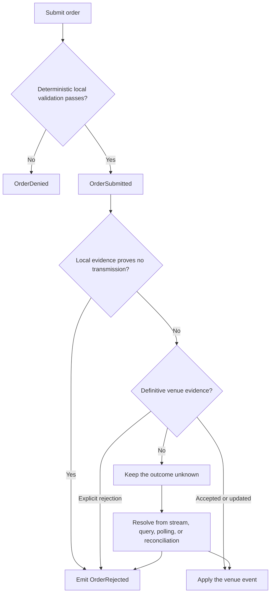
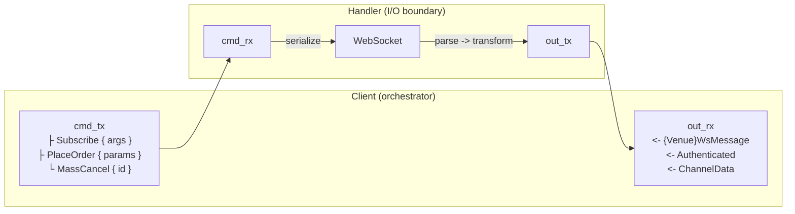

# 第 38 章：增加一个券商：以富途为例

[全书目录](./index.md) · [上一篇](./dst.md) · [附录](./core-topics.md)

::: tip 本章怎么读
本章的正文是 NautilusTrader 官方开发指南《Adapters》（[`docs/developer_guide/adapters.md`](https://github.com/nautechsystems/nautilus_trader/blob/develop/docs/developer_guide/adapters.md)）的中文全译，章节顺序、标题层级和原文一致，每个标题后面的锚点就是原文的英文锚点，方便对照。翻译依据提交 `364254f`（2026-11-18），原文以 LGPL-3.0 发布；译文力求完整，代码块保持原样。

每一节末尾的“富途怎么做”提示框是本书加的：说明富途适配器怎样满足这一节的要求，或在哪里需要记录为例外。哪些是官方指南的规定、哪些是本书的设计，以此区分。

富途本身的背景知识放在三个附录里：[附录 A：富途 OpenD 协议要点](#appendix-opend)、[附录 B：两边的概念对照](#appendix-concepts)、[附录 C：Python 绑定的三条路线](#appendix-python)。第一次读，可以先看附录 A，再回到正文。

**富途文档：** OpenAPI v10.12。文中的 `futu-opend`、`crates/adapters/futu` 及其文件和类型名都是本书的设计建议，仓库里还没有。

**对应官方文档：** [Adapters（概念）](https://nautilustrader.io/docs/latest/concepts/adapters/)；开发指南 Adapters 即本章正文
:::

## 结论先行 {#futu-summary}

- **结构上照 IB 适配器写。** 富途和 IB 一样只能连本地网关，所以拆成独立的协议库 `futu-opend` 和适配器 crate `crates/adapters/futu`。这是本书按协议形态的判断，指南推荐的参考适配器里没有 IB。
- **规则上严格按本指南。** 下文逐节给出富途怎样满足一致性清单和 0～9 阶段；OpenD 是私有 TCP 协议，不是 HTTP 或 WebSocket，这一点要作为一致性例外记录，并且连接仍要经 `nautilus_network::net` 建立，以满足确定性仿真的约定。
- **先模拟盘，先确定性测试。** 每个阶段先用抓包数据和模拟的 OpenD 对端写确定性测试，第 7 阶段才连模拟盘跑验收测试。
- **Python 有三条路线。** 先用纯 Python 适配器加富途官方 SDK 跑通，要进官方仓库时再按本指南做 Rust 适配器加 PyO3 绑定（附录 C）。

## 简介 {#introduction}

本指南用于为 NautilusTrader 构建或扩展 Rust 原生适配器。适配器将平台连接到交易场所（venue）和数据提供者，保留交易场所的语义，产生有效的 Nautilus 领域事件，并将不确定的结果显式化。适配器在 Rust 中实现平台的数据客户端和执行客户端 trait，然后通过 PyO3 向 Python 暴露配置、工厂以及部分底层 API。

::: info
对于用 Python 实现、或以独立 Rust/PyO3 包实现的仓库外适配器，请使用 [Python 适配器接口](https://github.com/nautechsystems/nautilus_trader/blob/develop/docs/developer_guide/python_adapters.md)。本指南涵盖仓库内的 Rust 适配器。
:::

请有选择地参考现有适配器。它们的目录布局反映了不同的交易场所协议、产品族和实现历史。

| 适配器 | 可参考之处 |
| --- | --- |
| [Bybit](https://github.com/nautechsystems/nautilus_trader/blob/develop/crates/adapters/bybit/src/lib.rs) | 多产品 HTTP 和 WebSocket 客户端、期权数据，以及执行结果处理。 |
| [OKX](https://github.com/nautechsystems/nautilus_trader/blob/develop/crates/adapters/okx/src/lib.rs) | 公共、私有和业务（business）WebSocket 端点，标的覆盖面广。 |
| [Binance](https://github.com/nautechsystems/nautilus_trader/blob/develop/crates/adapters/binance/src/lib.rs) | 现货与期货的产品拆分、交易 WebSocket，以及 SBE 行情数据。 |
| [Kraken](https://github.com/nautechsystems/nautilus_trader/blob/develop/crates/adapters/kraken/src/lib.rs) | 现货与期货子模块，各自具有独立的 HTTP、WebSocket、数据和执行路径。 |
| [Lighter](https://github.com/nautechsystems/nautilus_trader/blob/develop/crates/adapters/lighter/src/lib.rs) | Layer-2 签名、规范基准测试、覆盖率引导的模糊测试，以及细致的执行状态处理。 |
| [Derive](https://github.com/nautechsystems/nautilus_trader/blob/develop/crates/adapters/derive/src/lib.rs) | JSON-RPC 数据与执行、EIP-712 签名、规范基准测试，以及基于不变量的模糊测试。 |

本指南区分四类指引：

- **共享规则**来自公共 trait、网络抽象、钩子或 CI。
- **常见模式**出现在多个适配器中，但允许采用其他设计。
- **示例**展示一种合理的实现，但并不强制采用。
- **例外**在交易场所语义或协议边界要求时是有效的。


::: tip 富途怎么做
**参考哪个适配器。** 指南推荐的参考适配器都是 REST 加 WebSocket 的加密货币交易所。富途不一样：先在本机运行网关程序 **OpenD**，登录后通过 TCP 连上去，每个包是 44 字节的包头加一段 protobuf（见[附录 A](#appendix-opend)）。这和 Interactive Brokers 只能连本地 TWS 或 IB Gateway 几乎一样，所以本书按协议形态选 IB 适配器（`crates/adapters/interactive_brokers`）作结构上的参照：它把底层协议交给第三方 `ibapi` crate，自己没有 `http/`、`websocket/` 模块，IB 的集成文档（`docs/integrations/interactive_brokers.md`）的说法是它“does not own a transport”。IB 不在上表里，这是本书的判断，不是指南的推荐；涉及共享规则时，仍以本指南和上表的参考适配器为准。

**两层结构。** 富途适配器分成一个独立的协议库 `futu-opend`（连接、包头编解码、加密、心跳、请求与回包的对应，地位等同 IB 的 `ibapi`）和适配器 crate `crates/adapters/futu`（把富途的概念翻译成 Nautilus 的标的、行情、订单、成交、账户和对账）。

**仓库内还是仓库外。** 本指南只管仓库内的 Rust 适配器。三条路线的取舍：

| 路线 | 做法 | 门槛 |
| --- | --- | --- |
| A：仓库内 Rust 适配器 | 按本指南全部要求实现，经 `crates/pyo3` 暴露给 Python | 最高：一致性、DST、测试、文档都要满足 |
| B：纯 Python 适配器 | 继承 `nautilus_trader.live.clients` 的基类，可以直接用富途官方的 `futu-api` Python SDK | 最低，适合先跑通模拟盘 |
| C：独立的 Rust/PyO3 包 | 协议用 Rust 写，外观仍是路线 B 的 Python 基类 | 中等；只能和已安装 wheel 里的模型类交换对象 |

建议顺序：先用路线 B 跑通，再把协议层换成 Rust（路线 C），要进官方仓库时按本指南走路线 A。三条路线的细节见[附录 C](#appendix-python)。
:::

## 一致性 {#conformance}

当适配器满足下列每条适用于它的规则，或记录了相应的例外时，即视为符合一致性要求。须指明使该例外成为必要的交易场所行为。将例外限制在适配器内部。添加一个测试，当交易场所不再需要该例外时该测试会失败。[第 7 阶段](#phase-7-prove-conformance) 安排了证明一致性的工作顺序。

### 适配器基础 {#adapter-foundations}

| 规则 | 适用范围 |
| --- | --- |
| [仓库与 Python 接线](#repository-and-python-wiring) | 新的适配器 crate |
| [凭证与密钥处理](#credentials-and-secret-handling) | 所有适配器 |
| [配置](#configurations-configrs) | 所有适配器 |
| [符号与标的标识](#symbols-and-instrument-identity) | 所有适配器 |
| [交易场所负载建模与精度](#modeling-venue-payloads) | 所有适配器 |
| [客户端 trait 与工厂](#client-traits-and-factories-datars-executionrs-factoriesrs) | 所有适配器 |

### 运行时与客户端生命周期 {#runtime-and-client-lifecycle}

| 规则 | 适用范围 |
| --- | --- |
| [连接生命周期](#connection-lifecycle-connect) | 数据客户端和执行客户端 |
| [数据事件与请求新鲜度](#data-client) | 数据客户端 |
| [背压](#backpressure) | 所有适配器 |
| [任务管理](#task-management) | 所有适配器 |
| [确定性仿真](#deterministic-simulation) | 维护中的适配器 |

### 执行与对账 {#execution-and-reconciliation}

| 规则 | 适用范围 |
| --- | --- |
| [执行客户端边界](#execution-client) | 执行客户端 |
| [对账报告](#reconciliation-reports) | 执行客户端 |
| [手续费失败处理](#commission-failure-handling) | 执行客户端 |
| [有界的批量状态报告](#bounded-mass-status-reports) | 执行客户端 |
| [对账期间的标的解析](#instrument-resolution-during-reconciliation) | 执行客户端 |
| [本地跟踪的与外部的执行更新](#tracked-and-external-execution-updates) | 执行客户端 |
| [事件排序与去重](#event-ordering-and-deduplication) | 执行客户端 |
| [订单命令结果策略](#order-command-outcome-policy) | 执行客户端 |
| [为证据类别命名](#naming-the-evidence-classes) | 执行客户端 |
| [诊断信息与面向策略的原因](#separate-diagnostics-from-strategy-facing-reasons) | 执行客户端 |

### 传输与流式处理 {#transport-and-streaming}

| 规则 | 适用范围 |
| --- | --- |
| [请求流程](#request-flow) | HTTP 客户端 |
| [请求签名与认证](#request-signing-and-authentication) | HTTP 和 WebSocket 请求路径 |
| [错误处理与重试逻辑](#error-handling-and-retry-logic) | HTTP 和 WebSocket 请求路径 |
| [限流](#rate-limiting) | HTTP 和 WebSocket 客户端 |
| [处理器初始化握手](#handler-initialization-handshake-setclient) | WebSocket 客户端 |
| [认证](#authentication) | WebSocket 客户端 |
| [订阅管理](#subscription-management) | WebSocket 客户端 |
| [消息路由](#message-routing) | WebSocket 客户端 |
| [重连与关闭](#reconnection-and-shutdown) | WebSocket 客户端 |

[数据测试规范](https://github.com/nautechsystems/nautilus_trader/blob/develop/docs/developer_guide/spec_data_testing.md)和[执行测试规范](https://github.com/nautechsystems/nautilus_trader/blob/develop/docs/developer_guide/spec_exec_testing.md)收录了针对交易场所证明这些契约的场景。

### 共享基线 {#shared-baseline}

下列每一部分都应使用共享实现。之后可以选择任何满足其契约的状态结构。共享类型承载契约，并使各交易场所之间的行为保持可比较。本地结构必须通过自身的实现证明同样的契约。

该基线不适用于两个虽实现同一 trait、但并不通过交易场所 API 进行交易的执行客户端：

- [Sandbox](https://github.com/nautechsystems/nautilus_trader/blob/develop/crates/adapters/sandbox/src/execution.rs) 在本地模拟成交。
- [Blockchain](https://github.com/nautechsystems/nautilus_trader/blob/develop/crates/adapters/blockchain/src/execution/client.rs) 在 `defi` feature 之后执行链上操作。

确定性仿真对维护中的适配器是强制性的。每个维护中的适配器必须满足[适配器 DST 契约](https://github.com/nautechsystems/nautilus_trader/blob/develop/docs/concepts/dst.md#adapter-dst-contract)，或者附带一份限定于该交易场所的迁移记录来跟踪差距。OKX 是参考实现。[确定性仿真](#deterministic-simulation)定义了接缝（seam）、门禁（gate）以及对新适配器的要求标准。

| 目标 | 共享部件 | 契约 |
| --- | --- | --- |
| 命令结果证据 | [`CommandFailure`](https://github.com/nautechsystems/nautilus_trader/blob/develop/crates/live/src/execution/failure.rs) | [为证据类别命名](#naming-the-evidence-classes) |
| 订单标识与上下文 | [`OrderIdentity` 和 `OrderContext`](https://github.com/nautechsystems/nautilus_trader/blob/develop/crates/live/src/execution/context.rs) | [本地跟踪的与外部的更新](#tracked-and-external-execution-updates) |
| 重放去重 | [`FifoCache` 和 `FifoCacheMap`](https://github.com/nautechsystems/nautilus_trader/blob/develop/crates/common/src/cache/fifo.rs) | [事件排序与去重](#event-ordering-and-deduplication) |
| 订单拒绝原因 | [`OrderDeniedReason`](https://github.com/nautechsystems/nautilus_trader/blob/develop/crates/model/src/events/order/denied_reason.rs) | [诊断信息与原因](#separate-diagnostics-from-strategy-facing-reasons) |
| 任务生命周期 | [`TaskGroup`](https://github.com/nautechsystems/nautilus_trader/blob/develop/crates/live/src/task.rs) 和 [`TaskHandles`](https://github.com/nautechsystems/nautilus_trader/blob/develop/crates/common/src/live/task.rs) | [任务管理](#task-management) |
| 摄取精度 | [领域数值类型](https://github.com/nautechsystems/nautilus_trader/blob/develop/docs/developer_guide/rust.md#domain-numeric-types) | [交易场所负载建模](#modeling-venue-payloads) |
| HTTP 传输 | [`HttpClient`](https://github.com/nautechsystems/nautilus_trader/blob/develop/crates/network/src/http/client.rs) | [请求流程](#request-flow) |
| 认证状态 | [`AuthTracker`](https://github.com/nautechsystems/nautilus_trader/blob/develop/crates/network/src/websocket/auth.rs) | [认证](#authentication) |
| 订阅标识 | [`SubscriptionState`](https://github.com/nautechsystems/nautilus_trader/blob/develop/crates/network/src/websocket/subscription.rs) | [订阅管理](#subscription-management) |
| 重连请求 | [`request_reconnect`](https://github.com/nautechsystems/nautilus_trader/blob/develop/crates/network/src/websocket/client.rs) | [重连与关闭](#reconnection-and-shutdown) |
| 重试机制 | [`RetryManager`](https://github.com/nautechsystems/nautilus_trader/blob/develop/crates/network/src/retry.rs) | [错误处理与重试逻辑](#error-handling-and-retry-logic) |
| 推断的成交手续费 | [`ExecutionClient`](https://github.com/nautechsystems/nautilus_trader/blob/develop/crates/common/src/clients/execution.rs) | [手续费失败处理](#commission-failure-handling) |
| 时间、任务与运行时 | [`nautilus_common::live::dst`](https://github.com/nautechsystems/nautilus_trader/blob/develop/crates/common/src/live/dst.rs) | [确定性仿真](#deterministic-simulation) |
| 挂钟时间读取 | [`duration_since_unix_epoch`](https://github.com/nautechsystems/nautilus_trader/blob/develop/crates/core/src/time.rs) | [确定性仿真](#deterministic-simulation) |

交易场所可能以 IEEE-754 字段而非十进制字符串或 JSON 数字来传输离散值。对于这种情况，应在解析边界处记录该例外，并将 `f64` 限制在该边界之内。

重试分类是此表的例外：由于各交易场所的状态码和限流语义不同，它仍由适配器自行负责。但围绕它的共享机制并非如此。这两方面内容参见[错误处理与重试逻辑](#error-handling-and-retry-logic)。


::: tip 富途怎么做
对照上面五张表，富途适配器要特别处理的几条：

- **传输层不是 HTTP 或 WebSocket。** OpenD 是长度前缀的私有 TCP 协议。“传输与流式处理”一表里关于 WebSocket 订阅、重连、背压的规则同样适用于这条 TCP 连接；这属于需要记录的**一致性例外**：在适配器里写明原因（OpenD 只提供私有 TCP 协议），并加一个测试，交易场所不再需要这个例外时测试会失败。
- **`nautilus_network::socket::SocketClient` 用不上。** 它只支持按结尾分隔符切包，空分隔符会被拒绝；OpenD 是“固定包头 + 包体长度”，要自己写编解码器（比如基于 `tokio_util::codec`），但连接本身仍要经 `nautilus_network::net` 建立（见下一节）。
- **价格是浮点数。** 富途的 protobuf 里价格、数量多是 `double`，这正是“共享基线”里 IEEE-754 解析边界的例外：只在解析边界把浮点转成 `Decimal`，再按标的精度构造 `Price`、`Quantity`。
- **命令结果要分三类。** 超时（`retType = -100`）和断线（`-200`）是“结果不明”，不能当成拒单（见[订单命令结果策略](#order-command-outcome-policy)）。
:::

### 确定性仿真 {#deterministic-simulation}

每个维护中的适配器（即 [ADAPTERS.md](https://github.com/nautechsystems/nautilus_trader/blob/develop/ADAPTERS.md#adapter-tiers) 中所定义的 Official 级适配器）必须满足[适配器 DST 契约](https://github.com/nautechsystems/nautilus_trader/blob/develop/docs/concepts/dst.md#adapter-dst-contract)。尚未符合要求的适配器附带一份限定于该交易场所的迁移记录来跟踪差距。未声明的能力在某个切片（slice）证明它们之前，始终处于契约之外。

OKX 是参考实现。它通过共享接缝、静态门禁和行为门禁来证明契约：

- **接缝**：`nautilus_common::live::dst` 门面（facade）提供时间、任务、运行时和信号。`nautilus_core::time` 接缝提供挂钟时间访问。`nautilus-network` 提供模拟的 HTTP 和 WebSocket 传输。上方的基线表列出了共享的订阅、重连和重试机制。
- **静态门禁**：`check-dst-conventions` 覆盖所有 DST 路径上的生产文件（`.pre-commit-hooks/check_dst_conventions.sh` 中的 `ADAPTER_PATHS`），每晚运行的 `dst-smoke` 门禁则执行仿真模式下的 Clippy 和测试环节。
- **行为门禁**：`crates/adapters/okx/tests/integration/dst.rs` 针对受控的本地对端，固定（pin）精确的订阅字节和每个操作的精确线上字段。完整的“线上数据到领域对象”全新进程比对位于下游测试框架中。

[OKX 集成指南的 DST 部分](https://github.com/nautechsystems/nautilus_trader/blob/develop/docs/integrations/okx.md#deterministic-simulation-testing)记录了已审计的切片。

新适配器从其第一个传输层开始就要证明契约：

1. 每添加一个 DST 路径上的文件，就同时为其添加门禁。
1. 从配置出发，将每个端点驱动到本地对端。
1. 在扩展切片之前先固定线上字节。

在第二个适配器证明需要同样的边界之前，不要引入共享抽象。


::: tip 富途怎么做
这一节对富途的设计影响最大。`futu-opend` 如果要进官方仓库，就不能是一个完全不依赖 Nautilus 的独立库：时间、任务、随机数要经 `nautilus_common::live::dst` 获取，TCP 连接要经 `nautilus_network::net` 建立，不能直接 `tokio::net::TcpStream::connect`（`docs/concepts/dst.md` 的规则）。所有 `select!` 要写 `biased;`，重试和重连发出的请求字节必须完全相同。

按“从第一个传输开始证明约定”的要求，第一步就固定 InitConnect（协议号 1001）请求的字节：同样的输入，在仿真和真实运行下产生一模一样的包头和包体。只在自己的仓库里维护（路线 B、C）时，`futu-opend` 才可以完全独立。
:::

## 适配器的结构 {#structure-of-an-adapter}

Rust crate 是协议行为的唯一事实来源。适配器通常将以下关注点分开：

```text
crates/adapters/<adapter>/
├── Cargo.toml
├── src/
│   ├── common/              # Shared credentials, enums, models, parsing, symbols, and URLs
│   ├── http/                # Typed requests, responses, signing hooks, and transport client
│   │   ├── client.rs
│   │   ├── error.rs
│   │   ├── models.rs
│   │   ├── parse.rs
│   │   └── query.rs
│   ├── websocket/           # Streaming transport, protocol messages, parsing, and routing
│   │   ├── client.rs
│   │   ├── handler.rs
│   │   ├── messages.rs
│   │   ├── parse.rs
│   │   ├── subscription.rs  # When subscription identity or replay needs a boundary
│   │   └── dispatch.rs      # When execution routing needs a boundary
│   ├── config.rs
│   ├── data.rs              # Or data/ when product implementations need a split
│   ├── execution.rs         # Or execution/ when product implementations need a split
│   ├── factories.rs
│   ├── python/              # PyO3 projection
│   ├── signing/             # When authentication or transaction signing is a subsystem
│   └── lib.rs
├── tests/                   # Public Rust boundary tests
├── test_data/               # Canonical venue payloads and protocol vectors
├── benches/                 # When confirmed hot paths warrant benchmarks
│   ├── common/              # Shared benchmark fixtures
│   ├── data.rs
│   ├── exec.rs
│   └── micros.rs
├── fuzz/                    # When untrusted codecs warrant coverage-guided fuzzing
│   ├── fuzz_targets/
│   └── README.md
├── examples/                # Rust tester nodes and focused usage examples
├── bin/                     # Optional protocol inspection or capture tools
└── README.md
```

Python 和文档相关的部分位于 crate 之外：

```text
python/nautilus_trader/adapters/<adapter>/  # Public package and generated stubs
examples/live/<adapter>/                    # Python data and execution testers
python/tests/unit/adapters/<adapter>/       # Public Python package tests
docs/integrations/<adapter>.md              # User-facing integration guide
```

只有 `Cargo.toml` 和 `src/lib.rs` 是所有 crate 都具备的边界。其他模块在适配器需要时再添加：

- 将符号、凭证、URL、共享枚举和共享解析逻辑放在 `common/` 下。
- 将传输模型、类型化请求、签名和 HTTP 客户端放在 `http/` 下。
- 将帧、消息、订阅状态、路由和 WebSocket 客户端放在 `websocket/` 下。
- 在 `data.rs` 和 `execution.rs` 中实现实盘数据与执行 trait。如果交易场所暴露的协议存在实质性差异，可以改用按产品划分的子模块。
- 将 PyO3 投影代码放在 `python/` 下。
- 按公共边界或产品组织集成测试。不要强制所有适配器使用相同的文件名。

当各产品族使用不同协议时，按产品拆分是合理的。当请求和状态语义保持一致时，一个共享客户端也可以跨越不同的端点。应与交易场所的真实边界保持一致，并将共享行为置于这些拆分之上。

适配器的公共 Python 包位于 `python/nautilus_trader/adapters/<adapter>/` 下，通常会重新导出生成的绑定。应修改 Rust 绑定元数据或其他生成器输入，然后运行 `make py-stubs`。不要编辑生成的 `.pyi` 文件。


::: tip 富途怎么做


怎么读这张图：橙色虚线框是要新增的，其余是仓库里现有的。富途适配器和 IB 适配器平级、挂在 `live` 之下，实现 `nautilus-common` 里的 `DataClient`、`ExecutionClient` trait；`nautilus-system` 只在 `python` feature 下依赖，因为 Python 用到的工厂注册表 `get_global_pyo3_registry()` 在 `crates/system/src/python/registry.rs`；最上面的 `pyo3` 在 `adapters` feature 下依赖它。

按本节的推荐结构，富途没有 `http/`、`websocket/`，传输放在独立的协议库里：

```text
crates/futu-opend/             # 协议库（仓库内时经 nautilus_network::net 建连接，见上一节）
  build.rs                     # prost-build 从 .proto 生成代码
  proto/                       # 从 PyPI futu-api 包里取的 .proto
  src/codec.rs                 # 44 字节包头 + 包体的编解码器
  src/crypto.rs                # RSA（InitConnect）、FTAES_ECB
  src/client.rs                # InitConnect、KeepAlive、serial_no → 等待中的请求、推送分发

crates/adapters/futu/
  Cargo.toml
  src/lib.rs
  src/common/                  # 凭证、枚举、符号映射；shared_client.rs：一条 OpenD 连接共用
  src/config.rs
  src/data.rs                  # FutuDataClient
  src/execution.rs             # FutuExecutionClient
  src/factories.rs
  src/providers.rs             # FutuInstrumentProvider
  src/python/                  # PyO3 投影
  tests/                       # 公开边界测试
  test_data/                   # 抓包得到的 OpenD 回包和推送
  fuzz/                        # 包头与 FTAES 解码的模糊测试（不可信的二进制编解码）
  examples/                    # node_data_tester.rs、node_exec_tester.rs
  README.md
```

`Cargo.toml` 的依赖照 IB 写，feature 参考 OKX 等多数适配器（默认打开 `high-precision`，和 Python wheel 一致）：

```toml
# 示意：crates/adapters/futu/Cargo.toml
[dependencies]
nautilus-common = { workspace = true }
nautilus-core = { workspace = true }
nautilus-live = { workspace = true }
nautilus-model = { workspace = true }
nautilus-network = { workspace = true }
nautilus-system = { workspace = true, optional = true }
futu-opend = { path = "../../futu-opend" }
tokio = { workspace = true }
anyhow = { workspace = true }
async-trait = { workspace = true }
pyo3 = { workspace = true, optional = true }
pyo3-stub-gen = { workspace = true, optional = true }

[features]
default = ["high-precision"]
high-precision = ["nautilus-model/high-precision"]
python = ["dep:nautilus-system", "nautilus-system/python", "nautilus-live/python",
          "nautilus-model/python", "nautilus-common/python", "pyo3", "pyo3-stub-gen"]
```
:::

### 仓库与 Python 接线 {#repository-and-python-wiring}

新的适配器 crate 必须能被每个负责它的构建环节发现：

| 环节 | 必需的改动 | 强制检查或证明 |
| --- | --- | --- |
| 根 Rust 工作区 | 在 [`Cargo.toml`](https://github.com/nautechsystems/nautilus_trader/blob/develop/Cargo.toml) 的 members 和工作区依赖中添加该 crate。 | 工作区元数据和针对性的 Cargo 检查能够发现该 crate。 |
| 工作区测试清单 | 在 [`Makefile`](https://github.com/nautechsystems/nautilus_trader/blob/develop/Makefile) 的 `ADAPTER_CRATES` 中添加该 crate。 | [工作区覆盖检查](https://github.com/nautechsystems/nautilus_trader/blob/develop/scripts/ci/check-workspace-test-coverage.sh)要求存在一份测试清单。 |
| PyO3 crate | 在 [`crates/pyo3/Cargo.toml`](https://github.com/nautechsystems/nautilus_trader/blob/develop/crates/pyo3/Cargo.toml) 中添加可选依赖和 feature 传递。 | 构建对应的 PyO3 feature 时会编译该适配器的投影。 |
| PyO3 根模块 | 在 [`crates/pyo3/src/lib.rs`](https://github.com/nautechsystems/nautilus_trader/blob/develop/crates/pyo3/src/lib.rs) 中注册适配器模块。 | 约定检查钩子将此模块列表视为公共 API 白名单。 |
| 适配器 PyO3 注册表 | 通过 `get_global_pyo3_registry()` 注册每个适用的工厂和配置提取器。 | 工厂边界测试证明 Python 配置对象能够到达 Rust 工厂。 |
| Python 包与用户指南 | 仅针对适配器暴露的能力，添加包投影、测试、示例和集成指南。 | 导入检查、生成产物漂移检查、示例构建和文档检查覆盖这些部分。 |

[Nautilus 约定检查钩子](https://github.com/nautechsystems/nautilus_trader/blob/develop/.pre-commit-hooks/check_nautilus_conventions.sh)将 PyO3 模块列表视为公共 API 白名单。[PyO3 约定检查钩子](https://github.com/nautechsystems/nautilus_trader/blob/develop/.pre-commit-hooks/check_pyo3_conventions.sh)还会强制执行：

- 存根元数据使用 `nautilus_trader.adapters.<adapter>`。
- 运行时扩展导入使用 `nautilus_trader._libnautilus.<adapter>`。
- 使用 `#[pyo3(name = ...)]` 重命名的 Rust 函数，其 Rust 名称带有 `py_` 前缀。
- Python 异常使用项目的错误转换函数。

::: tip 富途怎么做
对富途来说，上表落到具体文件是：

| 位置 | 改什么 |
| --- | --- |
| 根 `Cargo.toml` | `members` 加 `crates/futu-opend`、`crates/adapters/futu`，`[workspace.dependencies]` 加 `nautilus-futu` |
| `Makefile` | `ADAPTER_CRATES` 加 `nautilus-futu` |
| `crates/pyo3/Cargo.toml` | 可选依赖 `nautilus-futu`（`features = ["python"]`），加进 `adapters` feature，并在 `extension-module`、`high-precision` 里传递 |
| `crates/pyo3/src/lib.rs` | 注册 `_libnautilus.futu` 子模块 |
| `crates/adapters/futu/src/python/` | 用 `get_global_pyo3_registry()` 登记工厂名 `"FUTU"` 和配置类名的提取函数；`add_class` 按导出类型名字母序排列 |
| Python 包、示例、文档 | `python/nautilus_trader/adapters/futu/`（手写 `__all__`）、`examples/live/futu/`、`python/tests/unit/adapters/futu/`、`docs/integrations/futu.md` |

每一步的代码示意见[附录 C](#appendix-python)。
:::

## 适配器实现顺序 {#adapter-implementation-sequence}

使用以下阶段来组织工作。它们描述的是依赖关系，而不是发布门槛。仅提供行情数据的适配器可以省略执行部分，适配器也可以先完成一个产品再开始另一个产品。在整个工作过程中持续更新能力矩阵，而不是等到最后的文档阶段。省略不适用于该适配器的阶段和步骤。

### 第 0 阶段：界定范围 {#phase-0-define-scope}

| 步骤 | 组件 | 工作内容 |
| ---- | ---- | -------- |
| 0.1 | 能力矩阵 | 列出范围内的产品、环境、账户模式、数据类型、订单类型和报告。 |
| 0.2 | 交易场所约束 | 记录交易场所（venue）的限制、不支持的能力以及测试网的差异。 |
| 0.3 | 协议边界 | 识别相互独立的产品 API、公共与私有端点，以及二进制或 JSON 传输方式。 |
| 0.4 | 初始切片 | 选择能够打通一条端到端路径的最小切片。 |
| 0.5 | 仓库接入 | 将 crate 加入 Rust 工作区和测试清单，然后只添加它实际暴露的投影接口。 |

**完成标准**：集成指南包含初始能力矩阵、已知缺口和测试计划。

### 第 1 阶段：构建协议核心 {#phase-1-build-the-protocol-core}

| 步骤 | 组件 | 工作内容 |
| ---- | ---- | -------- |
| 1.1 | HTTP 错误类型 | 对传输、HTTP 状态、交易场所、解析和校验失败进行建模。在支持时对是否可重试进行分类。 |
| 1.2 | HTTP 客户端 | 实现端点解析和类型化请求，并按需实现凭证、签名、限流、重试和分页。 |
| 1.3 | HTTP API 模型 | 定义类型化的请求与响应，通常位于 `http/` 或其按产品划分的模块下。 |
| 1.4 | HTTP 解析 | 在 `http/parse.rs` 或 `common/parse.rs` 中，于确定性的边界处将交易场所响应转换为领域类型。 |
| 1.5 | WebSocket 错误类型 | 对连接、协议和解析失败进行建模，在适用时还包括认证和命令失败。 |
| 1.6 | WebSocket 客户端 | 实现生命周期和关闭，在适用时还包括认证、心跳、订阅状态和重连。 |
| 1.7 | WebSocket 消息 | 在 `websocket/` 或按产品划分的模块下定义帧和消息。按需包含确认消息和交易场所错误。 |
| 1.8 | WebSocket 解析 | 每个帧只解码一次，转换为领域事件，并按类型化标识路由数据或执行消息。 |
| 1.9 | 协议测试 | 使用模拟对端验证测试夹具、规范请求、适用的签名向量、生命周期以及原始消息交换。 |

**完成标准**：crate 能够编译，协议测试夹具能够解析，适用的签名向量通过，模拟或受控请求能够完成所需的认证并交换原始的交易场所消息。

### 第 2 阶段：实现标的 {#phase-2-implement-instruments}

| 步骤 | 组件 | 工作内容 |
| ---- | ---- | -------- |
| 2.1 | 标的解析 | 解析每一个受支持的品类，包含完整的标识、精度、币种和合约字段。 |
| 2.2 | 标的加载 | 在每个需要上下文的解析边界处加载、过滤、缓存并发出标的定义。 |
| 2.3 | 代码映射 | 定义交易场所代码与 `InstrumentId` 之间的双向转换，且不得把不同的标的合并为同一个。 |
| 2.4 | 标的更新 | 实现获取最新标的的请求，以及任何受支持的定义或状态更新。 |

**完成标准**：各自独立的测试夹具覆盖每一个受支持的标的品类，无效定义会明确地失败，数据客户端能够发出或返回完整的 Nautilus 标的。

### 第 3 阶段：实现行情数据 {#phase-3-implement-market-data}

先从一个公共数据流和一个标的开始，再扩展到多个产品或端点。

| 步骤 | 组件 | 工作内容 |
| ---- | ---- | -------- |
| 3.1 | 公共 WebSocket 数据流 | 订阅和取消订阅每一种对外宣称支持的实时数据类型，同时保留订阅意图。 |
| 3.2 | 历史数据请求 | 请求受支持的 K 线、成交、报价或订单簿快照，并遵循精确的关联和新鲜度规则。 |
| 3.3 | 数据客户端 | 实现 `DataClient` 的请求、订阅、生命周期以及完整的 `DataEvent` 发出。 |
| 3.4 | 订单簿处理 | 保留快照、增量更新、序列号、清空和批次边界。 |
| 3.5 | 数据流恢复 | 处理格式错误的输入、数据缺口、取消订阅、断开连接、重连和订阅重放。 |

**完成标准**：单元测试和模拟传输测试证明，在受支持的请求与订阅矩阵上都能产出完整的领域事件。

### 第 4 阶段：实现执行 {#phase-4-implement-execution}

在启用订单流之前，先建立账户状态和对账。

| 步骤 | 组件 | 工作内容 |
| ---- | ---- | -------- |
| 4.1 | 账户引导 | 建立账户标识、初始账户状态、私有订阅以及连接就绪状态。 |
| 4.2 | 对账报告 | 在启动时和按需生成适用的订单、成交、持仓和批量状态（mass status）报告。 |
| 4.3 | 基础下单 | 实现受支持的市价单和限价单提交，并进行确定性的本地校验。 |
| 4.4 | 订单修改 | 实现受支持的改单和撤单命令，包括交易场所的撤单重下（cancel-replace）语义。 |
| 4.5 | 执行客户端 | 实现 `ExecutionClient` 的命令、生命周期、本地跟踪的订单与外部订单的路由，以及有序的事件发出。 |
| 4.6 | 结果恢复 | 保留未知的结果，对成交去重，并通过数据流、查询或对账来确定状态。 |

**完成标准**：模拟传输测试覆盖每一个受支持的命令、明确的拒绝、传输结果不确定、重复或乱序的更新，以及启动时对账。

### 第 5 阶段：添加可选的交易场所能力 {#phase-5-add-optional-venue-capabilities}

只有在基础生命周期稳定之后才添加这些能力。

| 步骤 | 组件 | 工作内容 |
| ---- | ---- | -------- |
| 5.1 | 高级订单类型 | 添加适用的条件单、止损单、止盈单、追踪止损单或其他高级订单。 |
| 5.2 | 批量操作 | 添加批量提交、批量撤单和全部撤单，并逐笔处理每个订单的结果。 |
| 5.3 | 交易场所特有数据 | 将资金费率、希腊值、强平或交易场所扩展作为独立的能力切片添加。 |
| 5.4 | 按产品或端点拆分 | 只有当协议、认证、配额或恢复边界有此需要时，才拆分归属。 |
| 5.5 | 能力证明 | 为每项能力添加测试夹具、功能测试、验收用例以及文档化的限制说明。 |

**完成标准**：每项可选能力都可以独立测试，并且不会削弱已建立的基础路径。

### 第 6 阶段：完成工厂与投影 {#phase-6-complete-factories-and-projection}

| 步骤 | 组件 | 工作内容 |
| ---- | ---- | -------- |
| 6.1 | 配置结构体 | 定稿类型化的数据与执行配置、默认值、环境变量回退以及密钥脱敏。 |
| 6.2 | 客户端工厂 | 实现以 `CacheView` 为输入、并使用数据客户端时钟的 Rust 工厂。 |
| 6.3 | PyO3 注册 | 将适用的工厂和配置提取器注册到 PyO3 注册表。 |
| 6.4 | Python 包 | 添加公开的包，并为暴露给 Python 的能力添加 Python 边界测试。 |
| 6.5 | 生成的存根 | 添加 Rust 存根元数据，并用 `make py-stubs` 重新生成 `.pyi` 输出。 |

**完成标准**：Rust 工厂测试和 PyO3 边界测试通过，包导入能够正确解析，生成的输出与其 Rust 输入一致。

### 第 7 阶段：证明一致性 {#phase-7-prove-conformance}

| 步骤 | 组件 | 工作内容 |
| ---- | ---- | -------- |
| 7.1 | Rust 单元测试 | 验证解析器、序列化器、代码、签名、状态转换以及格式错误的输入。 |
| 7.2 | Rust 集成测试 | 针对确定性的模拟传输，覆盖公共 HTTP、WebSocket、数据和执行边界。 |
| 7.3 | Python 边界测试 | 验证导入、配置提取、工厂、类型转换以及有代表性的异步调用。 |
| 7.4 | 验收测试 | 在测试网或受控账户上运行每一个适用的 `DataTester` 和 `ExecTester` 用例。 |
| 7.5 | 恢复测试 | 覆盖连接失败、重连、关闭、限流和状态恢复。 |
| 7.6 | 规范缺口 | 记录每一个被跳过的规范用例，并注明交易场所或能力方面的原因。 |

**完成标准**：适用的数据与执行测试规范全部通过，并且每一项对外宣称的能力都有确定性证据和交易场所证据。

### 第 8 阶段：衡量性能与健壮性 {#phase-8-measure-performance-and-robustness}

| 步骤 | 组件 | 工作内容 |
| ---- | ---- | -------- |
| 8.1 | 标准基准测试 | 使用有代表性的测试夹具，衡量已确认的端到端数据与执行热路径。 |
| 8.2 | 微基准测试 | 单独衡量已确认的签名、哈希、认证、编解码、解析或序列化开销。 |
| 8.3 | 模糊测试目标 | 使用贴近真实的语料，对不可信的解析、解码、规范化、签名和编码边界进行模糊测试。 |
| 8.4 | 不变量 | 断言比“不发生 panic”更强的领域与协议性质。 |

**完成标准**：标准基准测试套件和模糊测试套件能够使用有代表性的测试夹具和文档化的不变量运行，并且不包含适配器用不到的强制类别。

### 第 9 阶段：完成文档与运维 {#phase-9-finish-documentation-and-operations}

| 步骤 | 组件 | 工作内容 |
| ---- | ---- | -------- |
| 9.1 | 能力矩阵 | 使每一项支持声明和例外都与经过测试的实现相符。 |
| 9.2 | 集成指南 | 记录凭证、配置、限制、对账、环境差异和已知缺口。 |
| 9.3 | 测试器入口 | 提供适用的 Rust 与 Python 数据和执行测试器，并采用安全的默认值。 |
| 9.4 | 运维 | 记录恢复、故障排查以及运维人员必须了解的任何交易场所行为。 |
| 9.5 | 最终验证 | 验证链接、生成的输出、示例以及针对性的文档检查。 |

**完成标准**：用户无需阅读源码即可配置、测试、运维和诊断该适配器。


::: tip 富途怎么做
把十个阶段落到富途上，全程先连**模拟盘**（`TrdEnv = SIMULATE`，不需要解锁交易密码）。每个阶段的完成标准以确定性测试为准：用录下来的 OpenD 回包和模拟的 OpenD 对端（mock peer）验证，连真实 OpenD 的验收测试放到第 7 阶段。

| 阶段 | 富途要做的事 | 完成标准（确定性测试） |
| --- | --- | --- |
| 0 范围 | 能力矩阵：港股、美股、A 股通的行情与交易；订单类型、时间有效性、改单撤单语义；订阅额度和限频；模拟盘与实盘的差别 | `docs/integrations/futu.md` 草稿，含能力矩阵和测试计划 |
| 1 协议核心 | 包头编解码、SHA1、InitConnect、KeepAlive、`serial_no` 对应回包、FTAES；凭证与脱敏 | 对模拟 OpenD 的握手、心跳、断线测试；InitConnect 请求字节固定 |
| 2 标的 | `Qot_GetStaticInfo`（3202）→ `Equity`，每手股数用 `lotSize`；`Security{market, code}` 与 `InstrumentId` 互转 | 往返测试；歧义输入的拒绝测试；港股每手股数正确 |
| 3 行情 | 先一个标的的报价（3005），再成交（3011）、订单簿（3013）、K 线（3007、3103） | 用抓包数据驱动的解析和订阅测试，包括额度用尽、退订延迟 |
| 4 执行 | 先账户（2001、2008、2101）和对账（2201、2211、2102、2221、2222），再下单改单撤单（2202、2205）和推送（2208、2218） | 拒单、结果不明、重复成交、批量状态完整与不完整的测试 |
| 5 可选能力 | 融资账户、期权、盘前盘后、条件单 | 每项有能力矩阵条目和测试 |
| 6 工厂与投影 | 工厂、配置、PyO3 绑定 | 配置边界测试、脱敏测试、Python 导入测试 |
| 7 一致性 | 逐条对照本指南；`DataTester`、`ExecTester` 连模拟盘 | 一致性清单全部满足或记录了例外；验收测试通过 |
| 8 性能与健壮性 | 解析的基准测试；包头和 FTAES 解码的模糊测试 | 基准测试和模糊测试目标可运行 |
| 9 文档与运维 | 集成指南、OpenD 部署说明、限频和额度说明 | 文档检查通过 |
:::

## Rust 适配器模式 {#rust-adapter-patterns}

仓库范围的导入规则同样适用于适配器代码：导入 Nautilus 类型并使用其短名称，而不要在调用处使用完全限定名。[Nautilus 约定钩子](https://github.com/nautechsystems/nautilus_trader/blob/develop/.pre-commit-hooks/check_nautilus_conventions.sh)会强制执行这条规则，并说明其限定范围的例外标记。

### 配置（`config.rs`） {#configurations-configrs}

遵循通用的[配置指南](https://github.com/nautechsystems/nautilus_trader/blob/develop/docs/concepts/configuration.md)。特别是，Rust 配置使用类型化字段、严格的 Serde 解码、默认值的单一事实来源以及 `bon::Builder`。适配器配置在此基础上只添加交易场所相关的语义：

- 对封闭集合使用枚举，例如环境、产品系列、账户模式或端点。
- 只有当“缺省”具有独立含义时才使用 `Option<T>`，包括运行时的凭证回退。
- 当数据与执行的能力或凭证不同时，应将两者的配置分开。
- 将不得出现在 `Debug` 输出中的字段存储为 `SecretString`。当每个敏感字段都使用会脱敏的类型时，直接派生 `Debug`。只有在以下任一条件成立时才编写自定义实现：

  - 某个字段无法使用会脱敏的类型。
  - 该类型需要更严格的输出。
- 保持 Python 配置投影轻薄。它只负责类型转换，并委托给 Rust 配置。

集中处理默认的 HTTP 和 WebSocket 端点解析，使一次环境选择不会混用实盘端点和测试端点。只在自定义网关、模拟服务器或交易场所部署确有需要时，才保留显式的 URL 覆盖项。测试每一个受支持的环境，以及环境选择与显式覆盖项之间的任何优先级关系。

按以下顺序排列配置字段：

| 顺序 | 字段分组 | 放置规则 |
| ---- | -------- | -------- |
| 1 | 账户标识、凭证、环境 | 交易场所的等价字段也算在内：`network`、`deployment`、`region`。 |
| 2 | URL 覆盖项 | 一个连续的块：先 `base_url_http`，然后是各个 `base_url_ws*`。 |
| 3 | `proxy_url` | 紧跟在 URL 块之后。 |
| 4 | 其他所有字段 | 超时、重试、交易场所特有的行为。 |

在配置方法中将每个为 `None` 的覆盖项解析为对应环境的默认值。将解析后的 URL 传给客户端构造函数。构造函数不直接读取这些 `Option` 字段。

在结构体字段、`bon::Builder` 访问器、pyo3 getter 列表和 Python `__init__` 签名之间保持相同的相对顺序。**已发布的 Python 签名**保持其位置参数顺序：新参数追加在末尾，不重新排列已有参数，因此签名的顺序可能落后于结构体的顺序。有意的重新排序属于破坏性变更，应在 `RELEASES.md` 的 Breaking Changes 下注明。

::: tip 富途怎么做
富途的配置大致是两组。数据客户端：OpenD 的地址和端口（默认 `127.0.0.1:11111`）、是否启用 RSA 加密及私钥位置、要订阅的市场、标的提供者配置。执行客户端：除了连接参数，还要交易环境 `trd_env`（`SIMULATE` / `REAL`，按本节要求写成枚举，不要用布尔值）、账户 ID、交易市场、交易密码。环境决定行为的地方都应集中在配置里：同一个 OpenD 端点既能连模拟盘也能连实盘，靠的是请求里的 `TrdEnv` 字段，所以配置必须显式、不能有“默认实盘”。
:::

### 凭证与密钥处理 {#credentials-and-secret-handling}

当 HTTP 与 WebSocket 客户端使用同一套密钥材料时，应当把凭证处理集中到一个类型中，通常放在
`common/credential.rs` 下。配置保持为数据传输对象。在构造凭证、工厂或客户端时解析凭证。不要在 Python
包装层或单个请求方法中解析凭证。

#### 对敏感值分类 {#classify-sensitive-values}

在选择某个值的类型和诊断输出之前，先对它分类。当交易场所（venue）赋予同一个值多种角色时，采用更严格的规则。

| 值类别 | 示例 | 诊断输出 |
| --- | --- | --- |
| 机密材料 | 密码、私钥、API secret、口令短语（passphrase）、bearer 与会话令牌、刷新令牌以及签名。 | 始终显示 `<redacted>`。 |
| 凭证身份 | 认证过程中使用的 API key、客户端 ID、用户名和账户标识符。 | 默认脱敏。仅当运维关联确有需要时才使用掩码后的 API key。 |
| 携带机密的位置 | 可能包含凭证的代理 URL、RPC URL、请求路径和查询参数。 | 最多只显示公开的 origin（见下文）；若 origin 本身是机密，则对整个位置脱敏。 |
| 有意公开的身份 | 交易场所公开展示的钱包地址、金库（vault）地址和公开账户名。 | 仅当类型与适配器契约有意将该值归类为公开时才显示。 |

API key、用户名或 URL 单独可能不足以完成认证。不要据此推断打印它们是安全的。配置经常会跨越日志、异常和
Python 表示（representation）的边界，而在这些地方，即使是部分凭证身份也仍然敏感。

当适配器将某个 URL 的 scheme、host 和 port 归类为公开时，诊断输出可以只显示这个 origin。省略用户信息、路径、
查询和片段（fragment）。如果 origin 本身就包含凭证身份（某些 RPC URL 就是如此），则用 `SecretString` 或
`REDACTED` 对整个 URL 脱敏。

#### 使用通用的机密类型 {#use-the-common-secret-types}

使用 `nautilus_core::string::secret`、`nautilus_network` 和 `zeroize`，不要在适配器内部自行定义脱敏或清零
（zeroization）约定。

| 机制 | 用途 |
| --- | --- |
| `SecretString` | 持有一个在 drop 时必须清零、并在 `Debug` 中显示为 `<redacted>` 的字符串。 |
| `ConnectionUrl` | 存储带有公开 origin 的 URL；`Debug` 显示该 origin。仅在确有需要的地方通过 `expose()` 借用原始值。 |
| `url_origin` | 格式化 URL 的公开 HTTP 或 WebSocket origin，也适用于兼容的已存储 `String` 字段；否则显示 `<redacted>`。 |
| `TransportError::redacted_message` | 保留带类型的传输类别、I/O 种类和 HTTP 拒绝状态，同时省略任意的错误载荷。 |
| `REDACTED` | 在自定义 `Debug` 或 `Display` 实现中替换无条件属于机密的字段。 |
| `redact_option` | 在自定义 `Debug` 中对可选字段脱敏，同时保留 `Some` 与 `None` 的区别。 |
| `mask_api_key` | 仅通过显式的掩码身份方法来关联 API key。不得将其用于机密材料。 |
| `Zeroizing<T>` | 限定自有明文 `String`、字节缓冲区、解码后的密钥、规范化载荷或序列化后认证消息的生命周期。 |
| `Zeroize` 与 `ZeroizeOnDrop` | 在无法使用 `SecretString` 的结构体中清除携带机密的字段，包括字节数组和签名类型。 |
| `zeroize_json_value` | 在序列化携带机密的字段之后，清除可变 JSON 值中自有的字符串。 |

#### 安全地使用 `SecretString` {#use-secretstring-safely}

- 把序列化视为明文。`SecretString` 为了与线上格式（wire format）兼容而使用底层字符串，因此不得为诊断目的序列化配置、凭证或认证模型。
- 不要用普通的 `SecretString` 相等比较来校验攻击者可控的机密。它不是常量时间的。
- 仅在确实需要明文的签名、编码或传输边界上，通过 `expose_secret()` 借用明文。
- 仅在转移所有权时使用 `into_inner()` 消耗该值。如果接收方 API 要求 `String`，就在调用边界处创建最终副本。不要在适配器代码中保留该副本。
- 如果函数只读取该值，传 `&SecretString`。如果函数会保留或消耗该值，则按值传递。
- 将携带机密的字段放在经过认证的线上模型中，而不是仅为了改变 `Debug` 再创建第二个模型。当每个敏感字段都会脱敏时，派生 `Serialize` 并派生 `Debug`。
- 有些凭证使用字节数组、签名密钥或其他无法以 `SecretString` 存储机密字段的类型。对于这类凭证，编写自定义 `Debug`。
- 除非调用方需要，否则避免为携带机密的类型实现 `Display`。任何实现都必须对机密材料脱敏。

#### 解析与共享凭证 {#resolve-and-share-credentials}

- 环境变量名只定义一次，并根据带类型的环境和产品值来选择。
- 在适配器的集成指南中记录既定的环境变量名。
- 在 `scripts/strip-adapter-env.bash` 中登记适配器的每一个环境变量。`make pre-flight` 通过该包装脚本运行，并会清除所有这些变量，因此未登记的变量可能让测试在本地依赖环境中现有的凭证而通过。
- 将所有字段作为一个凭证集合整体解析。公共客户端可以保持未认证状态，但已认证的客户端必须在发送请求之前拒绝不完整或无效的集合。
- 在凭证边界处将配置和环境中的字符串转换为会清零的持有者（zeroizing owner）。转换后不得在适配器状态中保留不会清零的明文副本。
- 仅当多个传输使用同一套密钥材料时，才在它们之间共享凭证存储。当 HTTP、WebSocket 和交易签名方法的规范化载荷不同时，应保持它们彼此独立。

#### 将凭证投影到 Python {#project-credentials-into-python}

- 在 Rust 边界处，将 Python 构造函数接受的凭证字符串转换为 `SecretString`。
- 对 Python 的 `__repr__` 与 `__str__` 采用与 Rust `Debug` 和 `Display` 相同的脱敏规则。
- 对机密材料和携带机密的位置只暴露存在性检查，但为保持调用方兼容而必需的现有端点 URL getter 除外。该原始值不得进入诊断输出。
- 仅当现有公共 API 或其他显式调用方需要时，才返回用户名等凭证身份。记录这一选择，并让该值不进入诊断输出。
- 不得通过明文 getter 暴露密码、私钥、API secret、口令短语、令牌或签名。

#### 限定明文生命周期 {#bound-plaintext-lifetime}

- 每一块自有的明文内存分配在最后一次使用后都要清零。这包括规范化和解码后的密钥、携带机密的签名载荷、序列化后的认证消息、编码后的表单值以及可变的请求模型。
- 优先使用借用切片和现有的会清零的持有者，而不是中间的 `String` 和 `Vec<u8>` 副本。
- 这一保证仅限于适配器自己拥有的内存分配。序列化库、传输层、TLS 和操作系统可能产生适配器无法触及的副本。
- 尽量缩短明文的生命周期。不要承诺进程范围或传输范围的擦除。

#### 对诊断与传输错误脱敏 {#redact-diagnostics-and-transport-errors}

- 在任何级别的错误或日志中都不得包含凭证、签名、机密材料或携带机密的 URL 组成部分。最多只显示依据上述位置规则被归类为公开的 origin。
- 记录方法、字段数量和字节长度等请求元数据，而不是凭证或认证载荷。共享传输层记录的是元数据，而非载荷内容。
- 将 TRACE 视为面向开发者的诊断输出。当入站原始载荷的 schema 不可能包含凭证材料时，允许记录它们。
- 将私有流的原始 TRACE 输出视为敏感信息，因为它可能泄露订单、余额、持仓和账户身份。分享前须先脱敏。
- 当元数据或经过清理、有长度上限的摘录足以诊断协议问题时，优先使用它们。
- 当可变的源模型持有另一份明文副本时，在序列化后将其清除。
- 不得记录原始的认证请求或响应，也不得记录任何 schema 可能包含机密材料的帧。

| 场景 | 必需的处理方式 | 边界 |
| --- | --- | --- |
| HTTP 机密请求体 | 使用 `HttpClient::request_with_secret_body`。 | 客户端保留会清零的持有者。更底层可能会复制它。 |
| HTTP 路径或 `HashMap` 查询 | 使用 `HttpClient::request`。 | 客户端仅添加请求 origin 作为 URL 上下文。 |
| HTTP 带类型查询 | 使用 `HttpClient::request_with_params`。 | 客户端仅添加请求 origin 作为 URL 上下文。 |
| HTTP 机密 origin | 对 origin 属于机密的端点设置 `HttpClient::builder().redact_url(true)`。 | 客户端不添加任何 URL 上下文。 |
| HTTP 头部与代理 | 在客户端边界处创建携带凭证的字符串，避免克隆，且不在适配器状态中保留。 | 共享客户端或传输层可能保留副本。 |
| WebSocket 认证 | 字段和序列化后的帧保存在 `SecretString` 中。紧接 `send_text` 之前才创建最终的 `String`。 | 共享客户端没有保留机密持有者的发送方法。 |
| 不支持的组合 | 扩展通用客户端，而不是在适配器内部实现 URL 或错误清理。 | 通用 API 必须定义由此产生的所有权与脱敏规则。 |

HTTP URL 策略控制的是 `HttpClient` 添加的 URL 上下文。来自更底层的诊断消息不受影响。例如，即使设置了
`redact_url(true)`，TLS 证书校验仍可能在其错误和依赖库日志中包含主机名。

::: warning 认证请求须禁用重定向

发送凭证或签名载荷的客户端必须设置 `HttpRedirectPolicy::Reject`。使用其他 HTTP 传输时，应采用等效的禁止重定向策略，
以免重定向将凭证或签名载荷转发到其他目的地。

:::

#### 验证凭证处理 {#verify-credential-handling}

除了成功认证之外，还要测试机密处理契约：

- 覆盖显式传值、环境变量回退、不完整凭证和无效凭证。
- 断言配置、凭证、请求、响应和客户端的 `Debug` 输出不包含输入的原样机密。对每个实现了 `Display` 的携带机密类型，单独测试其 `Display`。
- 断言 Python 的 `__repr__` 与 `__str__` 不包含凭证身份和机密材料。测试存在性检查以及每个有意暴露身份的 getter。
- 在交易场所要求明文的地方，断言序列化和传输保留了原样的线上值。
- 针对携带凭证的 URL 强制制造传输失败，并断言错误的 `Display` 和 `Debug` 输出都不包含用户信息、路径中的机密、查询中的机密和片段。断言允许公开的 origin 仍然可见；否则断言已完全脱敏。
- 对 `Zeroize` 或 `ZeroizeOnDrop` 使用编译期 trait 断言，并对可变的请求和响应模型测试显式清除。
- 保留确定性的签名向量，使脱敏和清零方面的改动无法改变签名字节、字段顺序或编码。


::: tip 富途怎么做
富途要保护的机密有四样：

| 机密 | 出现在哪里 | 处理 |
| --- | --- | --- |
| 交易密码 | 实盘下单前的 `Trd_UnlockTrade`（2005），发送的是密码的 MD5 | 配置里用 `SecretString`；MD5 结果用 `Zeroizing` 包装，用完即清 |
| RSA 私钥 | OpenD 配置了 `rsa_private_key` 时，InitConnect 用它加密 | 只存路径或用 `SecretString`；读出的字节用 `Zeroizing` |
| AES 会话密钥 | InitConnect 回包里下发，之后每个包体用它加解密 | 持有者实现 `ZeroizeOnDrop`；`Debug` 输出 `<redacted>` |
| 账户 ID | 交易请求里都有 | 不算机密，但日志里可以截短 |

还要注意：本节要求“不要记录原始认证请求”，InitConnect 和 `Trd_UnlockTrade` 的包体都属于认证请求，日志只记协议号和结果；读取凭证的环境变量（如 `FUTU_TRADE_PASSWORD`）要登记到 `scripts/strip-adapter-env.bash`。
:::

### 符号与标的身份 {#symbols-and-instrument-identity}

将交易场所的符号与 Nautilus 的 `InstrumentId` 值分开。符号模块通常负责：

- 解析和格式化交易场所符号。
- 生成唯一 Nautilus 符号所需的产品或合约后缀。
- 校验交易场所与产品身份。
- 针对支持的形式编写往返（round-trip）测试，针对有歧义的形式编写拒绝测试。

根据交易场所的身份方案选择映射方式：

| 交易场所身份 | Nautilus 表示 | 示例 |
| --- | --- | --- |
| 原生符号可以区分产品 | 保留该符号并加上交易场所。 | `BTC-USDT-SWAP` -> `BTC-USDT-SWAP.OKX`。 |
| 原始符号在多个产品族之间复用 | 添加并校验稳定的产品后缀。 | Bybit 线性合约 `BTCUSDT` -> `BTCUSDT-LINEAR.BYBIT`。 |
| Nautilus 与交易场所使用不同的合约标记 | 在同一个边界上实现双向转换。 | Binance U 本位（USD-M）`BTCUSDT` -> `BTCUSDT-PERP.BINANCE`。 |
| 传输层的大小写与规范身份不同 | 仅在构建传输值时转换。 | Binance 流 `BTCUSDT-PERP.BINANCE` -> `btcusdt`。 |

[`BybitSymbol`](https://github.com/nautechsystems/nautilus_trader/blob/develop/crates/adapters/bybit/src/common/symbol.rs) 包装类型和
[Binance 符号转换](https://github.com/nautechsystems/nautilus_trader/blob/develop/crates/adapters/binance/src/common/symbol.rs)展示了后缀模式和双向转换模式。
请把它们当作示例，而不是一套共享的后缀方案。

不要把不同的交易场所标的规范化为同一个 `InstrumentId`。为测试夹具设置互不相同的符号、精度、币种和合约字段，
使字段互换和遗漏能够明显地导致失败。

对每个支持的产品族，测试 交易场所符号 -> `InstrumentId` -> 交易场所符号 的往返转换。只在身份边界处进行一次大小写规范化，
在其他地方保留对交易场所有意义的大小写。当映射需要产品标记时，在缓存标的之前拒绝缺失或有歧义的标记。

依据交易场所当前的定义构造标的。在缓存或发出之前校验必需的身份和精度。在可行的情况下，让解析函数保持确定性，
且不依赖实时客户端状态。

::: tip 富途怎么做
富途协议里证券是 `{market, code}`，`HK.00700` 只是 SDK 的字符串写法。本书建议：客户端的 venue 用 `FUTU`，标的挂在交易所上（`00700.XHKG`、`AAPL.XNAS`），执行客户端像 IB 那样覆盖 `handles_order_venue`，让 `FUTU` 客户端处理各交易所的标的。具体 ID 格式是本书的建议，要和平台的符号约定再对一遍。

按本节要求要有三类测试：往返测试（`InstrumentId` → `{market, code}` → `InstrumentId`）；歧义输入的拒绝测试（港股必须 5 位数字，`700` 和 `00700` 不能被悄悄当成同一个）；不同市场的同名代码不能映射到同一个 `InstrumentId`。
:::

### 为交易场所载荷建模 {#modeling-venue-payloads}

对线上实际传输的格式（wire format）建模，而不是对想象中的某个稳定子集建模：

- 对已知字段使用带类型的请求和响应结构体。
- 仅当所支持的载荷确有需要时，才使用 Serde 别名或自定义反序列化器。
- 对于含义会影响领域行为的封闭取值集合，拒绝未知值。
- 对于交易场所可能在不变更协议版本的情况下扩展的开放取值集合，保留未知值或对其做显式分类。
- 将原始模型与 Nautilus 领域对象分开。在一个可审计的边界上完成转换。
- 显式传入解析所需的上下文，包括标的精度、币种、账户身份以及 `ts_init`。不要让解析器持有实时客户端状态。
- 按照交易场所的 schema 处理缺失值、null 值和空值。当它们含义不同时，不要把它们合并为同一种回退值。
- 当载荷提供交易场所时间戳时，用它作为 `ts_event`。`ts_init` 应在适配器接收或构造该事件时取自适配器时钟。仅当交易场所没有权威时间戳时，才把接收时间用作事件时间，并为该回退编写测试。

避免使用宽松的回退逻辑，以免把交易场所新增的取值悄无声息地变成某个已有的语义值。稳定的错误处理是解析器契约的一部分。

#### 数值精度 {#numeric-precision}

将价格、数量、金额、费用及其他离散值反序列化为 `Decimal`。使用 `Price::from_decimal`、`Price::from_decimal_dp`、`Quantity::from_decimal`、`Quantity::from_decimal_dp`、`Money::from_decimal` 或 `Money::zero` 构造领域值。绝不要让线上传输的值经过 `f64`。参见[领域数值类型](https://github.com/nautechsystems/nautilus_trader/blob/develop/docs/developer_guide/rust.md#domain-numeric-types)。

根据字段契约选择领域精度，而不是根据载荷中偶然出现的格式：

| 字段契约                         | `"25.000"` 的结果     | 转换方式                                                   |
| -------------------------------- | --------------------- | ---------------------------------------------------------- |
| 交易场所声明的小数位数有意义     | 精度为 3 的 `25.000`  | 使用 `Price::from_decimal` 或 `Quantity::from_decimal`。     |
| 文档说明末尾的零只是无语义的填充 | 精度为 0 的 `25`      | 先调用 `Decimal::normalize`，再使用按小数位数推断精度的构造函数。 |
| 由标的或币种精度决定取值         | 精度为 2 的 `25.00`   | 使用 `Price::from_decimal_dp` 或 `Quantity::from_decimal_dp`。 |

当标的或币种精度可用时，事件和报告中的取值应使用该精度。交易场所可能把同一个值发送为 `"25"`、`"25.0"` 或 `"25.000"`。除非适配器定义并测试了一个显式的兼容回退，否则不要按每个载荷推断精度。当取值含有多余的非零位时，声明精度的构造函数会采用银行家舍入。如果字段契约要求精确表示，应校验往返转换后的相等性。在对账过程中，如果缺少精度元数据，请遵循[标的解析](#instrument-resolution-during-reconciliation)。

#### 交易场所枚举的回退 {#venue-enum-fallbacks}

交易场所会在不事先通知的情况下扩展线上枚举：新的订单状态、订单类型和类别代码会先出现在生产环境中，客户端随后才会更新。为每个可扩展的交易场所枚举提供一个带 `#[serde(other)]` 的前向兼容回退变体。交易场所状态使用 `Unknown`，类型、类别等开放取值集合使用 `Other`。这样，单个新取值就不会导致承载它的整条消息反序列化失败。由适配器自行定义的封闭集合仍保持严格。

回退改变的是严格性所在的位置，而不是严格性是否存在：

- 绝不要因未知的线上变体而 panic。回退可以让连接以及同一载荷中的其他同级记录保持存活。
- 绝不要把未知变体映射到已有的领域值。让领域映射可失败（`TryFrom`），以便在映射边界上显式拒绝回退变体。
- 即使某个同级分类无法映射，也要保留安全关键的载荷数据。如果订单状态或订单类型未知，适配器仍必须解析并发出该成交。成交字段自带价格、数量和费用。
- 只跳过无法映射的那个分类，并记录一条警告，附上排查所需的交易场所标识（订单 ID、标的）。当消息中没有值得保留的数据时，应显式让该记录失败，而不是凭空编造一个状态。当订单进入可映射的状态时，对账会弥补这一缺口。未映射的取值在对账路径上也会以同样方式失败。因此，应把这条警告视为需要补充映射的信号。


::: tip 富途怎么做
富途需要回退处理的枚举有订单状态（`OrderStatus`，如 `Submitted`、`Filled_Part`、`Cancelled_All`）、市场（`TrdMarket`、`QotMarket`）、订单类型、时间有效性等。注意 GitHub 上 `py-futu-api` 仓库 master 分支的 `.proto` 比文档旧（例如 `TimeInForce` 缺 IOC、GTD），要用最新版 PyPI `futu-api` 包里的 `.proto`；即便如此，OpenD 升级后仍可能出现新枚举值，所以每个枚举都要有未知值兜底，并且“订单状态未知时仍要解析并发出成交”。
:::

#### 将权威来源与投影分开 {#separate-authority-from-projections}

一个端点可能同时返回权威证据和用于更窄读取的数据。权威证据用于确立权限或授权状态变更。对于这类端点，应使用彼此独立的响应模型。

| 边界           | 用途                                         | 校验                                                                         | 成功的含义                                                   |
| -------------- | -------------------------------------------- | ---------------------------------------------------------------------------- | ------------------------------------------------------------ |
| **权威响应**   | 确立权限或授权状态变更。                     | 要求所有权威字段齐全。在映射之前拒绝遗留冲突和语义重复。                     | 该响应能够支撑它所建模的权威决策。                           |
| **窄投影**     | 读取余额、健康值或元数据，而不使用权威来源。 | 只解码返回的字段。其类型不能暴露、授予或推断被省略的权威信息。               | 仅代表投影出的值。被省略的权限或账户证据视为未知。           |

当格式错误的权威字段不应阻塞更窄的读取时，使用投影。权威模型应保持严格。

### 客户端 trait 与工厂（`data.rs`、`execution.rs`、`factories.rs`） {#client-traits-and-factories-datars-executionrs-factoriesrs}

共享的 [`DataClient`](https://github.com/nautechsystems/nautilus_trader/blob/develop/crates/common/src/clients/data.rs)、[`ExecutionClient`](https://github.com/nautechsystems/nautilus_trader/blob/develop/crates/common/src/clients/execution.rs) 以及[客户端工厂](https://github.com/nautechsystems/nautilus_trader/blob/develop/crates/common/src/factories/client.rs) trait 定义了适配器的边界。实现所支持的方法，并在集成指南中明确列出不支持的能力。

客户端 trait 使用 `#[async_trait(?Send)]`。客户端对象并不打算跨线程移动，并且可以持有非 `Send` 的 Python 状态。当异步工作必须比一次同步 trait 调用存活更久时，把拥有所有权且满足 `Send` 的输入移入显式的运行时任务中。


::: tip 富途怎么做
富途的类型名照本节规范：`FutuDataClient`、`FutuDataClientConfig`、`FutuDataClientFactory`、`FutuExecutionClient`、`FutuExecutionClientConfig`、`FutuExecutionClientFactory`，不加 `Live` 前缀，`Execution` 不缩写；工厂的 `name()` 返回 `"FUTU"`。`DataClient` 必须实现的只有 `client_id`、`venue`、`start`、`stop`、`reset`、`dispose`、`is_connected`、`is_disconnected`，其余方法有默认实现，可以一种数据一种数据地加；`ExecutionClient` 必须实现 `client_id`、`account_id`、`venue`、`oms_type`、`get_account`、`generate_account_state`、`start`、`stop`、`is_connected`，下单、对账方法要逐个覆盖。
:::

#### 客户端命名与注册 {#client-naming-and-registration}

每个客户端族按对称方式命名：

- **数据**：`<Venue>DataClient`、`<Venue>DataClientConfig` 和 `<Venue>DataClientFactory`。
- **执行**：`<Venue>ExecutionClient`、`<Venue>ExecutionClientConfig` 和 `<Venue>ExecutionClientFactory`。

每个工厂直接使用其对应的客户端配置。不要额外添加一层工厂配置包装。实盘节点会把它的 `LiveNodeConfig.trader_id` 传给执行工厂，而 `account_id` 等交易场所特定的取值应放在执行客户端配置上。

在一个 Python 模块中，客户端族的 `add_class` 注册应按导出类型名的字母顺序排列，使数据族和执行族各自保持成组。

不要给普通的客户端族加 `Live` 前缀。已连接的客户端是默认情形。`SandboxExecutionClient` 和 `DatabentoHistoricalClient` 这类名称用于标识另一种行为。仅当 `Live` 用于区分显式的运行时或协议同级类型时才保留它。`LiveNode`、`LiveClock` 以及 `Live*EngineConfig` 系列等运行时类型保留该限定词。

在公开的、由项目自有的 PascalCase 类型名中，不要把 `Execution` 缩写。内部实现类型可以保留已有的 `Exec` 名称。在[通用命名约定](https://github.com/nautechsystems/nautilus_trader/blob/develop/docs/developer_guide/coding_standards.md#naming-conventions)允许的场合也保留 `Exec`，包括 `ExecType` 这类交易场所协议术语。协议特定的线上模型按交易场所的概念命名，例如 `HyperliquidExchangeAction`。保留已有的公开名称，并将此约定应用于新的 API。

#### 工厂输入与缓存所有权 {#factory-inputs-and-cache-ownership}

工厂接收一个经过向下转型的 `ClientConfig` 和一个只读的 [`CacheView`](https://github.com/nautechsystems/nautilus_trader/blob/develop/crates/common/src/cache/mod.rs)。数据工厂还会接收共享时钟。使用该视图解析标的和已有状态。引擎缓存的写入留在引擎内部：适配器应发出领域事件和报告，而不是直接修改引擎缓存。当解析、订阅重放或响应关联需要时，使用私有的协议缓存是合理的。

### 适配器自有状态 {#adapter-owned-state}

根据所有权和更新行为选择集合类型：

- 由单个任务拥有的状态，使用普通的 `AHashMap` 或 `AHashSet`。
- 读多写少、以不可变快照形式读取的状态，使用 `AtomicMap` 或 `AtomicSet`。当写入方之间可能存在竞争时，使用 `rcu`。分开执行的 load 和 store 可能会丢失另一个写入方的更新。
- 对于彼此独立、会被并发更新条目的键，使用 `DashMap` 或 `DashSet`。

不同适配器会以不同组合使用这些模式。应把集合放在负责维护其不变量的组件之后，而不是仅仅为了省去传递消息就将其共享。当字符串驻留（interning）能降低分配或比较开销时，对重复出现的协议字符串使用 `Ustr`。唯一的请求 ID 和短生命周期的载荷文本保持其自然类型即可。

### 连接生命周期（`connect`） {#connection-lifecycle-connect}

把每个生命周期方法都当作一份契约：

| 方法         | 职责                                                                   | 成功后的后置条件                                             |
| ------------ | ---------------------------------------------------------------------- | ------------------------------------------------------------ |
| `start`      | 安装本地事件管道，并启动客户端自有的后台工作。                         | 在任何任务能够发布之前，本地事件路径已经存在。               |
| `connect`    | 建立传输、完成认证、加载所需的定义或账户状态，并启动流处理。           | 公开命令可以使用该传输，且所需的引导状态可被观察到。         |
| `disconnect` | 停止新的网络工作并关闭传输。                                           | 客户端不再收发任何交易场所流量。                             |
| `stop`       | 通过幂等的路径结束客户端自有的工作。                                   | 重复拆除是安全的。                                           |
| `reset`      | 清除可重连的缓存、计数器、取消状态以及过时的在途状态。                 | 之后的启动或连接不会继承无效的会话状态。                     |
| `dispose`    | 释放后台任务、线程和外部句柄。                                         | 不再有任何客户端自有资源处于活动状态。                       |

在公开命令能够使用传输、且引擎侧所需状态可被观察到之前，不要报告已连接。对账和策略启动会把 **connected 视为就绪信号**：

- 异步发出初始账户状态的执行客户端，应等到引擎缓存中已包含该账户后，再调用 `set_connected`。
- 对所需的标的或流引导状态，应用同样的就绪规则。
- 当传输连接完成时 socket 尚未变为活动状态，应在订阅或报告就绪之前，执行一个有时限的 `wait_until_active` 步骤。

如果在部分资源已启动后连接失败，应清理这些资源，使状态保持一致，以便重试或释放。

#### 执行事件发送端的设置 {#execution-event-sender-setup}

对于使用 [`ExecutionEventEmitter`](https://github.com/nautechsystems/nautilus_trader/blob/develop/crates/live/src/execution/emitter.rs) 的执行客户端，应在以下两个阶段都安装发送端：

1. **工厂创建**：使用 `try_get_exec_event_sender` 解析发送端。当它返回 `Some` 时，在 `create` 中返回客户端之前安装该发送端。`LiveNodeBuilder` 在调用已注册的工厂之前，会把运行器的发送端绑定到线程本地存储。因此，每个工厂中都可以拿到该发送端。

   `None` 表示调用线程上没有绑定任何发送端。这在工厂单元测试或稍后才绑定的宿主中属于预期情况，并不是构造失败。
1. **客户端启动**：在 `start` 中无条件地安装来自 `get_exec_event_sender` 的发送端。`LiveNode` 在启动客户端之前会在调用线程上重新绑定运行器的发送端，因此这次安装是权威的。发射器（emitter）的各个克隆共享同一个发送端槽位，因此该发送端会到达构造期间取得的每一个克隆，包括交给客户端自有任务的那些克隆。

如果宿主在 `LiveNodeBuilder` 之外调用工厂，它必须在 `start` 之前于客户端所在线程上绑定运行器的发送端。`get_exec_event_sender` 只读取线程本地槽位。如果该槽位未被绑定，它会 panic。

通过宿主的工厂或客户端构造函数传入的发送端，会经由 `set_sender` 到达发射器的共享槽位，但不会填充线程本地槽位。因此，仅靠构造函数注入无法满足上述查找。

只有当客户端的 `start` 接受一个已安装的发送端、而不执行无条件查找时，构造函数注入才能单独成立。本仓库中所有基于发射器的执行客户端都会执行该查找。

#### 引导顺序 {#bootstrap-ordering}

连接代码各不相同，但其依赖关系是一致的。数据客户端通常：

1. 解析环境，并校验引导期间所需的凭证。
1. 获取所需的标的定义并填充解析上下文。
1. 发布引擎必须在数据到达之前观察到的定义。
1. 启动传输，并等待命令路径变为活动状态。
1. 仅在处理器初始化之后才订阅或重放意图。
1. 在所需的引擎状态和协议状态就绪之后报告已连接。

执行客户端通常：

1. 校验凭证、账户身份和所需的标的上下文。
1. 建立私有传输并完成认证。
1. 按照不会丢失确认（acknowledgement）或账户更新的顺序启动流处理和订阅。
1. 获取并发出初始账户状态，或等待权威的流快照。
1. 等待所需的账户和标的状态对引擎可见。
1. 仅在命令和对账都能运行之后才报告已连接。

应把这些视为依赖约束，而不是必须使用的函数名。当测试能证明同样的后置条件时，交易场所可以合并或调整步骤顺序。如果任何步骤在资源启动后失败，应先拆除这些资源，再返回错误。


::: tip 富途怎么做
富途的连接顺序：

1. 建立 TCP 连接，发 InitConnect（1001），拿回 `connID`、AES 密钥和心跳间隔 `keepAliveInterval`；
2. 启动 KeepAlive（1004）这个会话级任务；
3. GetGlobalState（1002）确认行情和交易已登录；
4. 执行客户端：Trd_GetAccList（2001）找到账户，Trd_SubAccPush（2008）**带上完整的账户列表**订阅推送，不调用就收不到任何订单和成交推送；查资金生成 `AccountState`；
5. 标的加载进缓存。

按本节要求，只有账户和标的在引擎里都可见之后，才报告 connected。另外随时可能收到 Notify（1003），比如被踢下线，要转成断线处理。
:::

### 数据客户端 {#data-client}

订阅表达的是持续性的意图。请求则是向提供者索取当前或历史数据。应区分两者的新鲜度语义：

- 显式的标的请求应从提供者获取数据，除非 API 契约明确允许返回缓存结果。
- 私有缓存可以提供解析上下文，但不得把一次新请求变成过时的响应。
- 仅针对满足请求标识和过滤条件的数据发出响应。
- 在响应事件中保留请求关联 ID 和原始参数。

共享的 [`DataEvent`](https://github.com/nautechsystems/nautilus_trader/blob/develop/crates/common/src/messages/mod.rs) 信封决定了数据如何进入引擎：

| 变体                                         | 用途                                         | 需要保持的契约                                               |
| -------------------------------------------- | -------------------------------------------- | ------------------------------------------------------------ |
| `DataEvent::Data(Data::Instrument(_))`       | 来自引导、请求或更新的标的定义。             | 在可用时保留完整的标识、精度和交易场所时间戳。               |
| `DataEvent::Data(Data::InstrumentStatus(_))` | 交易或可用状态的变化。                       | 发出有意义的状态转换，而不是未发生变化的轮询快照。           |
| `DataEvent::Data`                            | 所有带类型的数据，包括本表上下各行所列的载荷。     | 在发出之前完成解析和事件边界的构造。                         |
| `DataEvent::Response`                        | 当前或历史数据请求的结果。                   | 保留请求关联、参数、过滤条件和新鲜度语义。                   |
| `DataEvent::Data(Data::FundingRate(_))`      | 衍生品的资金费率更新。                       | 保留交易场所的生效时间或事件时间，以及标的标识。             |
| `DataEvent::Data(Data::OptionGreeks(_))`     | 交易场所提供的期权希腊值。                   | 保留来源标的，并将交易场所提供的值与本地计算值区分开。       |
| `DataEvent::DeFi`                            | 受 feature 控制的去中心化金融数据。          | 仅当适配器和构建开启共享的 `defi` feature 时才发出。         |

添加一个回归测试，在两次请求之间改变上游的标的响应。第二次响应必须反映交易场所的新状态，而不是私有缓存中的条目。

通过引擎的数据事件路径发布带类型的数据。在发出之前完成解析和校验，并且不要在下游分发期间持有可变的适配器状态。事件接收端关闭通常意味着引擎正在停止。记录发送失败，并交由生命周期的拆除流程负责恢复，而不是无限次地重试同一个事件。

对于订单簿增量，遵循[增量标志与事件边界契约](https://github.com/nautechsystems/nautilus_trader/blob/develop/docs/concepts/data/index.md#delta-flags-and-event-boundaries)。每个逻辑更新都以 `F_LAST` 结束。快照使用 `F_SNAPSHOT`，并以 `F_SNAPSHOT | F_LAST` 结束，包括仅由 `Clear` 表示的空快照。

如果交易场所只以轮询快照的形式提供标的状态，应将其与上一次的完整快照进行比较，只发出变化部分，而不是再次发出所有状态。对于从快照中消失的标的，按照交易场所的契约处理。仅当消失意味着该标的不可用时，才将其映射为 `NotAvailableForTrading`。即使发出的事件被过滤为仅限活动订阅，也要更新完整的私有缓存。

::: tip 富途怎么做
- **订阅额度。** 富途按账户资产分档给订阅额度（100 到 2000 个不等，一只股票的一种数据占 1 个），订阅后至少 1 分钟才能退订。数据客户端要记账：额度用尽时让订阅失败并给出原因，退订要延后执行。
- **订单簿。** 3013 推送的是前若干档的完整盘口，不是增量。按本节对快照的规定，每次推送都要作为快照发出（`F_SNAPSHOT`，最后一条带 `F_SNAPSHOT | F_LAST`）；也可以考虑映射到 `subscribe_book_depth`。
- **显式请求要取新数据。** `request_instrument` 要真的去 OpenD 查 `Qot_GetStaticInfo`，不能直接返回缓存。
- **时间戳。** `ts_event` 用富途回包里的时间（注意各市场的时区），没有时才退回到接收时间，并对这个回退写测试。
:::

### 订单簿恢复的归属 {#order-book-recovery-ownership}

[`nautilus_live::book`](https://github.com/nautechsystems/nautilus_trader/blob/develop/crates/live/src/book/mod.rs) 提供共享的恢复机制。各交易场所特有的订单簿同步与恢复逻辑应保留在各适配器的 `src/book/` 中，由流处理器负责分发命令和帧。

#### 单个订单簿的同步 {#per-book-sync}

`BookSync` 保存一个订单簿的阶段（等待首个快照、已在某个交易场所位置上同步、或正在恢复）、其待处理快照以及恢复状态。它不执行任何 I/O，因此 [L0 属性测试](https://github.com/nautechsystems/nautilus_trader/blob/develop/docs/developer_guide/spec_data_testing.md#validation-levels) 可以用任意编排的订阅、快照、缺口、拒绝、重连和截止时间序列来驱动它。

失去同步的订单簿需要一个归属者：一个正在运行的恢复，或一个已设定的快照截止时间。`BookSync::gap` 仅在二者都不存在时才请求恢复，而 `BookSync::claim` 每次只接纳一个正在运行的恢复，因此重复的缺口报告不会启动相互竞争的恢复。只应在有监视器检查截止时间的地方设定截止时间，否则订单簿会保留一个永远不会采取行动的归属者。过期数据流（stale feed）报告覆盖所有不归任何正在运行的恢复所有的订单簿。

- OKX、Polymarket、Binance、Hyperliquid、Bybit、AX Exchange 和 Coinbase 为每个订单簿保留一个 `BookSync`。
- Derive 为每个精确的线路通道保留一个 `BookSync`，由参数相同的增量和深度消费者共享。
- Betfair 为每个市场保留一个 `BookSync`，因为它以整个市场为单位生成镜像（image）。
- Lighter 在其处理器拥有的跟踪器内，为每个订单簿保留一个 `BookRecoveryState`。

#### 启动恢复 {#starting-recovery}

`BookSync` 订单簿的恢复要经过四个步骤，订单簿可以在任意两步之间停下：

1. **标记**：`BookSync::gap` 将订单簿切换到 `Recovering`，此时它不输出任何内容。
1. **请求**：仅当没有正在运行的恢复或已设定的快照截止时间拥有该订单簿时，同一调用才返回 `BookSequenceOutcome::Recover`。请求并不授予归属权，因此在某个恢复过程（episode）被认领之前，后续调用会再次返回 `Recover`。
1. **认领**：`BookSync::claim` 接纳一个恢复过程，该过程随后拥有该订单簿，并结束任何待处理的快照等待。
1. **运行**：适配器在其任务作用域内为已认领的恢复过程派生 `BookRecovery::run`。

Binance 在检测到缺口的同一步中进行认领：针对未同步订单簿的每个差量（diff）都会尝试 `claim`，而在有恢复过程运行时 `claim` 会拒绝。

当恢复无法启动时，应让订单簿保持能够再次发起请求的状态：

- 在认领之前，先检查替换操作所需的条件，例如套接字、通道或令牌。这样提前返回时，订单簿仍处于无归属状态。
- 让未同步订单簿的每个增量更新都经过 `BookSync::gap`，包括在其已处于恢复状态时到达的更新。仅凭阶段就抑制更新，会使一个无人拥有的订单簿陷入停滞：在偶然有快照到达之前，它的输出一直处于空白。
- 如果任务作用域拒绝了已认领恢复过程的任务，应取消该恢复过程。例如，在恢复过程的取消令牌上使用 drop guard。该任务接管这个 guard 的所有权。一个没有任务的运行中恢复过程会拥有该订单簿，并拒绝之后的每次认领。
- 取消订阅或关闭之后不得启动任何操作。移除订单簿会取消其恢复过程，而已关闭的任务作用域会拒绝该任务，因此 drop guard 会取消迟到的认领。

#### 恢复状态与重试预算 {#recovery-state-and-retry-budgets}

在适配器现有的状态锁或所属任务下，为每个已订阅的订单簿保留一个 `BookRecoveryState`。可以直接存储它，也可以存放在共享的每簿 `BookSync` 中。它只接纳一个正在运行的恢复，并取消过时的工作。订单簿永远不会停留在失败状态。

`BookRecovery::run` 负责替换尝试、子取消令牌、快照等待、退避和重试上限。它在 180 秒内最多进行八次尝试。超出该预算后，重试间隔从一分钟开始倍增，直至十五分钟。重试持续进行，直到订单簿接受一个快照或恢复过程被取消。被分类器拒绝的错误会直接进入该间隔。

预算之后的每次尝试都有 `max(snapshot_timeout, 60 seconds)` 的时限。因此，停滞的写入或被禁用的快照截止时间都无法阻止重试。适配器提供替换操作和错误分类器。

应让正在运行的调用跨越重连持续存在，这样重连既不能补充预算，也不能放弃一次替换写入。重连永远不会中断一次尝试，也不会缩短预算内的退避。对于已超出预算、正在两次尝试之间等待的调用，重连会将其唤醒，使下一次尝试立即使用新连接。如果重连发生在一次尝试期间，或发生在预算耗尽之前，则改为结束预算之后两次尝试之间的下一次等待。

#### 快照接受 {#snapshot-acceptance}

仅有一次已确认的写入，永远不足以建立可用的订单簿。按以下顺序协调替换与接受：

1. 在替换之前关闭 `SnapshotGate`。
1. 在目标连接确认订阅写入后打开该闸门。
1. 在启动恢复的同一归属边界下接受快照，然后替换所有价位，空快照也不例外。

当快照被接受或待处理的归属者被移除时，`PendingSnapshot` 会取消初始等待。

#### 交易场所规则与共享决策 {#venue-rules-and-shared-decisions}

适配器负责排序、通道路由、线路命令、确认关联和快照解析。共享类型描述的是校验与监控的结果：

- `BookSequenceOutcome`：接受、抑制或恢复。适配器保留各自的校验规则和缺口诊断。
- `BookSyncSignal`：某个订单簿的数据流过期或快照缺失。

- **Lighter**：保留订阅代和控制确认/类型化快照的关联。
- **OKX**：保留其文档中说明的[确认关联限制](https://github.com/nautechsystems/nautilus_trader/blob/develop/docs/integrations/okx.md#snapshot-correlation-limitation)。
- **Hyperliquid**：将每个 `l2Book` 帧都作为快照接受。启用过期数据流恢复时，其流健康监视器会为过期的增量订单簿启动恢复。
- **Betfair**：每个连接承载一个市场订阅，因此一次替换会重新生成每个市场的镜像。恢复会加入一个待处理的镜像请求，而不是写入相互竞争的订阅。重连时，已同步的订单簿根据订阅的时钟继续。
- **AX Exchange**：将每个 L2 和 L3 帧都作为快照接受，并在客户端重连期间保留订单簿，因为其 WebSocket 客户端会在连接时重放订阅。
- **Coinbase**：每个信封（envelope）检查一个全连接范围的 `sequence_num`，因此一个缺口会标记每个已订阅的订单簿。替换使用一对取消订阅/订阅，因为重复订阅不会发送快照。
- **Derive**：仅在完整快照的时间戳前进时才接受它们，并在重连期间保留这一下限。时间戳前进的空快照计为更新。替换在现有套接字上使用一对取消订阅/订阅。计时器默认值和通知关联限制参见 [Derive 订单簿恢复](https://github.com/nautechsystems/nautilus_trader/blob/develop/docs/integrations/derive.md#order-book-recovery)。
- **Deribit**：对非分组通道，按标的用 `change_id`/`prev_change_id` 排序；对分组通道，按精确通道将其作为仅快照的订单簿跟踪。替换在现有套接字上使用一对取消订阅/订阅。计时器默认值和实盘验证参见 [Deribit 序列缺口恢复](https://github.com/nautechsystems/nautilus_trader/blob/develop/docs/integrations/deribit.md#sequence-gap-recovery)。

适配器分为两个恢复家族，这决定了压力测试工具可以使用的判定依据（oracle）：

- 推送式（OKX、Polymarket、Lighter、Hyperliquid、Bybit、Betfair、AX Exchange、Derive、Deribit、Coinbase）：替换时重新订阅，由交易场所数据流投递快照。
- 拉取式（Binance）：差量流保持订阅。替换时获取 REST 快照，且仅当缓冲的差量从其 `lastUpdateId` 起无缺口地衔接时，适配器才接受该快照。

#### 任务生命周期与取消 {#task-lifetime-and-cancellation}

在客户端的任务作用域或处理器拥有的 future 中运行异步工作。写入等待期间，处理器必须继续消费命令和帧，以便取消订阅、关闭和恢复截止时间能够取消过时的操作。

#### 命名与配置 {#naming-and-configuration}

实现这套机制的适配器共享名称和调优参数，使运维人员在不同交易场所之间切换时无需重新学习其行为：

- 将订单簿同步状态放在 `src/book/sync.rs` 中，并通过 `BookSyncTracker` 封装。
- 使用 `book_snapshot_timeout_secs` 等待快照，默认值为 `nautilus_live::book` 中共享的 `DEFAULT_BOOK_SNAPSHOT_TIMEOUT_SECS`（10 秒）。该值可按部署进行调整。
- 在所有等待路径上，将零超时视为禁用快照截止时间。这包括适配器自己负责的发送以及共享运行器之外的快照等待。没有截止时间时，这些等待只会因取消而结束。共享运行器仍然以其 180 秒的初始预算以及之后每次一分钟的尝试来约束恢复。
- 将实盘压力测试工具保留在 `tests/stress/book_stress.rs`，作为 `<venue>-book-stress` 测试目标。[订单簿同步一致性](https://github.com/nautechsystems/nautilus_trader/blob/develop/docs/developer_guide/spec_data_testing.md#order-book-sync-conformance)规范定义了它检查的契约及其强制注入的故障。


::: tip 富途怎么做
3013 每次推送都是完整的前若干档，所以富途的订单簿不存在“增量断档、要拉快照恢复”的问题，本节的恢复机制大部分用不上；但仍要在推送中断、重连之后清掉旧盘口，避免策略看到过期数据。
:::

## 执行客户端 {#execution-client}

执行客户端负责转换命令、保持订单身份、发布账户状态，并为对账生成报告。它们必须一致地支持以下边界：

- 在提交之前校验确定性的本地约束。
- 仅当命令进入适配器的提交路径时才发出 `OrderSubmitted`。
- 将交易场所的响应和流更新关联到正确的客户端订单 ID 与交易场所订单 ID。
- 以工厂所使用的账户类型和基础货币发出余额与保证金。
- 根据交易场所状态生成订单、成交、持仓和批量状态报告，用于对账。
- 在发布账户状态之前释放对共享时钟、缓存或账户的借用，因为订阅者可能会同步访问同一状态。

将确定性的、适配器特有的检查集中放在一个返回 `OrderDeniedReason` 的 `validate_order` 函数中。在单订单和订单列表的提交路径中，于发出 `OrderSubmitted` 之前调用它。

不要仅凭交易场所 API 推断是否支持某项能力。应先实现并测试 Nautilus 的命令与事件语义，再声明该能力。


::: tip 富途怎么做
`validate_order` 是检查港股规则的地方：数量必须是每手股数（`lotSize`）的整数倍，价格必须落在港股价位表的档位上，订单类型和时间有效性要在能力矩阵里。不合格就在发出 `OrderSubmitted` 之前以 `OrderDeniedReason` 拒绝，而不是发到 OpenD 再被拒。下单请求要带 `PacketID{connID, serialNo}` 防重放。
:::

### 对账报告 {#reconciliation-reports}

对账通过五个 [`ExecutionClient`](https://github.com/nautechsystems/nautilus_trader/blob/develop/crates/common/src/clients/execution.rs) 报告方法读取交易场所状态。它们返回报告而不是发出订单事件，由执行引擎判断缓存状态与交易场所状态之间的差异意味着什么。

| 方法                               | 产出                                                                                 | 触发来源                                                             |
| ---------------------------------- | ------------------------------------------------------------------------------------ | -------------------------------------------------------------------- |
| `generate_order_status_report`     | 一个可选的 [`OrderStatusReport`](https://github.com/nautechsystems/nautilus_trader/blob/develop/crates/model/src/reports/order.rs)。 | 针对开放订单检查未能解决的单个订单的定向探查。 |
| `generate_order_status_reports`    | 若干 [`OrderStatusReport`](https://github.com/nautechsystems/nautilus_trader/blob/develop/crates/model/src/reports/order.rs) 值。 | 批量状态以及周期性开放订单检查。 |
| `generate_fill_reports`            | 若干 [`FillReport`](https://github.com/nautechsystems/nautilus_trader/blob/develop/crates/model/src/reports/fill.rs) 值。 | 批量状态。 |
| `generate_position_status_reports` | 若干 [`PositionStatusReport`](https://github.com/nautechsystems/nautilus_trader/blob/develop/crates/model/src/reports/position.rs) 值。 | 批量状态以及周期性持仓检查。 |
| `generate_mass_status`             | 一个可选的 [`ExecutionMassStatus`](https://github.com/nautechsystems/nautilus_trader/blob/develop/crates/model/src/reports/mass_status.rs)。 | 启动对账，每个执行客户端一次。 |

[执行对账](https://github.com/nautechsystems/nautilus_trader/blob/develop/docs/concepts/execution/reconciliation.md)文档说明了引擎如何处理这些报告，包括启动流程、驱动周期性请求和定向请求的运行时检查，以及它们的重试与节流规则。[执行测试规范](https://github.com/nautechsystems/nautilus_trader/blob/develop/docs/developer_guide/spec_exec_testing.md)中的用例 TC-E84 至 TC-E87 以及 TC-E101 针对交易场所演练启动对账。用例 TC-E88 和 TC-E89 使用确定性测试夹具演练 REST 和私有数据流的手续费获取失败。

#### 启动时的批量状态 {#startup-mass-status}

`generate_mass_status` 在交易开始之前，每个执行客户端运行一次。其默认实现：

- 从同一个 `ts_init` 出发，并发组合三个批量方法。
- 根据 `lookback_mins` 推导每个命令的 `start`。
- 以 `open_only=false` 请求完整的订单历史。

因此，实现这些批量方法就足以支持启动。当客户端声明了历史范围上限（参见[有界的批量状态报告](#bounded-mass-status-reports)），或者不使用实时时钟时，应覆盖这一组合逻辑。

返回 `Ok(None)` 会记录一条警告，并使该客户端保持未对账状态。返回错误则会导致启动失败。

#### 批量状态中的订单证据 {#mass-status-order-evidence}

为每个成交报告提供来自以下来源之一的订单证据：

- 同一批量状态中，与其交易场所订单 ID 对应的订单报告。
- 缓存中已持有的订单。

对于两者都没有的成交组，对账会将其丢弃并记录警告，除非该组的成交带有 `venue_position_id`。对于这一例外，若启用了 `generate_missing_orders`，对账会构建该订单，否则跳过。

因此，只包含开放订单的批量状态，会丢失缓存中不存在的已关闭订单的成交。例如在节点之外下的订单，或在没有持久化缓存的情况下于重启之前下的订单。

如果交易场所没有可查询的订单记录，应根据其成交构建一个 `FILLED` 订单报告。例如没有已关闭订单历史的交易场所、大宗交易成交以及结算成交。如果应用这些成交会错误地表述持仓，则应改为扣留这些成交，例如它们遗漏了未经交易而发生的余额变动时。

#### 持仓报告中的开仓均价 {#position-report-entry-averages}

将交易场所的平均开仓价格不经舍入地作为 `avg_px_open` 传递，并说明对账可以如何使用它：

- Nautilus 计算开仓成交的数量加权平均值。减仓不会改变它，反手会将其重置。如果交易场所的均价遵循这些规则，保持默认设置即可。
- 当交易场所以其他方式计算均价（例如基于 FIFO 批次）时，调用 `with_avg_px_open_reconciliation(AvgPxReconciliation::OpeningOnly)`。此后对账仅在从空仓开立持仓时使用它，且永远不会将其与缓存中的均价比较。
- 当交易场所对均价进行舍入或截断时，调用 `with_avg_px_open_precision(precision)`。此后比较时允许在该精度下相差一个单位。数量匹配不受影响。当适配器用精确值替换该均价时，应去掉这一标记。

[上报的开仓均价](https://github.com/nautechsystems/nautilus_trader/blob/develop/docs/concepts/execution/reconciliation.md#reported-entry-averages)一节描述了每种设置的效果。

#### 批量状态的时间戳契约 {#mass-status-timestamp-contract}

`ExecutionMassStatus.ts_init` 标记快照收集的开始。对于每个生产者，包括重连快照和自定义的 `generate_mass_status` 实现：

- **在收集之前捕获**：在第一个请求、缓存读取或并发收集任务之前读取适配器的本地时钟。
- **使用一致的时钟**：使用与执行成交和成交作废（fill void）初始化时间戳相同的本地时钟。不得以交易场所时间戳或零代替。
- **保持边界不变**：在快照构建和发布的全过程中保留该值。完成时间和单个报告的时间戳都不得替代它。

当缓存中的某个成交或成交作废的 `ts_init` 等于或晚于这一边界时，运行时对账会跳过该订单快照。配套的成交记录仍照常处理。

错误的时间戳会改变对账行为：

- **完成时间戳**可能使较旧的快照看起来比与之重叠的成交更新，导致引擎错误地作废该成交。
- **零时间戳**可能无限期地抑制合理的快照修正。

对于自定义生产者，应延迟某个报告的响应，断言批量状态时间戳是在收集开始之前捕获的，并断言收集完成时该时间戳保持不变。

关于启动时的区别以及交易场所状态已经过时时的限制，参见[快照新鲜度与成交修正](https://github.com/nautechsystems/nautilus_trader/blob/develop/docs/concepts/execution/reconciliation.md#snapshot-freshness-and-fill-corrections)。

#### 批量报告过滤条件 {#bulk-report-filters}

批量方法接收一个过滤命令，其中携带 `instrument_id`、`start` 和 `end`，订单报告另有 `open_only`，成交报告另有 `venue_order_id`。凡交易场所端点支持的过滤条件都应使用，其余的在本地完成：

- `open_only` 用于区分周期性检查所需的当前开放订单与批量状态所需的历史。对于 `open_only`，应保留状态为开放**或**在途（in-flight）的报告，而不只是开放的报告。如果交易场所持有某订单但尚未确认它，会将其报告为 `SUBMITTED`。这一状态属于在途，而非开放。
- 仅对已关闭的报告应用 `start` 和 `end`。在交易场所中仍在工作的订单是权威来源，无论它已多久没有更新。
- 使用 `is_closed()` 判断报告是否处于终态，永远不要用 `!is_open()`，后者会把 `SUBMITTED` 归为终态。

以命令的 `log_receipt_level` 记录报告数量，使周期性检查保持在 debug 级别，而批量状态以 info 级别记录。

当必需的活跃订单来源失败，或范围内的某个活跃行无法解析或映射时，报告请求应当失败。该规则适用于启动时的批量状态，以及 `open_check_open_only` 取任一值时的周期性检查。当历史端点返回活跃行时，这些活跃行仍是权威来源。

只有在活跃订单覆盖成功的情况下，周期性的完整历史检查才可以在历史部分失败后保留成功获取的报告。应记录历史部分的失败，因为这些结果不带任何完整性标记。

如果周期性检查请求失败，引擎会将该客户端在本周期内标记为失败。它会停止对该客户端所覆盖的订单和持仓推断“不存在”。因此，返回错误比返回空集合更安全。

#### 单订单探查 {#single-order-probes}

`generate_order_status_report` 用于解析单个订单。在缺失订单的重试预算用尽后，引擎会在仅开放订单检查和完整历史检查中都发出该请求。仅开放订单的缺失检查会跳过归在途恢复所有的订单。该命令携带所查询的 `instrument_id` 和 `client_order_id`，若订单已有 `venue_order_id` 则一并携带，因此需要支持尚无交易场所标识符的查询。对于身份与查询不匹配的报告，引擎会将其丢弃。

在该探查中要区分“不存在”与“失败”：

- `Ok(Some(report))` 在两种模式下都提供用于对账的状态和已成交数量。配套的成交报告提供具体的执行记录。引擎也会应用适配器根据“不存在”推断出的报告。
- `Ok(None)` 表示交易场所已作出应答，且不存在该订单。只有完整历史检查会利用这一应答，将已接受、已提交或部分成交的订单判定为终态。待撤单和待修改状态保持未解决。仅开放订单检查会让该订单保持开放。
- 返回错误表示查询未得到应答，因此引擎会把判定推迟到之后的检查。

在完整历史模式下，如果把一次失败的查询作为 `Ok(None)` 返回，可能会拒绝或撤销一个在交易场所中仍然有效的订单。该 trait 的默认实现会在记录“处理器未实现”后返回 `Ok(None)`。要支持缺失订单恢复，必须实现此方法；仅有一个可用的 `query_order` 处理器并不能提供这一能力。

#### 共享对账逻辑的变更 {#shared-reconciliation-changes}

执行引擎和实盘 `ExecutionManager` 通过同一套代码应用所有适配器的报告。因此，对共享执行或对账逻辑的修改会同时改变所有交易场所的行为。应针对每个拥有执行客户端的适配器评估此类变更，而不仅仅是促成该变更的那个交易场所。对每个适配器，检查变更所依赖的报告字段，例如：

- `OrderStatusReport.ts_accepted` 携带的是哪个时间：交易场所的接受时间、最后更新时间，还是本地时间戳。最后更新时间或本地时间可能使订单的接受时间晚于其自身的成交。
- 对于已关闭的订单，`OrderStatusReport.ts_last` 携带的是哪个时间：其关闭时间，还是更早的时间（如创建时间）。更早的时间可能使撤单发生在订单自身的成交之前。
- 成交报告是否与同一订单的订单报告携带相同的 `venue_order_id`。
- 在单个批量状态中，一个客户端订单是否可能对应多个交易场所订单 ID，例如在价格替换之后。
- 批量状态是包含已关闭订单，还是只包含开放订单。

将每个适配器归类为受益、不受影响或有风险，并引用决定该归类的代码。将结果写入 pull request 描述中。

::: tip 富途怎么做
富途对账的数据来源：

| 报告 | 富途协议 |
| --- | --- |
| 单个订单 `generate_order_status_report` | Trd_GetOrderList（2201）按订单号过滤；查不到时再查历史订单（2221）。查询失败要返回错误，不能返回 `Ok(None)` |
| 订单 `generate_order_status_reports` | 未完成订单 2201 加历史订单 2221。只查未完成订单会漏掉已经结束的订单的成交 |
| 成交 `generate_fill_reports` | 当日成交 2211 加历史成交 2222 |
| 持仓 `generate_position_status_reports` | Trd_GetPositionList（2102）；持仓不生成虚拟的订单报告 |

`ts_init` 在开始收集之前用本地时钟取一次。富途持仓给出的成本价口径（以 `.proto` 里的字段说明为准）和 Nautilus 按成交算出的开仓均价不一定一致，要按本节的说明设置开仓均价的对账方式。
:::

### 手续费失败处理 {#commission-failure-handling}

手续费是成交经济记录的一部分。应使用精确的十进制算术计算手续费，再构造交易场所币种的 [`Money`](https://github.com/nautechsystems/nautilus_trader/blob/develop/crates/model/src/types/money.rs) 值。共享的 `ExecutionClient::calculate_commission` 钩子区分以下几种结果：

| 结果                   | 含义                                                                       |
| ---------------------- | -------------------------------------------------------------------------- |
| `Ok(Some(commission))` | 交易场所公式适用，并得出一个可表示的手续费。使用这个精确值。               |
| `Ok(None)`             | 适配器没有针对该交易场所的覆盖实现。调用方可以使用通用手续费公式。         |
| `Err(error)`           | 交易场所公式适用，但无法得出可表示的值。以失败关闭（fail closed）方式处理。 |

绝不能用零手续费或通用公式替代 `Err(error)`。这种替代会记录一笔已确认的交易，而其经济数据并非交易场所所报告的。

#### REST 报告构造 {#rest-report-construction}

手续费的构造属于 REST 报告请求的一部分。如果某笔必需成交的手续费构造失败，应从受影响的请求返回错误：

- 直接的成交报告请求。
- 定向恢复。
- 完整的批量状态（mass status）。

对于这类失败，绝不能丢弃该成交、返回部分批量状态，或把有界报告集标记为不完整。否则，订单报告或持仓报告可能使引擎推断出相同的数量，却没有交易场所给出的手续费。

在启动期间，该错误会阻止节点启动，并使该客户端的批量状态不被应用。周期性对账和定向对账会把受影响的工作推迟到后续周期。

#### 推断成交 {#inferred-fills}

对于每次订单执行都需要交易场所成交 ID 和费用的适配器，应让 `ExecutionClient::requires_authoritative_fills` 返回 `true`。这样，订单状态会把缺失的成交以及依赖它们的状态转换保持为待定，直到私有更新或对账提供交易场所成交为止。默认值为 `false`。仅针对持仓的合成修正不受影响。

对每一笔由适配器支撑的推断成交，都应调用 `ExecutionClient::calculate_commission`：包括外部订单和缓存中的订单、持续对账以及定向订单恢复。如果手续费计算失败，引擎可以应用有效的显式成交，但会把剩余的推断数量以及依赖它的终态转换保持为待定。

对于外部订单，应在任何可能阻止重试的缓存或事件转换发生之前计算手续费。如果负责的执行客户端不可用，应推迟该推断成交。不要把缺失的客户端当作 `Ok(None)` 响应处理。

传入与推断成交事件相同的数量、价格和流动性方向。缓存中的订单可能已有先前的成交。对于这样的订单，应根据尚未入账的增量数量反推得出的价格计算手续费。不要使用交易场所报告中的累计平均价格来计算该手续费。

仅针对持仓的合成修正没有底层的交易证据，可以不指定手续费。不要把汇总值或通用值当作这笔未知成交的精确手续费。这种情况与交易场所计算失败是不同的。

#### WebSocket 成交处理 {#websocket-trade-processing}

应原子地处理每一笔 WebSocket 成交。在执行以下任何操作之前，先构造好所有归属本客户端的 maker 和 taker 成交报告：

- 发出报告。
- 修改成交跟踪器。
- 消耗该成交的去重键。

只有在所有报告都路由成功后才消耗该键。

失败时，记录错误日志，并让该成交保持未处理状态。不要确认受影响的订单或使其进入终态，也不要把它们标记为永久无法对账。重复消息或重连重放可以重试该成交。计划中的 REST 对账仍然是权威的恢复路径。WebSocket 处理器不会立即发起 REST 请求。

Polymarket 则会隔离无效成交，并立即发起定向 REST 解析；修复后的 WebSocket 重放仍保持隔离。其恢复和去重应遵循 [TC-E89 例外](https://github.com/nautechsystems/nautilus_trader/blob/develop/docs/developer_guide/spec_exec_testing.md#tc-e89-websocket-commission-failure)。


::: tip 富途怎么做
富途成交推送（2218）里是否带手续费、手续费是否有单独的查询接口，需要在 OpenD 上实测（见[待核实](#futu-todo)）。按本节要求，拿不到手续费时要以失败关闭的方式处理，不能填 0。
:::

### 有界批量状态报告 {#bounded-mass-status-reports}

当执行客户端对历史对账报告施加时间下界时，应使用 `ExecutionMassStatus::set_report_window(Some(lookback_start), reports_complete)` 记录这一约定。为批量状态请求确定一个截止时间点，并在所有历史订单和成交查询中使用它。移动的截止时间点可能在不同边界上遗漏记录，从而产生一个在交易场所从未存在过的报告集。

只有同时满足以下两个条件时，才设置 `reports_complete=true`：

- 解释该有界历史所需的全部数据源都已完成。
- 所有必需记录都已解析、映射，并关联到各自的订单。

即使有界历史不完整，也必须要求完整的[活跃订单覆盖](#bulk-report-filters)。如果活跃订单覆盖成功，那么以下任一情况都会使有界历史不完整：某个必需的历史数据源失败、某条历史记录无法解析或映射，或者某笔历史成交缺少其必需的订单报告。应保留成功的各部分和权威的活跃订单，但不要把失败的历史查询表示为成功的空结果。

手续费构造是部分有界历史的一个例外。应遵循[手续费失败处理](#commission-failure-handling)，让报告请求失败，而不是返回一个遗漏受影响成交的报告集。

::: danger 持仓报告解析即市场敞口
<strong>必须精确解析持仓报告。引擎把每份显式报告视为持仓本身，然后在对账容差范围内与之对齐，否则以失败关闭方式处理。</strong>错误的数量、错误的方向、被丢弃的行或凭空捏造的平仓状态，都会变成策略将据以交易的敞口。

默认情况下，引擎会生成达到你所发出报告所需的订单和成交。它无法恢复你丢弃或捏造的持仓事实。

只针对交易场所明确陈述的事实发出报告：

- 未平仓数量和方向，作为开仓报告
- 无持仓，作为显式平仓报告，并且仅在覆盖证明该持仓确为平仓之后

不要针对以下情况发出报告：

- 没有权威覆盖的被省略标的
- 空（null）数量
- 未解析的行
- 不发布持仓的交易场所

丢弃已报告的零值或平仓状态，或在没有权威覆盖的情况下捏造零值，都属于适配器编码错误。只有当完整的交易场所快照在其文档说明的覆盖范围内包含该持仓时，才能确立平仓状态。缺失或失败的响应不能做到这一点。
:::

当持仓来自缓存的流时，只有当前连接周期（epoch）内的完整快照明确覆盖了某个标的，该标的的缺失才能证明其为平仓。重连时应使快照覆盖失效；某行无法解析或映射时，应使其保持未覆盖状态。只有在确立了这种覆盖之后，才为缺失的、曾涉及的标的发出显式平仓报告。

在实时分发和批量状态之间保持稳定的交易场所订单身份和成交身份。在交易场所提供时，包含客户端订单关联信息；在交易场所提供时，包含 `venue_position_id`。这些字段让执行引擎能够区分连贯的生命周期与结果不明的历史。关于引擎的经济应用规则，参见[有界历史安全](https://github.com/nautechsystems/nautilus_trader/blob/develop/docs/concepts/execution/reconciliation.md#bounded-history-safety)。


::: tip 富途怎么做
富途的查询限频是同一账户每 30 秒 10 次（下单 15 次、改撤单 20 次），历史订单和历史成交的查询要按时间窗口分批，批量状态报告要明确自己覆盖的时间范围；覆盖不完整时不能据此推断“没有订单”或“已经平仓”。
:::

### 对账期间的标的解析 {#instrument-resolution-during-reconciliation}

报告生成会为每条记录解析其标的，以便按正确的价格和数量精度解析交易场所载荷。应从适配器在连接期间加载的标的中进行解析。对于未命中的情况，按该记录是否在范围内进行分类。

生成报告时，不要向交易场所请求标的：

- 逐条记录的请求会成倍增加启动对账本已针对交易场所限流发出的批量查询。
- 隐藏的请求会使对账的时序和结果无法复现。
- 失败的请求无法与交易场所并不拥有的标的区分开来。

应改为在连接期间加载适配器所需的内容。

范围内的记录若缺少标的，绝不会被静默丢弃。引擎无法区分被丢弃的未结订单报告与交易场所并不拥有的订单。因此，它会把一个活跃订单判定为在交易场所缺失。范围决定了未命中是否在预期之内，所以应先评估范围，再对记录进行分类：

| 记录                             | 结果                     | 报告集                 |
| -------------------------------- | ------------------------ | ---------------------- |
| 不在 `load_ids` 范围内           | 以 debug 级别记录并丢弃  | 不受影响               |
| 在范围内，未结订单或持仓状态报告 | 从报告请求返回错误       | 不返回                 |
| 在范围内，已关闭或历史记录       | 记录点名该标的的警告日志 | 历史有界时标记为不完整 |

`InstrumentProviderConfig.load_ids` 定义了该范围。如果它指定了一个显式集合，那么该集合之外标的的记录属于预期内的缺失，而不是错误。因此，限定于单个标的的节点在交易场所返回其他标的的记录时，不会失败或发出警告。

历史查询经常会超出已加载的标的集合，因为到期会让标的退役，而较早的成交仍然引用它们。为一个已到期标的而让有界历史查询失败，会扣下该查询返回的所有其他记录，因此应通过 `set_report_window` 记录不完整性。

**持仓影响**：

- 不完整性不会否决显式持仓报告。
- 对于没有显式持仓报告的标的，来自不完整历史的有界成交不会改变持仓。
- 只有当覆盖证明交易场所没有持仓时，才发出显式平仓报告。不要省略该行并指望引擎推断出平仓。

`reconciliation_instrument_ids` 在执行引擎接收报告之后才对其进行过滤，因此它无法阻止适配器内部的解析失败。应把适配器的范围放在其标的提供者配置中。

### 本地跟踪与外部的执行更新 {#tracked-and-external-execution-updates}

应根据订单归属来路由执行更新，而不取决于分发模块的布局：

- 对于由本客户端提交并跟踪的订单，在其到达终态生命周期结果之前，通过正常的订单状态机发出类型化的订单事件。之后新的成交证据通过报告恢复进行路由。
- 对于未跟踪订单或外部订单，发出 `OrderStatusReport` 和 `FillReport` 值。这些报告让执行引擎能够对账或创建该外部订单。

不要为未跟踪订单捏造策略或客户端身份。应在报告中保留可用的交易场所身份，并让引擎应用[外部订单归属](https://github.com/nautechsystems/nautilus_trader/blob/develop/docs/concepts/execution/reconciliation.md#external-order-creation)。适配器可以使用任何能够证明这一路由决策的状态结构。

用两个概念层对本地跟踪的归属建模：

- **订单身份**包含把更新与所提交订单关联起来的稳定字段：客户端订单 ID、策略、标的、方向和订单类型。
- **订单上下文**把该身份与所提交订单的形态结合起来。形态提供在无法访问引擎缓存时构造后续事件所需的字段，包括数量、价格和触发细节、有效期（time in force）以及执行标志。

把交易场所订单绑定、请求关联、累计成交和改单状态保存在围绕这一公共接口的、由适配器拥有的上下文中。

[`OrderIdentity` 和 `OrderContext`](https://github.com/nautechsystems/nautilus_trader/blob/develop/crates/live/src/execution/context.rs) 提供了这一公共接口。应以它们为起点，只有在适配器本地结构能证明同样的路由决策时才保留它。

在发送或派生可能产生入站更新的工作之前，先注册订单上下文。在处理活跃本地订单的实时更新之前，先恢复其上下文；只要订单仍可能产生归属本客户端的更新，就保留该上下文。不要仅仅为了限制重放状态的规模而驱逐活跃上下文。

让每个执行更新都走一条明确的路由：

| 路由   | 证据                                                     | 结果                                     |
| ------ | -------------------------------------------------------- | ---------------------------------------- |
| 跟踪   | 活跃的、提交待定的，或交易场所已成交待定的订单上下文。   | 发出、去重或安全地推迟类型化的订单事件。 |
| 外部   | 不存在跟踪、待定或终态的归属。                           | 转发报告以供对账或创建外部订单。         |
| 恢复   | 在生命周期结果之后的终态归属。                           | 发出带有保留客户端身份的 `FillReport`。  |
| 抑制   | 已证明该更新是重复的、过时的或已被取代的。               | 既不发出事件，也不发出报告。             |

缺失的跟踪元数据、解析失败或未解析的交易场所绑定，都不能证明某个更新是外部的。没有对应 Nautilus 生命周期事件的跟踪状态，属于跟踪层面的无操作（no-op）或推迟的更新，除非适配器记录并测试了一个报告例外。

#### 触发的父订单与子订单 {#triggered-parent-and-child-orders}

有些交易场所会在触发后用子订单替换被跟踪的父交易场所订单。应把两个交易场所 ID 视为同一个订单上下文：

- 保持客户端身份稳定。
- 将子订单的绑定与触发转换原子地完成。子订单 ID 成为后续事件和命令的权威来源。
- 如果子订单在绑定竞态期间到达，应使用交易场所关联信息完成跟踪转换，或推迟该更新。不要把它作为外部订单路由。
- 一旦子订单成为权威来源，应抑制过时的父订单接受事件，以及任何会使子订单权威性倒退的已被取代的父订单更新。

#### 不完整与迟到的更新 {#incomplete-and-late-updates}

应把以下情况与正常的跟踪事件区分开来：

- 缺少成交身份或类型化事件所需其他字段的汇总父订单状态，仍属于跟踪层面的无操作或推迟的更新。权威的子订单产生实时事件，而基于报告的恢复仍留在对账路径中。
- 在跟踪生命周期到达终态之后才到达的、带有新成交身份的成交，仍然是 `FillReport`。活跃订单上下文已不再可用于类型化事件，因此由对账来应用这一迟到的交易场所证据。在这种恢复状态下，保留的终态身份只用于关联报告，绝不用于构造类型化事件或重新激活订单上下文。
- 在其第一笔确定成交之前到达的交易场所 `filled` 状态，并未完成跟踪生命周期。应保持正常的跟踪路由，直到标有交易场所终态 `filled` 状态的成交已被路由。在该次投递中的每笔成交都被路由之后，再通过报告恢复路由之后的新成交身份。

抑制终态状态的重放，以及成交身份已处理过的成交。


::: tip 富途怎么做
在富途 App 或其他终端上手动下的单，对本系统来说是外部订单：推送（2208、2218）里出现本地不认识的订单号时，转成订单状态报告和成交报告交给执行引擎，而不是生成订单事件。策略可以通过 `external_order_instrument_ids` 认领某些标的上的外部订单。
:::

### 事件排序与去重 {#event-ordering-and-deduplication}

交易场所可能通过订单响应、私有流、查询和对账结果报告同一个转换。应按稳定的交易场所身份去重，而不是按投递该更新的传输方式去重：

- 成交使用交易场所的成交 ID 或撮合 ID。当交易场所不保证全局唯一时，还应包含账户、标的或产品身份。
- 当实时分发和对账路径可能重叠时，让它们共享成交身份。
- 在解析和路由成功之前，不要消耗去重键。如果实现先进行预留，应在失败后释放该键，以便重放能够恢复该事件。
- 对长期存在的去重状态设置上限，但要在重连之间保留足够的历史以覆盖交易场所的重放。只有当协议证明旧标识符不会再次出现时，才重置它。
- 当先进先出驱逐与重放约定相符时，复用共享的 [`FifoCache` 和 `FifoCacheMap`](https://github.com/nautechsystems/nautilus_trader/blob/develop/crates/common/src/cache/fifo.rs)。在多个状态变更必须保持原子性的地方，保留适配器特定的加锁。
- 使重复的确认和订单快照幂等。它们不得使状态倒退，也不得发出第二个生命周期事件。

一个状态对象可以同时拥有活跃订单上下文、待定关联、重放去重和终态墓碑（tombstone）。即便如此，也应把它们作为各自独立的生命周期概念。对重放和墓碑状态设置上限，但不能让驱逐把活跃订单的更新重新分类为外部更新。

对于本地跟踪的订单，确定的成交可能先于确认或未结订单更新到达。只有同时满足以下两个条件时，才发出必需的前置生命周期事件：

- 适配器拥有完整的订单身份。
- 交易场所证据证明了该状态。

记录这个合成的转换，以免后续的确认重复它。未跟踪订单继续通过报告处理，而不是通过合成的策略事件。

当父订单和子订单的更新可能来自不同的流时：

- 将交易场所订单 ID 的绑定与发布它的生命周期事件串行化。
- 在路由子订单的成交或撤单之前，发出所有必需的 `OrderAccepted`、`OrderUpdated` 和 `OrderTriggered` 事件。
- 从同一个权威绑定路由命令。不要从可能仍在处理这些事件的引擎缓存中推断它。

当交易场所以撤单再下单（cancel-replace）的方式实现改单时，应在路由替换腿之前更新交易场所订单 ID 映射。区分针对旧腿的过时撤单与对活跃替换单的撤单，并根据当前累计成交计算替换数量。这一行为是交易场所特定的，需要有针对性的竞态测试。它并不意味着存在共享的分发状态布局。

有针对性的测试应区分：跟踪更新与外部更新、先于确认到达的成交、来自重叠来源的重复、提交或交易场所绑定的竞态，以及终态之后的过时更新。应将活跃上下文的保留与有界重放驱逐分开测试。


::: tip 富途怎么做
同一笔成交会从两条路到达：推送 Trd_UpdateOrderFill（2218）和查询 Trd_GetOrderFillList（2211）。去重的键用富途的成交 ID（`fillID`），用 `FifoCache` 保存近期的键，并且在路由成功之后才登记，避免路由失败后同一成交再也进不来。
:::

### 订单命令结果策略 {#order-command-outcome-policy}

以[执行策略](https://github.com/nautechsystems/nautilus_trader/blob/develop/docs/concepts/execution/policies.md)作为跨适配器的约定，涵盖命令投递、事件应用、持久化和恢复。

区分三类证据：

- **确定的本地失败**：本地证据证明该命令从未被发送。提交前的确定性校验就是一个例子。在 `OrderSubmitted` 之前发出 `OrderDenied`。在撤单或改单的准备阶段，只有同时满足以下两个条件时，才发出带有命令 ID 的 `OrderModifyDenied` 或 `OrderCancelDenied`：

  - 该失败可归因于该命令。
  - 该失败证明该命令未被发送。

  否则，记录该失败日志，而不捏造命令结果。
- **确定的交易场所结果**：结构化的交易场所响应或状态明确接受、更新或拒绝了某一个命令。发出相应的领域事件。
- **未知结果**：请求可能已到达交易场所，但没有可用的确定结果。让该命令保持在途状态，等待流更新、轮询、查询或对账。



如果提交失败发生在 `OrderSubmitted` 之后，当本地证据证明该命令从未被发送时，发出 `OrderRejected`。否则，除非有确定的交易场所证据解决它，否则让该订单保持在途状态。

传输错误、超时、断连、任务取消、重试耗尽、HTTP 5xx 响应、限流、缺失的确认，以及发送后的解析失败，通常会导致结果未知。不要把它们转换为交易场所拒绝。

对于批量命令，应按订单逐一应用证据。整个请求的失败并不能证明每个子命令都失败了。对于诸如“not found”或“already closed”之类的交易场所消息，应按交易场所文档说明的语义处理。它们可能描述的是与成交或撤单之间的竞态，而不是一个明确的命令拒绝。

使这一策略独立于发送命令所用的 HTTP 或 WebSocket 路径。

::: tip 富途怎么做
富途回包的 `retType` 映射到三类命令结果（本书的设计）：

| `retType` | 含义 | 结果分类 |
| --- | --- | --- |
| 0 | 成功 | 已发送，等推送确认 |
| -1 | 失败 | 视 `retMsg` 而定：明确的业务拒绝是 `VenueRejected`；“订单不存在”“已经结束”这类可能是竞态，按本节要求不要直接当拒绝 |
| -100 | 超时 | `Ambiguous`，等对账查清 |
| -200 | 断开 | `Ambiguous` |
| 其他 | 未知 | 按 `Ambiguous` 处理并记录 |

下单的回包只说明“OpenD 收到了”，订单状态要看 2208 推送或查询。
:::

### 证据类别的命名 {#naming-the-evidence-classes}

使用一致的名称，以便在不同适配器之间比较命令失败分类，并使同一种线路状况得到一致的分类。将每一次改变状态的订单命令失败归类为一个
[`CommandFailure`](https://github.com/nautechsystems/nautilus_trader/blob/develop/crates/live/src/execution/failure.rs) 变体：

| 证据类别           | `CommandFailure` 变体 | 能否据此证据发出确定性事件 |
| ------------------ | --------------------- | -------------------------- |
| 确定的本地失败     | `NotSent`             | 可以                       |
| 确定的交易场所拒绝 | `VenueRejected`       | 可以                       |
| 结果未知           | `Ambiguous`           | 永不                       |

`Ambiguous` 分类本身永远不会发出确定性事件。之后来自流更新、查询、轮询或对账的确定性证据，仍然可以将该命令向任一方向确定下来。

交易场所确定的接受或更新不属于失败，不对应任何变体。直接应用该交易场所事件即可。

利用下层保留下来的证据，在执行边界处一次性完成分类。不要在每个发出事件的位置对错误枚举重新分支判断。对每一种改变状态的订单命令（提交、修改和撤单）一视同仁地应用这一点，包括它们的批量形式和列表形式。只覆盖某一种命令类型的分类器会让其他命令类型逐渐偏离。查询不会产生终态命令事件，无需分类。

将这一维度与 `is_retryable` 分开。可重试性回答的是是否再次发送请求；结果不明回答的是交易场所是否可能已经对第一次尝试采取了行动。一个错误可以同时具备两者、只具备其一，或两者都不具备；把两者合并，正是让未知结果看起来像拒绝的原因。

有两种情况容易归错类：

- 没有确定性命令证据的 HTTP 5xx 属于结果不明。它只能证明命令未被确认，不能证明交易场所没有应用该命令。网关返回的 5xx 也不能证明请求未能到达交易场所。
- 响应解析失败属于结果不明，而请求编码失败属于 `NotSent`。两者可能以同一个序列化错误变体出现，因此要根据失败发生在写入边界的哪一侧来分类。

### 将诊断信息与面向策略的原因分开 {#separate-diagnostics-from-strategy-facing-reasons}

在分类和日志记录过程中保留结构化的诊断错误。只有在执行事件边界处、在结果判定和重试决策之后，才派生出面向策略的原因。

对于来自客户端 trait 的不透明错误，只记录操作名称和可信的公开命令元数据。将类型化的状态、交易场所代码或传输类别保留在适配器边界处，因为那里知道它们的类型。不要通过格式化任意错误载荷来还原这些细节。共享的命令日志记录器为保持调用方兼容性保留了错误参数，但会省略其文本。

| 表示形式         | 使用者                               | 必需内容                                                                                 |
| ---------------- | ------------------------------------ | ---------------------------------------------------------------------------------------- |
| 诊断错误         | 分类、重试控制、日志和运维人员       | 类型化的错误来源，以及可获得的状态、交易场所代码、端点、退避、传输和解码上下文。         |
| 面向策略的原因   | 由策略消费的拒绝事件                 | 有长度上限的交易场所含义，不含 HTTP 前缀、响应信封、标记、控制字符或机密信息。           |

对于来自
[`OrderDeniedReason`](https://github.com/nautechsystems/nautilus_trader/blob/develop/crates/model/src/events/order/denied_reason.rs) 的标准化本地拒绝消息，在格式化时只附加识别诊断上下文所需的最少后缀：

- 当拒绝不需要诊断后缀时，只发出 `CODE`。
- 对于单个类型化值或一段自由文本诊断，使用 `CODE: value`。代码本身已经标识了这个唯一的值，因此不要重复其名称。
- 只有当多个类型化值需要相互区分时，才使用 `CODE: key=value, key=value`。
- 当一个类型化值位于一段自由文本诊断之前时，使用 `CODE: value; free text`。

只有开头的代码是规范内容。不要解析诊断后缀来还原分类、可重试性或命令结果。

在边界处应用以下规则：

- 根据类型化或结构化的证据进行分类。永远不要从格式化后的显示文本中还原状态、可重试性或命令结果。
- 提取干净的原因不得抹去诊断错误或用于对其分类的证据。
- 优先使用交易场所文档中的错误字段和代码。在记录、驻留（interning）或发出原始回退文本之前，先对其进行清理并限制长度；当没有剩下有用的文本时，使用一个稳定的回退值。
- 对于来自 HTTP、WebSocket、轮询或对账的等价交易场所证据，使用同一套由适配器负责的分类函数和原因函数。

当协议提供结构化的交易场所代码或标志时，据此设置 `OrderRejected.due_post_only`。否则，在每条交易场所路径上使用同一个范围狭窄、由适配器负责、有来源依据的消息分类器。测试精确的正例，以及相近但不匹配的消息。不要引入跨适配器的交易场所分类器。

## HTTP 客户端模式 {#http-client-patterns}

### 客户端结构 {#client-structure}

一种常见的设计将三项职责分开：

| 层         | 接受                           | 产出                           | 负责                                               |
| ---------- | ------------------------------ | ------------------------------ | -------------------------------------------------- |
| 原始客户端 | 交易场所的请求和查询类型。     | 交易场所响应模型和传输错误。   | 传输、认证、限流以及精确的线路编码。               |
| 领域客户端 | Nautilus 标识符和领域值。      | 领域对象、报告或确认。         | 操作语义、解析上下文、缓存和领域映射。             |
| 执行客户端 | Nautilus 执行命令。            | 生命周期事件和执行报告。       | 命令生命周期、失败证据分类和终态事件策略。         |

执行客户端是共享的命令结果边界。原始客户端和领域客户端保留足够的适配器特有证据，以区分发生在发送之前的失败与发生在交易场所可能已收到请求之后的失败。它们保持各自自然的交易场所和领域返回类型。不要仅仅为了统一命令处理而让它们返回 `CommandFailure`。

在各适配器之间共享 `CommandFailure` 证据类别和终态事件策略。将交易场所错误代码、响应状态、协议语义以及它们到证据类别的映射保留在适配器内部。不要引入跨适配器的交易场所分类器或共享的分类 trait。

当协议规模较小、原始/领域拆分只会增加转发方法时，使用单一的 HTTP 客户端层。当端点、签名或响应模型随产品系列不同而变化时，按产品拆分。无论采用哪种结构，执行边界都保持不变。

在可行时，按交易场所的操作为低层方法命名，例如 `get_instruments` 或 `place_order`。按 Nautilus 语义为领域方法命名，例如 `request_instruments`、`submit_order` 或 `cancel_order`。

#### 请求流程 {#request-flow}

无论这些职责由一个客户端还是两个客户端承担，都要保持它们之间的边界清晰：

1. 在领域边界处，校验 Nautilus 输入并构建类型化的交易场所参数。
1. 在传输边界处，选择 HTTP 方法和路径，然后序列化出精确的查询或请求体。
1. 分配所需的请求标识、时间戳或 nonce。需要时对精确的线路表示进行签名，然后通过共享的 `nautilus_network::http::HttpClient` 并带上适用的限流键将其发送。
1. 解码响应信封，并保留传输、HTTP 状态、交易场所和解析方面的失败。
1. 在领域边界处，结合明确的标的、账户和时间上下文，将成功的载荷转换为领域类型。

将类型化的请求构建与发送分开。这样无需服务器即可测试签名和规范的查询编码。当响应转换不需要实时状态时，将其放在纯解析函数中。

类型化的请求和查询构建器要保留“省略字段”“显式零值”和“空值”之间的区别。交易场所必需的参数保持为必需。在线路表示中省略缺失的可选参数。测试精确序列化后的查询或请求体。

分页测试覆盖游标方向、包含性边界、重复的边界记录，以及重复出现的游标或空页，确保分页不会无限循环。

### 请求签名与认证 {#request-signing-and-authentication}

对于每一次尝试，构建交易场所要求的精确规范字节，然后对该表示只签名一次。测试：

- 字段顺序和分隔符。
- 时间戳和接收窗口的单位。
- 小数和枚举的编码。
- 请求体或查询的哈希。
- 环境和账户标识符。
- 可用时，交易场所提供的已知测试向量。

明确 nonce 或序列号的归属。如果命令可以并发执行，需定义适配器如何串行化、分配或拒绝相互冲突的 nonce。除非交易场所语义保证安全，否则永远不要以新的标识重试一个已签名、会改变状态的请求。

即使交易场所将请求标识、时间戳和 nonce 打包进同一个签名载荷，也要将它们视为相互独立的协议字段。分配 nonce 的组件同时负责其排序规则。

对于请求准备与恢复：

1. 使用同一个预留值进行构建和签名。
1. 按照交易场所文档中关于 nonce 消耗的语义，处理发送前失败、传输情况不确定以及交易场所拒绝 nonce 的情形。
1. 出现序列号不匹配时，在发出更多改变状态的命令之前，先从权威来源重新同步。

测试确定性测试向量、并发分配、单调性或唯一性，以及序列号被拒绝后的恢复。

### 错误处理与重试逻辑 {#error-handling-and-retry-logic}

映射传输、HTTP 状态、交易场所错误、解析和校验失败时，不要抹去它们的来源。只有当失败被归类为暂时性失败、且该操作可以安全重复时才重试。在客户端边界处将这两项决策组合起来。仅针对错误本身的谓词并不是完整的重试策略。这一约定适用于 HTTP 和 WebSocket 请求路径。

#### 对暂时性失败进行分类 {#classify-transient-failures}

暂时性失败的分类由适配器负责，因为各交易场所的状态码、错误代码和限流语义各不相同。为每个适配器的每种传输方式提供唯一一个生产环境分类器入口。HTTP 和 WebSocket 共用的规则在适配器内只定义一次，然后从这些入口调用。移除已被取代的分类器路径。不要引入跨适配器的交易场所分类器或共享 trait。

#### 按操作安全性控制重试 {#gate-retries-by-operation-safety}

在每个调用点，对不安全的操作跳过重试，或者传入一个将暂时性失败分类与操作安全性结合起来的 `should_retry` 谓词。`POST` 可能可以安全重试，而 `DELETE` 也可能不安全。这实现了[安全性检验](https://github.com/nautechsystems/nautilus_trader/blob/develop/docs/concepts/execution/policies.md#safety-test)。

只有同时满足以下所有条件时，重复执行才是安全的：

- 它不会把一次状态变更应用两次。
- 它不会改变第一次尝试未指明的订单。
- 它不会把先前的成功报告为拒绝。

将这些条件应用到每个操作上：

- 读取或其他幂等操作可以对已归类为暂时性的失败进行重试。只读的 `POST` 可以重试。方法白名单（例如 `GET` 和 `DELETE`）并不能证明安全性。
- 会话令牌请求只有在以下条件下才可以重试：

  - 重复执行只会额外签发一个短期令牌。
  - 它不会吊销已有的会话。
  - 它不会创建持久的凭证。
- 提交、提交订单列表、修改、撤单、批量撤单和全部撤单命令只发送一次。只有当针对稳定请求标识的重复检测，或针对同一目标的幂等语义，在整个重试窗口内都成立时，才重试。

这个窗口不仅仅是第一笔订单挂单未成交的那段时间：

- 它还包括目标订单成交或撤销之后的时间。
- 它一直持续到交易场所的去重时钟到期为止。重试预算必须在该时钟之内结束。

Betfair 在 60 秒的 `customerRef` 窗口内保留 45 秒的订单重试预算。

当上述检验不成立时，只发送一次命令。将未知结果留给流更新、查询、轮询或对账来确定。参见[保留标识与结果不明状态](#preserve-identity-and-ambiguity)。

#### 保留标识与结果不明状态 {#preserve-identity-and-ambiguity}

在重试闭包之外分配语义层面的请求标识，并在各次尝试之间保持其稳定。只有当改变认证时间戳、签名或其他传输字段不会改变交易场所的请求标识或重复检测时，才重新生成它们。

对于同一个语义命令，结果不明状态在各次尝试之间是单调的。一旦任何一次尝试可能已到达交易场所，之后的失败就始终保持结果不明。只有当文档化的语义使该响应对同一请求标识具有权威性时，之后的交易场所拒绝才能消除结果不明状态。这些语义还必须证明没有任何一次尝试被应用。

只有当接受与同一个语义命令相关联时，它才能消除结果不明状态。在构造领域标识符或将其绑定到本地订单之前，校验返回的交易场所标识符，检查其语法和预期范围。非空字符串本身并不构成证明。格式错误或不匹配的标识符会使结果保持不明，除非有独立的权威证据证明已被拒绝。

交易场所的重复标识响应表明，交易场所曾见过带有该线路标识的较早请求。默认情况下，不要将其视为对原始命令的拒绝。只有当适配器能证明语义标识相同时，才用它来确定当前命令的结果。如果该标识可能发生冲突，或其范围不确定，则保持结果不明，并根据交易场所状态进行对账。

#### 处理退避与终止 {#handle-backoff-and-termination}

遵守交易场所的退避和限流信号，并在取消时停止重试。当共享的 [`RetryManager`](https://github.com/nautechsystems/nautilus_trader/blob/develop/crates/network/src/retry.rs) 的取消与退避模型适用时，使用它。

`RetryManager` 会向调用方的错误回调传入一个类型化的 [`RetryError`](https://github.com/nautechsystems/nautilus_trader/blob/develop/crates/network/src/retry.rs)：`Canceled`、`OperationTimeout`、`ElapsedBudgetExceeded` 或 `InvalidConfiguration`。当适配器必须区分其控制原因时，对变体进行匹配。永远不要根据显示文本进行分支。为 `OperationTimeout` 返回的错误会由 `should_retry` 评估，因此当超时应当重试时，将其映射为适配器的暂时性超时变体。其他合成出来的原因直接终止，不再重新分类。

`InvalidConfiguration` 在操作能够运行之前就已创建，因此它是确定的本地失败。保留这一证据，而不是将其映射为传输结果或结果不明。

`RetryManager` 的控制错误不会记录操作是否已经运行。对于改变状态的命令，在适配器边界处跟踪是否可能已发生传输：除非有更精确的证据，否则将进入发送操作视为可能已传输。只有当本地证据证明没有任何一次尝试被传输时，才将取消、单次尝试超时和重试耗尽归类为 `CommandFailure::NotSent`。如果没有这样的证明，则将它们归类为 `CommandFailure::Ambiguous`。

根据传输证据而不是返回错误的形态，映射每一条耗尽时间预算的终止路径。如果某个错误给出了最小延迟，而有效重试延迟无法放入剩余预算之内，`RetryManager` 会返回原始的操作错误。在这种情况下，它不会合成预算错误。

#### 测试重试行为 {#test-retry-behavior}

有针对性的测试应区分：

- 暂时性失败与永久性失败。
- 当协议提供交易场所退避提示时，带有和不带有该提示的 HTTP 429 响应。
- 会重试的只读或幂等操作（包括非 `GET` 请求），以及只发送一次的提交、修改、撤单、批量撤单或全部撤单。对于这些命令，模拟服务器恰好收到一个请求。可能已传输之后发生的暂时性失败使结果保持不明，且不会发出拒绝。
- 在一次可能已传输的较早尝试之后出现的最终失败，包括之后的交易场所拒绝。
- 针对同一语义命令的重复标识响应，以及与另一个不同命令发生的线路标识冲突。
- 各次尝试之间稳定的语义请求标识，包括在协议允许时刷新认证字段后进行的重试。
- 在可能已传输之前和之后的取消、单次尝试超时，以及每一条耗尽时间预算的终止路径。

#### 重试门控一致性 {#retry-gate-conformance}

本表只涵盖 HTTP 重试门控。它并非完整的普查，也不评估 WebSocket 或 gRPC 的重试。新适配器必须遵循安全性检验。不要照搬不安全的门控。

状态列使用以下定义：

- <strong>符合</strong>：适配器按操作进行判断，除非重复执行是安全的，否则订单命令只发送一次。
- <strong>过度限制</strong>：订单命令只发送一次，但门控依据的是 HTTP 方法，因此安全的 `POST` 不会被重试。
- <strong>不安全</strong>：订单命令或其他状态变更可能被应用两次。

| 适配器       | 重试门控                                         | 订单命令                                                                                       | 状态     | 备注                                                                                                                 |
| ------------ | ------------------------------------------------ | ---------------------------------------------------------------------------------------------- | -------- | -------------------------------------------------------------------------------------------------------------------- |
| Architect AX | 方法白名单：`GET`、`HEAD` 和 `OPTIONS`。         | 只发送一次。                                                                                   | 过度限制 | `POST /authenticate` 不会重试。                                                                                      |
| Binance      | 方法白名单：`GET`。                              | 只发送一次。                                                                                   | 过度限制 |                                                                                                                      |
| Betfair      | 结果不明的订单重试会复用 `customerRef`。         | 在 45 秒预算和 60 秒 `customerRef` 窗口内重试。                                                | 符合     |                                                                                                                      |
| Bybit        | 方法白名单：`GET` 和 `HEAD`。                    | 只发送一次。                                                                                   | 过度限制 | 提现的 `requestId` 不是重试键。                                                                                      |
| Coinbase     | 方法白名单：`GET` 和 `DELETE`。                  | 只发送一次。                                                                                   | 过度限制 | 只读的预览 `POST` 不会重试。                                                                                         |
| Derive       | 读取会重试，写入只发送一次。                     | 只发送一次。                                                                                   | 符合     | 下单、撤单和替换使用 `send_private_write`。全部撤单和按标签撤单使用 `send_private_once`。                            |
| Hyperliquid  | `/info` 会重试，`/exchange` 不会。               | 只发送一次。                                                                                   | 符合     |                                                                                                                      |
| Kraken spot  | 读取会重试，写入只发送一次。                     | 只发送一次。                                                                                   | 符合     | 批量提交和撤单直接发送一个请求。其他写入使用 `send_request_once`。读取还会对非认证类的 HTTP 4xx 进行重试。           |
| Lighter      | 订单和推荐（referral）写入只发送一次。           | 只发送一次。                                                                                   | 符合     |                                                                                                                      |
| OKX          | 按路径豁免，其他 `POST` 请求会重试。             | 提交、算法单修改/撤单以及价差单撤单只发送一次。常规执行的提交、修改和撤单使用 WebSocket。     | 不安全   | 常规的 HTTP 修改和撤单路径仍会重试。                                                                                 |

### 限流 {#rate-limiting}

共享的 [`HttpClient`](https://github.com/nautechsystems/nautilus_trader/blob/develop/crates/network/src/http/client.rs) 支持一个或多个限流器。限流器状态的作用范围应对应交易场所的配额，而不是某个方便的 Rust 对象：

- 对于消耗同一份额度的客户端和操作，共享同一个桶。
- 只有当交易场所公布了相互独立的配额时，才分开使用不同的桶。
- 在发送请求之前获取所需的全部配额。
- 让分页和重试循环处于同一策略之内。

与交易场所实际的计量方式保持一致：窗口形态、突发行为、端点权重，以及共享该配额的外部流量。按标称速率配置的令牌桶，在空闲后的突发中仍可能超出严格的滚动窗口。不要假定线路延迟会带来余量。

当交易场所另外限制未确认命令的并发数量时，在发送速率限流器之外再增加一个闭环的在途请求门控。在每一次终态确认、拒绝或发送失败时释放其槽位，并在重连时重置该门控。仅靠限流器无法观测到确认延迟。

不要把某个适配器的桶名称或配额照搬到另一个适配器中。在集成指南中记录用户可见的限制和配置。

::: tip 富途怎么做
富途没有 HTTP，但本节关于重试和限流的规则同样适用于 OpenD 的请求层：

- **下单只发一次。** 本节要求提交、改单、撤单只有在“重试窗口内能用稳定身份去重”时才可以重试。富途的 `PacketID` 由 `connID` 和 `serialNo` 组成，重连后 `connID` 会变，跨重连无法去重，所以下单类命令不重试，超时一律按结果不明处理。
- **限频是滚动窗口。** 本节提醒“按标称速率的令牌桶仍可能超过严格的滚动窗口”。富途的限制是同一账户每 30 秒下单 15 次、改撤单 20 次、查询 10 次，要用滚动窗口计数，而不是简单的令牌桶。
:::

## WebSocket 客户端模式 {#websocket-client-patterns}

WebSocket 分发遵循共享的所有权与路由约定，而模块布局和状态容器仍由各适配器自行决定。新代码应当与共享的网络抽象、有界缓存原语以及协议最接近的同类适配器保持一致。不应把某一个适配器的分发模块，或者各交易场所状态的并集，当作目标架构。

### 客户端结构 {#client-structure-1}

一种常见模式是把外层客户端与处理器任务分开：

- 外层客户端负责生命周期、认证协调、订阅意图，以及向数据客户端或执行客户端暴露的流。
- 处理器持有 `WebSocketClient`，串行化命令、解码帧，并发出带类型的消息。
- 通道负责在边界两侧传递具有所有权的命令和消息。

有些适配器使用流模式，并在适配器内部执行重连；另一些则使用网络客户端的处理器模式和自动重连。两种方式都是合理的。只有当端点、认证、吞吐量或协议语义足以证明额外的生命周期管理是值得的，才应拆分行情数据处理器和交易处理器。

应当根据协议事实来选择客户端边界：

| 协议形态                                 | 可考虑的结构                                   | 义务                                                       |
| ---------------------------------------- | ---------------------------------------------- | ---------------------------------------------------------- |
| 一个端点、一个多路复用协议               | 一个客户端和一个处理器                         | 按带类型的通道标识进行路由，不重复维护生命周期状态。       |
| 同一协议分布在多个独立的产品端点上       | 一个编排器加一组客户端                         | 对每个活跃的产品客户端执行连接、关闭和意图重放。           |
| 独立的公共、私有或交易端点               | 独立的传输层，在有用时共享模型                 | 按各端点自己的约定分别认证和恢复。                         |
| 不同的线上格式、签名或重连规则           | 在共享的数据或执行逻辑之下放置独立的协议模块   | 把共享的标的与订单标识置于协议相关代码之上。               |

此表是决策辅助工具，而不是目标分发架构。不要仅仅为了与另一个适配器的文件名保持一致而拆分客户端。如果合并端点会掩盖彼此独立的认证、配额或恢复机制，就不要合并。



该图展示的是常见的所有权边界，并不规定类型名或字段名。

#### 处理器初始化握手（`SetClient`） {#handler-initialization-handshake-setclient}

有几个适配器通过 `SetClient` 命令，把已连接的 `WebSocketClient` 移交给一个已在运行的处理器；另一些适配器则以不同方式构造或发布处理器。无论采用哪种设计，都要保持以下不变式：

> 任何公开的订阅、订单或控制命令都不能抢先于处理器初始化。

对于基于命令的客户端，使用以下启动顺序：

1. 私下创建传输层和命令通道。
1. 将 `SetClient`、必需的缓存初始化以及初始订阅重放依次入队。
1. 在现有的发布锁下发布已初始化的发送端。
1. 发布连接纪元（如果有），然后发布活跃连接状态。

缓存写入方必须与启动快照及发送端发布同步，使一次更新要么进入快照，要么到达新的处理器。如果缓存分发依赖活跃状态，就应在释放守卫之前发布该状态。同步的缓存写入方也必须保持相同的顺序。

需要等待处理器响应的认证，应当放在处理器启动之后，并且在这些锁之外进行。

那些在构造处理器时一并带上传输层、或者发布一个已初始化的连接池槽位的客户端，必须保持同样的不变式。应当测试在连接边界处发出的命令，确保竞争条件不会把它悄无声息地丢弃。同时还要测试：在发送端发布被阻塞期间，客户端保持非活跃状态。

### 认证 {#authentication}

当认证状态必须在客户端、处理器和重连路径之间共享时，使用 [`AuthTracker`](https://github.com/nautechsystems/nautilus_trader/blob/develop/crates/network/src/websocket/auth.rs)。协议细节仍由适配器负责：

- 发起一次认证尝试，并关联其响应。
- 依据交易场所发来的明确帧，标记确定的成功或失败。
- 在可重连的连接丢失时使认证失效。
- 在终止性关闭时让所有等待方失败返回。
- 在认证成功之前，阻止私有重放和命令。

可刷新的令牌、多个账户会话以及公私混合的端点，需要适配器特有的状态。应把这类状态放在靠近凭证和订阅路径的地方，并用有针对性的测试覆盖轮换或过期场景。

### 订阅管理 {#subscription-management}

当交易场所会确认订阅或需要重连重放时，使用 [`SubscriptionState`](https://github.com/nautechsystems/nautilus_trader/blob/develop/crates/network/src/websocket/subscription.rs)。它把意图与确认区分开，并为重复订阅者维护引用计数。

| 状态         | 含义                                                         |
| ------------ | ------------------------------------------------------------ |
| 待订阅       | 客户端打算订阅，正在等待交易场所确认或第一条数据。           |
| 已确认       | 交易场所已确认该订阅，或已为其发送权威数据。                 |
| 待取消订阅   | 客户端打算移除该订阅，正在等待确认。                         |

| 触发条件                         | 共享操作                                  | 结果                                                   |
| -------------------------------- | ----------------------------------------- | ------------------------------------------------------ |
| 第一个本地订阅者                 | `try_mark_subscribe` 或 `mark_subscribe`  | 记录待订阅意图，并在需要时发送。                       |
| 订阅确认或权威的第一帧           | `confirm_subscribe`                       | 将待处理意图转为已确认。                               |
| 订阅失败                         | `mark_failure`                            | 保持订阅意图为待处理，以便恢复。                       |
| 最后一个本地订阅者               | `mark_unsubscribe`                        | 移除活跃意图，并记录待取消订阅。                       |
| 取消订阅确认                     | `confirm_unsubscribe`                     | 移除待取消订阅，但不抹掉之后的重新订阅。               |

如果协议提供显式的交易场所确认，就依据它来确认。如果确认消息缺失或不可靠，可以用权威的第一条数据来确认该主题。由于确认是幂等的，两条路径可以并存。绝不能仅凭本地发送成功就确认订阅。

收到否定的订阅结果时，调用 `mark_failure`，使重连时保留该意图。取消订阅的结果要单独关联，这样迟到的订阅确认不会让已移除的意图复活，过期的取消订阅确认也不会抹掉之后的重新订阅。

从交易场所的订阅参数派生一个稳定的主题键。如果重放时需要对该键做有损解析，就保留原始参数。重连时：

1. 使连接状态和认证状态失效。
1. 重新建立传输层。
1. 在需要时进行认证。
1. 重放活跃的和待处理的订阅意图。
1. 依据显式确认或权威数据确认订阅。
1. 当下游消费者必须重置协议状态时通知它们。

不要重放待取消的订阅。处理迟到或过期的确认时，不得让已移除的订阅复活。`SubscriptionState` 提供这些状态转换，适配器负责线上的请求响应关联。

### 消息路由 {#message-routing}

保持路由边界可审计：

- 原始帧只解码一次。
- 先处理传输控制、认证和订阅确认，再处理领域数据。
- 在选择解析器之前，先校验通道和产品标识。
- 将交易场所的载荷转换为一条带类型的适配器消息，或一个有界的消息序列。
- 在可行的情况下，在可变协议状态之外分发领域事件。
- 保留足够的标识信息，以便关联执行响应，并对重叠的数据源去重。

处理器负责传输控制、认证、订阅确认、帧解码和协议关联。作为消费方的数据客户端或执行客户端负责领域路由和事件发出。当解析依赖处理器持有的协议状态时，可以把解析留在处理器中，但一个执行事件归属于本地跟踪的订单还是外部订单，仍由客户端决定。

报告格式错误的帧时，将解析错误与经过清洗、长度受限的载荷摘录分开记录。绝不记录原始的认证帧，也不记录其模式可能包含机密信息的帧。对端的关闭码应由接收它的传输层记录。不要把服务端可任意控制的关闭原因写入诊断信息，但在重试分类或需要向下游传递时应予以保留。适配器不应重复记录共享传输层已经输出的日志。

分发模块布局、中间枚举名称、上下文注册表、交易场所绑定和状态容器，都由各适配器自行决定。优先选择能让协议所有权和状态转换可测试的最小设计。只有当多个适配器共享某个组件的语义和原子性时，才将其抽取出来。

### 重连与关闭 {#reconnection-and-shutdown}

重连必须恢复协议状态，而不仅仅是恢复套接字：

- 在报告客户端为活跃状态之前，重新创建或替换命令路径。
- 对私有会话重新认证。
- 恢复订阅意图和所需的标的上下文。
- 当交易场所要求重新引导时，重置序列号、快照或缺口状态。
- 保留为关联迟到响应或对账所需的在途执行状态。

在适用时，同时支持 WebSocket 控制帧和交易场所的文本心跳。协议控制帧交给共享客户端处理，应用层心跳消息保留在交易场所处理器中。

#### 重连的所有权 {#reconnect-ownership}

处理器模式的客户端通过共享客户端请求重连，而不是使用私有的重连循环。只有当这次调用把一个活跃客户端切换为重连中状态时，它的 `request_reconnect` 才返回 `true`。如果适配器必须区分 `ReconnectRequestOutcome` 的各个变体，就使用重连句柄上的 `request_reconnect`。对于已在重连、正在断开、已关闭或不支持重连的传输层，各自需要不同的响应。流模式客户端自己持有重连循环，其句柄会报告 `Unsupported`。

::: info
绝不要求旧套接字在替代连接就绪之前保持存活。应使用现有的重连路径，而不是为了避免重连间隙而另外引入并行的连接所有权和纪元协调。

执行对账通常可以恢复错过的订单和成交状态。对于行情数据缺口，使用交易场所支持的快照或重放。恢复效果取决于交易场所的覆盖范围，并不保证每一条错过的消息都能送达。
:::

#### 重连期间的出站命令 {#outbound-commands-during-reconnect}

在共享客户端重连期间，处理器可以把确定尚未写出的命令排入队列。在所需的会话状态恢复之后再继续发送，并保持命令标识不变。不要重放写出结果未知的命令。排队的命令在本地超时判定之后仍可能到达交易场所；参见[终态对账来源](https://github.com/nautechsystems/nautilus_trader/blob/develop/docs/concepts/execution/policies.md#terminal-reconciliation-provenance)。

#### 关闭 {#shutdown}

关闭时先向任务发出信号，请求传输层关闭，然后按照有界的策略等待或中止自身持有的工作。重复关闭必须是安全的。当客户端对象可以被克隆时，不要假设处理器的 `JoinHandle` 只有一个所有者。

### 背压 {#backpressure}

共享的 WebSocket 传输层和适配器事件路径使用 **无界** Tokio 通道，使接收循环不必等待队列容量。实时事件路径应保持这一约定。引入有界通道、合并、丢弃或满时断开等策略，会改变平台语义，需要明确的共享设计，而不能作为适配器内部的局部改动。

无界队列以内存增长换取了不施加背压。应让接收循环中的工作保持聚焦，暴露处理器故障，并测试从消费者断开中恢复的过程。绝不丢弃执行事件。只有当行情数据的协议约定定义了恢复方式时，才可以对其使用快照和重新同步。

::: tip 富途怎么做
OpenD 的长连接和本节描述的 WebSocket 客户端形状相同，几条规则直接对应：

- **认证：** InitConnect 相当于握手和认证；重连后要重新 InitConnect，拿新的 `connID` 和 AES 密钥。
- **订阅：** `Qot_Sub` 的订阅状态用 `SubscriptionState` 一类的结构管理，正好能表达“已订阅、待退订（富途要等 1 分钟）”。
- **路由：** 推送按包头里的协议号分发。
- **重连：** 依次重做 InitConnect、`Trd_SubAccPush`、`Qot_Sub`，重放订阅但不重放待退订的项目，也不重放结果不明的命令。
- **背压：** 事件通道用无界通道，执行事件不得丢弃。
:::

## 任务管理 {#task-management}

在为每个生产任务选择存储方式和关闭路径之前，先按其所有者对它进行分类。

| 所有权       | 用途                                                                 | 必需行为                                                                       |
| ------------ | -------------------------------------------------------------------- | ------------------------------------------------------------------------------ |
| 会话作用域   | 流消费者、保活（keepalive）、健康轮询、刷新循环和重连驱动。          | 从成功准入到断开连接或启动失败，任务始终由一个会话任务组拥有。                 |
| 命令作用域   | 由同步数据请求或执行命令派生的工作。                                 | 由一个独立的命令任务组拥有该任务，不把其结果与传输会话绑定。                   |
| 显式单例     | 句柄或带类型结果必须保留在所属状态中、以便直接 join 的单个任务。     | 存储一个具名句柄，并应用相同的有界 join、强制中止和失败报告规则。              |
| 处理器局部   | 在一个处理器内部创建并 join 的重试 future、发送 worker 和子工作。    | 处理器在退出前排空这些工作，并将失败暴露给其所有者。                           |
| 协议例外     | 带类型的扇出结果、按键区分的超时，或本地 join 才能保留协议语义的工作。 | 将例外保持在局部，说明共享任务组为何会丢失语义，并测试其关闭路径。             |

即使会话任务组和命令任务组采用相同的超时策略，也应当分开使用。断开连接会结束会话，而已被接受的命令仍可能需要对账或给出显式的结果不明（ambiguous）结论。不得让传输关闭悄无声息地重新归类该命令的结果。

### 任务存储与观察 {#task-storage-and-observation}

[`TaskHandles`](https://github.com/nautechsystems/nautilus_trader/blob/develop/crates/common/src/live/task.rs) 存储单元输出的任务句柄，但不设定派生（spawn）、取消、代际（generation）或 join 策略。应当在定义了这些规则的组件内部使用它。

[`TaskGroup`](https://github.com/nautechsystems/nautilus_trader/blob/develop/crates/live/src/task.rs) 为单元输出的会话任务和命令任务提供共享的实时客户端策略。当客户端状态必须观察某个分组任务的逻辑名称、实例标识或终止状态时，使用 `TaskGroup::spawn_named`。它返回的 `TaskRef` 是只读的：任务组仍然是取消和 join 的唯一所有者。只读观察并不会使该任务成为显式单例。

`TaskRef::is_active` 和 `TaskRef::is_finished` 暴露的是同一个单向生命周期状态。“活跃”表示任务已被准入且尚未到达终止状态。任务可能在 `spawn_named` 返回之前就已完成。这两种状态都不能证明用户 future 已经收到了首次 poll。

同一任务模块中的 `finish_task` 函数对显式单例句柄应用有界策略，且不会抹除带类型的结果。对于其他显式所有权模式，按照 [异步代码](https://github.com/nautechsystems/nautilus_trader/blob/develop/docs/developer_guide/rust.md#async-code) 中的说明，通过 `nautilus_common::live::get_runtime().spawn()` 派生任务，然后保留返回的句柄或在本地 await 它。

### 通过任务组派生任务 {#spawn-through-a-task-group}

同步的客户端 trait 方法不得阻塞活跃的 Tokio 运行时。克隆所需的自有输入，派生异步操作，然后返回本地校验结果。客户端拥有的工作应通过其 `TaskGroup` 注册。任务组会在打开任务的启动闸门之前存储句柄，因此并发发生的关闭要么拥有该任务，要么拒绝其准入。

[Tokio 用法钩子](https://github.com/nautechsystems/nautilus_trader/blob/develop/.pre-commit-hooks/check_tokio_usage.sh) 会拒绝适配器生产代码中的 `tokio::spawn`，并要求 Tokio 的 spawn、time 和 sync 路径使用完全限定形式。

保持同步边界尽量小：

```rust
fn spawn_request<F>(&self, description: &'static str, future: F)
where
    F: Future<Output = anyhow::Result<()>> + Send + 'static,
{
    let future = async move {
        if let Err(e) = future.await {
            log::warn!("{description} failed: {e:?}");
        }
    };

    if let Err(e) = self.command_tasks.spawn(future) {
        log::warn!("Skipping {description} after shutdown began: {e}");
    }
}
```

在构造 future 之前先校验命令并克隆每个输入。生命周期超出 trait 调用的工作不得捕获以下值：

- `RefCell` 借用。
- 缓存守卫（guard）。
- 时钟借用。
- 对命令的引用。

当长生命周期任务创建子任务时，应从所属任务组获取一个 `TaskSpawner`。当这些子任务在关闭失败时也需要标识时，使用 `TaskSpawner::spawn_named`。来自旧代际的 spawner 无法在替换后的新代际中注册工作。

为每个任务提供：

- 一个负责 join 或中止它的所有者。
- 一个用于失败日志的稳定描述。
- 一条取消路径。
- 不保留 `RefCell` 或引擎借用的自有输入。

将带类型的任务结果保留在 await 它们的组件内部。当 `T` 携带订单、传输或启动证据时，不得为了适配单元输出任务组而抹除 `JoinHandle<T>` 的类型。

### 关闭并重新开启任务代际 {#shut-down-and-reopen-task-generations}

任务关闭分为同步和异步两个阶段：

1. `stop`、`reset` 和 `dispose` 调用 `begin_shutdown`。这会关闭准入并取消当前代际，且不阻塞运行时。
   只有当现有的同步契约要求立即取消任务时，才改用 `abort`。
1. `disconnect` 或下一次异步 `connect` 按协议要求的顺序关闭该代际的传输，并以有界的优雅期和强制期调用 `finish_shutdown`。
1. `finish_shutdown` 反复排空因允许的竞态而注册的任务。它会报告意外的取消和 join 失败。优雅期结束后，它中止未完成的工作，并在第二个时限内 await 强制中止的完成。
1. `start_generation` 只有在前一代际排空之后才重新开启任务组。若超时，则保留剩余句柄并保持准入关闭。

当 `connect` 在创建传输或准入任务之后失败时，应在返回启动错误之前执行同样的流程。关闭该次尝试创建的所有传输。排空无法在该失败后继续存在的会话工作和命令工作。将拆除（teardown）过程中的失败纳入返回或记录的证据中。

确保重复调用 `begin_shutdown` 和 `finish_shutdown` 是安全的。同步生命周期方法可能在某个异步边界完成拆除之前多次开始拆除。

### 切勿在 trait 方法中使用 `block_on` {#never-use-block_on-in-trait-methods}

实时运行器在 Tokio 内部调用同步的数据和执行方法。在那里调用 `block_on` 可能会 panic，因为运行时已经处于活跃状态。

| 边界                                       | 适配器的做法                                     | 原因                                                         |
| ------------------------------------------ | ------------------------------------------------ | ------------------------------------------------------------ |
| 同步的 `DataClient` 或 `ExecutionClient`   | 克隆自有输入，派生操作，然后返回。               | 实时运行器可能已经在 Tokio 内部执行该方法。                  |
| 异步的客户端、处理器或任务方法             | await 该操作，或将其与取消信号一起 select。      | 异步边界本身已经参与到活跃的运行时中。                       |
| 顶层二进制程序或专用的非 Tokio 线程        | 仅当该边界拥有运行时生命周期时才阻塞。           | 边界构造正确时，不存在环境中的运行时。                       |
| 测试                                       | 使用 `#[tokio::test]` 或由测试拥有的运行时。     | 测试框架负责运行时的搭建，并避免嵌套的 `block_on` 调用。     |

不要用顶层和测试这两种例外来为在实时客户端 trait 方法内部阻塞辩护。应当把含糊不清的边界重新设计为异步边界。

### 使用 `CancellationToken` 优雅关闭 {#graceful-shutdown-with-cancellationtoken}

当多个任务共享同一生命周期时，使用 `CancellationToken`。将取消信号与流、定时器或响应通道一起 select。对于分组任务，从当前代际的任务组或 spawner 获取子令牌，并由 `begin_shutdown` 取消其父令牌。只有在 `finish_shutdown` 排空所有句柄、且 `start_generation` 重新开启任务组之后，才获取替换令牌。复用已取消的令牌会使替换任务立即退出；而在排空之前替换令牌，则会让旧工作跨越重连边界。


::: tip 富途怎么做


怎么读这张图：左边是核心线程，中间是 Tokio，右边是外部进程；命令从左往右走，事件从右往左回来。trait 方法（`subscribe_quotes`、`submit_order`）在核心线程上同步执行，只做校验和记账，把网络工作交给任务组后立刻返回；只有 `connect`、`disconnect` 和 `generate_*` 是 `async` 的。富途的任务按本节划分：读包循环和 KeepAlive 是会话级任务，放进会话任务组，重连时整代关闭再开；下单、查询是命令级任务，放进命令任务组。所有请求经同一个共享连接（`FutuSharedClient`），结果经 `get_data_event_sender()`、`get_exec_event_sender()` 回到核心线程。
:::

## 测试 {#testing}

测试在逐步扩大的边界上证明适配器语义。将规范的有效测试夹具存放在 `test_data/` 下，并让普通单元测试和集成测试不访问网络。有效载荷应当来源于官方交易场所文档或捕获的交易场所响应，不得手工伪造。合成的畸形或变异输入在负向测试、属性测试和模糊测试中仍然有用，前提是测试明确标注了这一点。

| 边界                   | 典型位置                                                       | 必需的证明                                                                 |
| ---------------------- | -------------------------------------------------------------- | -------------------------------------------------------------------------- |
| 纯协议逻辑             | `src/**` 测试模块                                              | 符号、枚举、时间戳、小数、签名、编解码器、解析器和畸形输入。               |
| 公共 Rust 客户端边界   | `tests/`                                                       | 通过模拟服务器验证的带类型 HTTP 和 WebSocket 行为、事件分发、生命周期和重试。 |
| Rust PyO3 边界         | `tests/integration/python.rs` 或其他受 feature 控制的 crate 测试 | 模块注册、转换、构造函数以及有代表性的异步调用。                           |
| 公共 Python 包         | `python/tests/unit/adapters/`                                  | 包导入、配置、工厂，以及 Rust 测试未证明的用户可见行为。                   |
| 实盘交易场所验收       | 适配器示例或测试节点                                           | 认证、订阅、执行、报告、恢复，以及所声明的限制。                           |

### Rust 测试 {#rust-testing}

仓库共享的测试策略要求 Rust 测试函数使用 `#[rstest]`，允许异步测试使用 `#[tokio::test]`，并拒绝 arrange/act/assert 注释。[测试约定钩子](https://github.com/nautechsystems/nautilus_trader/blob/develop/.pre-commit-hooks/check_testing_conventions.sh) 在整个仓库范围内强制执行这些规则。

通过生产代码使用的相同入口点来测试适配器行为。将测试夹具和私有状态探针放在仅用于测试的模块中。当测试需要访问私有内容时，使用子测试模块，并让生产可见性保持在调用方所需的最小范围。

#### 测试夹具与解析器断言 {#fixtures-and-parser-assertions}

使用精确的夹具值，并断言每一个稳定的输出字段。彼此不同的输入应当能暴露字段互换、值遗漏、精度错误和意外的默认值。

解析器和序列化器测试应当覆盖：

- 每个受支持的消息或标的族各一个真实的测试夹具。
- 小数精度、数量、时间戳、ID 和枚举代码的边界值。
- 按交易场所契约处理的未知、缺失、null 和畸形字段。
- 协议定义了往返或规范字节时的往返测试或规范字节。
- 针对被拒绝输入的稳定错误。

当状态字段、分页游标、时间戳或嵌套的结果包装会影响行为时，保留完整的交易场所消息封装。在夹具本身、相邻的 README 或来源清单中记录夹具来源。对于结构上不同的状态（例如多头、空头、平仓、空、部分成交），使用各自独立的真实载荷。不要把一个正常路径夹具改造成所有有效用例。

如果 HTTP 和 WebSocket 测试共享夹具加载器或模型构建器，将仅用于测试的代码放在 `common::testing` 模块中。不要把这些共享测试代码复制到生产模块里。如果没有共享的测试代码，此模式是可选的。

#### 客户端同步 {#client-synchronization}

通过模拟的 HTTP 或 WebSocket 服务器驱动公共客户端方法。断言发出的事件、请求、连接状态、订阅状态、重试次数和关闭行为。

当操作暴露了由测试或模拟对象拥有的通知时，优先使用该通知。先订阅再读取权威状态，然后在每次通知后重新检查，这样在读取与 await 之间发生的状态转换就不会被遗漏。当没有合适的信号时，使用 [`wait_until_async`](https://github.com/nautechsystems/nautilus_trader/blob/develop/crates/common/src/testing.rs)。当被测对象本身就是时间窗口时，短暂 sleep 是合理的，但它不应掩盖缺失的同步点。

### 功能测试与集成测试 {#functional-and-integration-testing}

用成功和不利两类协议证据来测试每个公共边界：

| 接口             | 成功证据                                                         | 失败与恢复证据                                                             |
| ---------------- | ---------------------------------------------------------------- | -------------------------------------------------------------------------- |
| HTTP 客户端      | 精确的方法、路径、查询或请求体、认证，以及带类型的响应。         | 缺失凭证、交易场所错误、畸形响应体、重试分类和分页终止。                   |
| WebSocket 客户端 | 连接、认证、心跳、订阅确认和带类型的路由。                       | 认证失败、畸形帧、过期确认、断开连接、重放和关闭。                         |
| 数据客户端       | 请求和订阅产生具有正确标识和时间的完整领域事件。                 | 新鲜度、过滤、畸形输入、流间隙、取消订阅和重连行为。                       |
| 执行客户端       | 命令产生有序事件、账户状态和对账报告。                           | 本地拒绝、明确拒绝、结果未知、重复、部分批次和启动恢复。                   |

模拟传输应当暴露足够的状态，以便断言请求、连接次数、认证、订阅和发出的事件。等待这些可观察条件成立，而不是 sleep。断言边界的两端：精确的交易场所请求，以及由此产生的 Nautilus 事件或报告。

数据测试覆盖每个声明支持的请求和订阅，此外还包括：

- 标的的标识、精度和新鲜度。
- 订单簿快照与增量的边界。
- 共享同一连接的多个符号或产品族。
- 确认、拒绝、取消订阅、重连和重新订阅行为。
- 畸形或未知消息，且不丢失后续的有效数据。

执行测试覆盖每个声明支持的命令和报告，此外还包括：

- 提交前的本地拒绝。
- 交易场所的明确拒绝。
- 每条有改动的拒绝路径的诊断上下文，以及面向策略的精确、干净的原因。
- 仍可对账的未知传输结果。
- 一次结果不明的尝试之后紧跟一个看似明确的响应。
- 缺失、畸形和不匹配的返回交易场所标识符。
- 结构化错误字段与有界的原始响应体回退：空内容、纯文本、畸形结构化数据、标记文本（markup）、无效 UTF-8 和超大输入。
- 等价的 HTTP、WebSocket、轮询和对账证据产生相同的原因和分类。
- 结构化的 post-only 证据或精确的文本分类器，包括相近但不匹配的消息。
- 部分批次结果和逐订单的批次结果。
- 重复或乱序的流更新。
- 账户状态、未结订单、成交、持仓和启动对账。
- 有界订单查询和成交查询共用一个固定截止点，包括恰好落在边界上的记录。
- 针对每个可独立失败的报告来源，完整与不完整的批量状态（mass status）。
- 重连后的持仓快照覆盖范围、跳过的行、显式平仓和缺失的标的。
- 当有界历史不完整时，精确恢复订单且不产生持仓或投资组合影响。
- 幂等的 stop、reset 和 dispose。

让适配器测试专注于适配器行为。[数据测试规范](https://github.com/nautechsystems/nautilus_trader/blob/develop/docs/developer_guide/spec_data_testing.md) 和 [执行测试规范](https://github.com/nautechsystems/nautilus_trader/blob/develop/docs/developer_guide/spec_exec_testing.md) 定义了共享的场景目录和跳过规则。应当链接到它们，而不是把部分列表复制到适配器 README 中。

### 验收测试 {#acceptance-testing}

只有在确定性测试通过后才运行验收测试。使用测试网或受控账户，并记录：

- 交易场所环境和产品。
- 支持的和跳过的规范用例。
- 测试过的订单类型和标志。
- 测试过的重连或恢复用例。
- 交易场所限制、限流和已知缺口。

验收测试必须验证事件和交易场所状态，而不只是确认没有错误。按照测试计划清理未结订单和持仓，并且绝不能根据一条正常路径推断出生产支持。

提供适用的测试器入口点：

- Rust：`crates/adapters/<adapter>/examples/node_data_tester.rs` 和 `node_exec_tester.rs`；当协议按产品划分时，使用产品子目录。
- Python：`examples/live/<adapter>/data_tester.py` 和 `exec_tester.py`，使用 `LiveNode` 以及 Rust 的配置类和工厂类。

Python 测试器的设置以模块级常量的形式放在文件顶部。运行脚本时会立即连接并启动，无需 CLI 参数。

<strong>执行测试器默认会下真实订单。</strong>应在模块顶部的警告中说明这一点。在 `ExecTesterConfig` 中显式设置 `dry_run=False`，以展示 dry-run 选项的存在。Rust 测试器的控制项各不相同，运行前应先检查。

### Python 边界测试 {#python-boundary-testing}

对于暴露给 Python 的适配器，应先测试 Rust 模块，再测试宽泛的 Python 工作流。验证：

- 模块可以在运行时路径下导入。
- 存根（stub）元数据指向公共适配器包。
- 配置转换保留可选值，并拒绝未知字段。
- 工厂能向下转换配置并构造正确的 Rust 客户端。
- 有代表性的异步客户端方法能正确转换成功和错误结果。

在 Python 标的边界使用 `instrument_any_to_pyobject` 和 `pyobject_to_instrument_any`，以在两个方向上保留具体的标的变体。

修改导出的 Rust 类型或签名后，使用 `make py-stubs` 重新生成存根。[生成物漂移检查](https://github.com/nautechsystems/nautilus_trader/blob/develop/scripts/ci/check-generated-drift.bash) 会验证生成器输入与已提交的 `.pyi` 输出是否一致。


::: tip 富途怎么做
富途测试数据的来源：在模拟盘上抓 OpenD 的真实回包和推送，存进 `test_data/` 并记录来源（OpenD 版本、日期、账户类型、操作），不手写协议包。确定性测试用模拟的 OpenD 对端回放这些包。验收测试只连模拟盘：`ExecTester` 默认会下真实订单，脚本开头要有警告，并显式设置 `dry_run=False` 才下单。
:::

## 性能与健壮性 {#performance-and-robustness}

在功能测试、集成测试和验收测试确立了正确行为之后，再较晚地加入这些测试套件。它们针对已确认的热点路径和不可信的交易场所输入加深保障，但不能替代一致性测试。

### 规范基准测试 {#canonical-benchmarks}

对经测量确认重要的生产边界，使用 Criterion 进行深入的性能测试。Lighter 和 Derive 的测试套件提供了参考结构：

| 套件                | 规范边界                                                                              | 参考                                                                                                                                                                                                                       |
| ------------------- | ------------------------------------------------------------------------------------- | -------------------------------------------------------------------------------------------------------------------------------------------------------------------------------------------------------------------------- |
| `benches/data.rs`   | 原始交易场所帧或载荷，经过解码、解析、必要时的缓存查找，直至构造 Nautilus 领域对象。  | [Lighter data](https://github.com/nautechsystems/nautilus_trader/blob/develop/crates/adapters/lighter/benches/data.rs)、[Derive data](https://github.com/nautechsystems/nautilus_trader/blob/develop/crates/adapters/derive/benches/data.rs)           |
| `benches/exec.rs`   | 订单命令经过序列化和签名；在适用时，还包括入站执行载荷直至事件分发。                  | [Lighter execution](https://github.com/nautechsystems/nautilus_trader/blob/develop/crates/adapters/lighter/benches/exec.rs)、[Derive execution](https://github.com/nautechsystems/nautilus_trader/blob/develop/crates/adapters/derive/benches/exec.rs) |
| `benches/micros.rs` | 仅解码、仅解析，以及用于定位在流水线边界发现的回归的聚焦组件开销。                    | [Lighter micros](https://github.com/nautechsystems/nautilus_trader/blob/develop/crates/adapters/lighter/benches/micros.rs)、[Derive micros](https://github.com/nautechsystems/nautilus_trader/blob/develop/crates/adapters/derive/benches/micros.rs)   |

将共享的真实标的、载荷、签名器状态和其他测试夹具放在 `benches/common/` 中。当生产环境不会为每次操作支付稳定的搭建、分配和状态开销时，将它们放在计时区域之外构造。当搭建本身是真实热点路径的一部分时，则将其纳入计时。

首先测量有代表性的端到端流水线。加入诊断性组件是为了解释回归，而不是为了扩充套件规模。当字节、消息、订单或其他单位能够阐明运行容量时，设置吞吐量（throughput）。

针对已确认的热点路径（例如签名、哈希、二进制编解码器或认证）添加交易场所特定的套件。Lighter 有聚焦的密码学套件，Derive 有签名套件。不要要求适配器提供其并未使用的类别。Lighter 签名的记录数据以及与官方 Go 实现的对比见 [Lighter 适配器基准测试](https://github.com/nautechsystems/nautilus_trader/blob/develop/crates/adapters/lighter/benches/BENCHMARKS.md)。

工具选择、基线、噪声控制和结果报告请遵循仓库的 [基准测试指南](https://github.com/nautechsystems/nautilus_trader/blob/develop/BENCHMARKING.md)。基准测试结构和本地命令请参考 [Criterion 实践指南](https://github.com/nautechsystems/nautilus_trader/blob/develop/docs/developer_guide/benchmarking.md#writing-criterion-benchmarks)。

### 模糊测试 {#fuzz-testing}

在任意交易场所字节或值跨越信任边界的位置，覆盖率引导的模糊测试能增加保障。优先考虑：

- 原始 WebSocket 帧或二进制帧解码。
- 小数、时间戳、符号和枚举的规范化。
- 签名载荷和规范编码。
- 哈希和二进制编解码器。
- nonce 或序列号分配。
- 其他接受不可信输入的交易场所特定解析器和编码器。

当能提升覆盖率时，用 `test_data/` 中有代表性的载荷为解析器和解码器的语料库提供种子。将测试框架（harness）保持在实时网络层和运行时层之下，除非目标确实需要这些边界之一。

不 panic 只是底线。应断言确定性的性质，例如：

- 编码/解码往返。
- 规范编码与幂等性。
- 长度、精度、范围和分配的上下界。
- 确定性的哈希和签名。
- 单调的 nonce 或序列号模型。
- 与独立实现的一致性。
- 对无效输入的稳定拒绝。

当存在足够独立的参考实现时，使用差分模糊测试。Lighter 的标量乘法目标和 Derive 的 nonce 模型展示了如何在不把网络状态放入测试框架的情况下比较不同实现。

规范的适配器接线方式如下：

| 接口                                                       | 必需的接线                                                                | 强制执行或用途                                                   |
| ---------------------------------------------------------- | ------------------------------------------------------------------------- | ---------------------------------------------------------------- |
| 适配器 `[features]`                                        | `fuzz = ["nautilus-live/fuzz"]`                                           | 启用共享的模糊测试支持，而不改变普通构建。                       |
| 适配器 `[package.metadata]`                                | `cargo-fuzz = true`                                                       | 让 `cargo fuzz` 将适配器清单视为模糊测试包。                     |
| 适配器 `[[bin]]`                                           | 每个目标一个条目，启用 `fuzz` feature，且 `test`、`doc` 和 `bench` 为 false。 | 注册可被发现的二进制程序，而不把它们加入普通测试运行。           |
| `fuzz/fuzz_targets/`                                       | 位于实时网络层和运行时层之下的聚焦目标。                                  | 让任意输入停留在解析器、编解码器、规范化或模型边界。             |
| [`scripts/fuzz-adapter.sh`](https://github.com/nautechsystems/nautilus_trader/blob/develop/scripts/fuzz-adapter.sh) | 适配器目标发现以及重复的分时运行。                                        | 使用已注册的二进制程序，并保留语料库和产物的位置。               |

适配器 crate 不得直接依赖 `libfuzzer-sys`。[Cargo 约定钩子](https://github.com/nautechsystems/nautilus_trader/blob/develop/.pre-commit-hooks/check_cargo_conventions.sh) 强制使用共享的 feature 路径。关于搭建、语料库、产物和目标命令，请参考聚焦的 [Lighter 模糊测试 README][lighter-fuzz] 和 [Derive 模糊测试 README][derive-fuzz]，而不是在这里复制每一条调用命令。


::: tip 富途怎么做
富途的二进制帧解码正是本节说的“不可信的编解码”：44 字节包头（长度字段、SHA1 校验）和 FTAES 解密（富途改过的填充方式）都应该有模糊测试目标，至少保证任意输入都不会 panic 或越界读取。
:::

## 文档 {#documentation}

创建或更新 `docs/integrations/<adapter>.md`，内容包括：

- 支持的产品、环境、数据类型、订单类型和报告。
- 认证方式和环境变量。
- 配置示例和工厂注册。
- 交易场所限制、对账行为和已知缺口。
- 测试网或沙箱环境的差异。
- 实现所用交易场所协议文档的链接。

保持能力声明可测试，并点名合理的例外。链接到共享的 [配置](https://github.com/nautechsystems/nautilus_trader/blob/develop/docs/concepts/configuration.md)、[基准测试](https://github.com/nautechsystems/nautilus_trader/blob/develop/BENCHMARKING.md) 和测试指南，而不是复制它们的策略。

遵循仓库的 [文档指南](https://github.com/nautechsystems/nautilus_trader/blob/develop/docs/developer_guide/docs.md) 和 [Markdown 风格指南](https://github.com/nautechsystems/nautilus_trader/blob/develop/docs/developer_guide/markdown_style.md)。修改生成器输入，并重新生成生成的输出。


::: tip 富途怎么做
`docs/integrations/futu.md` 至少要写：OpenD 的安装、登录和端口配置；模拟盘与实盘的切换；交易密码与 RSA 密钥的配置方式；能力矩阵；订阅额度和限频；`InstrumentId` 的格式；已知限制（如美股模拟盘不支持盘前盘后）。
:::

## 测试规范参考 {#testing-spec-references}

使用以下共享规范来规划和报告适配器的一致性：

- [数据客户端测试规范](https://github.com/nautechsystems/nautilus_trader/blob/develop/docs/developer_guide/spec_data_testing.md)。
- [执行客户端测试规范](https://github.com/nautechsystems/nautilus_trader/blob/develop/docs/developer_guide/spec_exec_testing.md)。

[binance]: https://github.com/nautechsystems/nautilus_trader/blob/develop/crates/adapters/binance/src/lib.rs
[bybit]: https://github.com/nautechsystems/nautilus_trader/blob/develop/crates/adapters/bybit/src/lib.rs
[derive]: https://github.com/nautechsystems/nautilus_trader/blob/develop/crates/adapters/derive/src/lib.rs
[derive-fuzz]: https://github.com/nautechsystems/nautilus_trader/blob/develop/crates/adapters/derive/fuzz/README.md
[kraken]: https://github.com/nautechsystems/nautilus_trader/blob/develop/crates/adapters/kraken/src/lib.rs
[lighter]: https://github.com/nautechsystems/nautilus_trader/blob/develop/crates/adapters/lighter/src/lib.rs
[lighter-fuzz]: https://github.com/nautechsystems/nautilus_trader/blob/develop/crates/adapters/lighter/fuzz/README.md
[okx]: https://github.com/nautechsystems/nautilus_trader/blob/develop/crates/adapters/okx/src/lib.rs

## 附录 A：富途 OpenD 协议要点 {#appendix-opend}

OpenD 是运行在你电脑或服务器上的网关程序，登录富途账号以后在本地开放 Socket 服务（默认 `127.0.0.1:11111`），客户端只连 OpenD。官方 SDK 有 Python、Java、C#、C++、JavaScript 五种，没有 Rust；文档里专门有一页“底层协议介绍”，就是给自己实现协议的人看的。

**包头**，44 字节，全部小端：

```rust
// 示意：字段顺序和大小来自富途“底层协议介绍”页与 Python SDK 的 MESSAGE_HEAD_FMT = "<1s1sI2B2I20s8s"
struct Header {
    flag: [u8; 2],       // b"FT"
    proto_id: u32,       // 协议 ID
    fmt: u8,             // 0 = protobuf，1 = JSON
    ver: u8,             // 0
    serial_no: u32,      // 包序号，用来对应请求和回包
    body_len: u32,       // 包体长度（加密后的）
    body_sha1: [u8; 20], // 包体的 SHA1（按加密前的明文算）
    reserved: [u8; 8],   // 填 0
}
```

**包体**是 proto2 语法的 protobuf，每个协议都是 `Request{ c2s }` / `Response{ retType, retMsg, errCode, s2c }`，推送只有 `Response`。`retType` 里 -100 是超时、-200 是断开，对应[订单命令结果策略](#order-command-outcome-policy)里的“结果不明”。Rust 侧可以用 `prost` 从 `.proto` 生成代码。

**`.proto` 要从最新版 PyPI 包 `futu-api` 里取**，不要用 GitHub 上 `py-futu-api` 仓库 master 分支的，那里比文档旧，比如 `TimeInForce` 只有 DAY 和 GTC，缺了文档里已有的 IOC 和 GTD。

**加密**是可选的：只有 OpenD 配了 `rsa_private_key` 才启用。InitConnect 用 RSA，之后的包用 InitConnect 返回的 AES 密钥；默认算法 FTAES_ECB 是富途改过的填充方式（补零到 16 的倍数，再追加一个记录原长度余数的 16 字节块）。本机调试可以先不开。

**连接流程**：

1. InitConnect（1001）：上报客户端版本、是否接收推送、加密算法；拿回 `connID`、AES 密钥和心跳间隔 `keepAliveInterval`。
2. 按间隔发 KeepAlive（1004）。
3. GetGlobalState（1002）查各市场状态、行情和交易是否已登录。
4. 随时可能收到 Notify（1003）推送，比如被踢下线。

**常用协议号**（来自 Python SDK `futu/common/constant.py` 的 `ProtoId`，交易和订阅相关的已对照文档逐个核对）：

| 用途 | 协议 |
| --- | --- |
| 连接 | InitConnect 1001、GetGlobalState 1002、Notify 1003（推送）、KeepAlive 1004 |
| 标的 | Qot_GetStaticInfo 3202（含每手股数 `lotSize`） |
| 订阅与行情推送 | Qot_Sub 3001；UpdateBasicQot 3005、UpdateKL 3007、UpdateTicker 3011、UpdateOrderBook 3013 |
| 历史 K 线 | Qot_RequestHistoryKL 3103、剩余额度 3104 |
| 账户 | Trd_GetAccList 2001、Trd_UnlockTrade 2005、Trd_SubAccPush 2008、Trd_GetFunds 2101、Trd_GetPositionList 2102 |
| 下单与改单 | Trd_PlaceOrder 2202、Trd_ModifyOrder 2205（改单和撤单都走它，靠 `ModifyOrderOp` 区分） |
| 订单与成交推送 | Trd_UpdateOrder 2208、Trd_UpdateOrderFill 2218 |
| 查询 | Trd_GetOrderList 2201、Trd_GetOrderFillList 2211、历史订单 2221、历史成交 2222 |

几条会直接影响设计的限制：

- **订阅额度按资产分档**，从 100 到 2000 个不等（一只股票的一种数据占 1 个额度），订阅后至少 1 分钟才能退订。适配器的订阅管理要记账，退订要延后执行。
- **交易限频**（同一账户每 30 秒）：下单 15 次、改单和撤单 20 次，各类查询 10 次。要接限流器；对账查询不能太频繁。
- **`Trd_SubAccPush` 每次都要传完整的账户列表**，不调用就收不到 2208/2218 推送。Python SDK 替你调了，自己实现协议时容易漏。
- **下单要带 `PacketID{connID, serialNo}`**，用来防重放。
- **实盘下单前要 `Trd_UnlockTrade`**（交易密码的 MD5），模拟盘不用；解锁作用于整个 OpenD；图形界面版 OpenD 不支持用接口解锁。
- **代码格式**：港股必须 5 位数字（`00700`），A 股 6 位，美股不限；协议里证券是 `{market, code}`，`HK.00700` 只是 SDK 的字符串写法。


## 附录 B：两边的概念对照 {#appendix-concepts}

| 富途 | Nautilus |
| --- | --- |
| OpenD 连接、InitConnect、KeepAlive | 共享连接层（参照 IB 的 `shared_client.rs`），后台任务交给 `TaskGroup` |
| `Security{market, code}` | `InstrumentId` 与富途代码的双向转换，要有往返测试 |
| GetStaticInfo | `InstrumentProvider` 生成 `Equity`，每手股数用 `lotSize` |
| Qot_Sub + 推送 3005 / 3013 / 3011 / 3007 | `subscribe_quotes` / `subscribe_book_deltas` / `subscribe_trades` / `subscribe_bars` |
| RequestHistoryKL | `request_bars` |
| GetAccList、SubAccPush、GetFunds | 执行客户端的连接流程、`AccountState`；现金账户和融资账户对应 `AccountType::Cash` / `Margin` |
| PlaceOrder、ModifyOrder | `submit_order`、`modify_order`、`cancel_order`，前面加限流 |
| UpdateOrder、UpdateOrderFill | 平台跟踪的订单：订单事件、成交事件；平台不认识的订单：`OrderStatusReport`、`FillReport` |
| GetOrderList、GetOrderFillList、GetPositionList | 三个 `generate_*_reports` 对账方法 |
| `retType` -100（超时）、-200（断开） | `CommandFailure::Ambiguous` |
| `OrderStatus`（Submitted、Filled_Part、Cancelled_All……） | Nautilus 的 `OrderStatus`，逐个写映射和测试 |


## 附录 C：Python 绑定的三条路线 {#appendix-python}


怎么读这张图：左边是官方适配器的路线，每一步对应一个文件；右边是不改 NautilusTrader 仓库也能走的两条路。

### C.1 路线 A：Rust 适配器 + PyO3 绑定

这是 IB、OKX 等官方适配器的做法。适配器全部逻辑在 Rust 里，Python 只拿到**配置类和工厂类**，用来告诉节点“建一个富途客户端”。客户端本身不出现在 Python 里，跑起来以后和纯 Rust 节点完全一样。

**① 配置和工厂类型加 `#[pyclass]`。** 和第 0 章讲的模型类型一样，在 `python` feature 下给 Rust 结构体加属性，Python 侧的模块名写公开路径：

```rust
// 示意：crates/adapters/futu/src/factories.rs（照 interactive_brokers/src/factories.rs）
#[derive(Clone, Debug)]
#[cfg_attr(feature = "python",
    pyo3::pyclass(module = "nautilus_trader.adapters.futu", from_py_object))]
#[cfg_attr(feature = "python",
    pyo3_stub_gen::derive::gen_stub_pyclass(module = "nautilus_trader.adapters.futu"))]
pub struct FutuDataClientFactory;

impl DataClientFactory for FutuDataClientFactory {
    fn create(&self, name: &str, config: &dyn ClientConfig, cache: CacheView,
              _clock: Rc<RefCell<dyn Clock>>) -> anyhow::Result<Box<dyn DataClient>> {
        let config = config.as_any().downcast_ref::<FutuDataClientConfig>()
            .ok_or_else(|| anyhow::anyhow!("expected FutuDataClientConfig"))?.clone();
        Ok(Box::new(FutuDataClient::new(ClientId::from(name), config, cache)?))
    }
    fn name(&self) -> &str { "FUTU" }          // 注册表靠这个名字找提取函数
    fn config_type(&self) -> &str { "FutuDataClientConfig" }
}

// 示意：crates/adapters/futu/src/python/factories.rs（照 IB 的同名文件）
#[pymethods]
#[pyo3_stub_gen::derive::gen_stub_pymethods]
impl FutuDataClientFactory {
    #[new]
    fn py_new() -> Self { Self }
    #[pyo3(name = "name")]
    fn py_name(&self) -> &str { "FUTU" }      // Python 侧也要能调用 name()
}
```

工厂必须在 `#[pymethods]` 里把 `name()` 暴露给 Python（IB 的 `src/python/factories.rs` 就有 `py_name`），因为节点的 Rust 代码会通过 PyO3 调用这个 Python 对象的 `name()` 方法，拿返回值去查注册表。每个 `#[pymethods]` 下面都要紧跟 `gen_stub_pymethods`，否则生成的 `.pyi` 里没有这些方法。配置类在 `src/python/config.rs` 里再写一个 `#[new]`，参数全部可选，这样 Python 可以用关键字参数构造（IB 的 `InteractiveBrokersDataClientConfig` 就是这样，有十几个可选参数）。

**② `#[pymodule] fn futu`。** 在 `src/python/mod.rs` 里把类登记到模块，并向**全局工厂注册表**登记两类提取函数：

```rust
// 示意：crates/adapters/futu/src/python/mod.rs（照 interactive_brokers/src/python/mod.rs）
fn extract_futu_data_factory(py: Python<'_>, factory: Py<PyAny>)
    -> PyResult<Box<dyn DataClientFactory>> {
    factory.extract::<FutuDataClientFactory>(py)
        .map(|f| Box::new(f) as Box<dyn DataClientFactory>)
        .map_err(|e| to_pyvalue_err(format!("Failed to extract FutuDataClientFactory: {e}")))
}

fn extract_futu_data_config(py: Python<'_>, config: Py<PyAny>)
    -> PyResult<Box<dyn ClientConfig>> {
    config.extract::<FutuDataClientConfig>(py)
        .map(|c| Box::new(c) as Box<dyn ClientConfig>)
        .map_err(|e| to_pyvalue_err(format!("Failed to extract FutuDataClientConfig: {e}")))
}

#[pymodule]
pub fn futu(_py: Python<'_>, m: &Bound<'_, PyModule>) -> PyResult<()> {
    // 开发指南要求客户端相关的 add_class 按导出类型名的字母序排列（IB 自己没遵守）
    m.add_class::<FutuDataClientConfig>()?;
    m.add_class::<FutuDataClientFactory>()?;
    m.add_class::<FutuExecutionClientConfig>()?;
    m.add_class::<FutuExecutionClientFactory>()?;

    let registry = nautilus_system::get_global_pyo3_registry();
    registry.register_factory_extractor("FUTU".to_string(), extract_futu_data_factory)
        .map_err(|e| to_pyruntime_err(format!("{e}")))?;
    registry.register_config_extractor("FutuDataClientConfig".to_string(), extract_futu_data_config)
        .map_err(|e| to_pyruntime_err(format!("{e}")))?;
    // 执行客户端用 register_exec_factory_extractor，配置同上
    Ok(())
}
```

**③ 挂到 `_libnautilus`。** 在 `crates/pyo3/src/lib.rs` 里照其他适配器加一段：

```rust
// 示意：crates/pyo3/src/lib.rs
#[cfg(feature = "adapters")]
{
    let n = "futu";
    let submodule = pyo3::wrap_pymodule!(nautilus_futu::python::futu);
    m.add_wrapped(submodule)?;
    sys_modules.set_item(format!("{module_name}.{n}"), m.getattr(n)?)?;
}
```

`crates/pyo3/Cargo.toml` 同时加上 `nautilus-futu = { workspace = true, optional = true, features = ["python"] }`，并把 `dep:nautilus-futu` 写进 `adapters` feature、把 `nautilus-futu?/extension-module` 写进 `extension-module` feature。

**④ Python 包转出。** 新建 `python/nautilus_trader/adapters/futu/__init__.py`，照 IB 的写：导入 `fixup_module_names`，`from nautilus_trader._libnautilus.futu import *`，**手写一个 `__all__` 列表**列出公开的类，最后调用 `fixup_module_names(globals(), __name__)`。`__init__.pyi` 由 `make py-stubs` 生成，不手写；生成脚本会把 `__init__.py` 里的 `__all__` 抄进存根，适配器的外观模块没有 `__all__` 会直接报错。

**⑤⑥ 用户脚本和节点。** Python 里的用法和 IB 的 `examples/live/interactive_brokers/data_tester.py` 一样：

```python
# 示意：examples/live/futu/data_tester.py
from nautilus_trader.adapters.futu import FutuDataClientConfig, FutuDataClientFactory
from nautilus_trader.common import Environment
from nautilus_trader.live import LiveNode
from nautilus_trader.model import TraderId

node = (
    LiveNode.builder("FUTU-DATA-TESTER-001", TraderId.from_str("TESTER-001"), Environment.LIVE)
    .add_data_client(None, FutuDataClientFactory(), FutuDataClientConfig(host="127.0.0.1", port=11111))
    .build()
)
node.run()
```

`add_data_client` 是 `crates/live/src/python/node.rs` 里的现成代码。它先判断工厂是不是 Python 写的（路线 B）；不是的话，调用工厂的 `name()` 得到 `"FUTU"`，在注册表里找到 ② 登记的提取函数，把 Python 对象提取成 `Box<dyn DataClientFactory>`；再用配置对象的**类名** `"FutuDataClientConfig"` 找到配置提取函数，得到 `Box<dyn ClientConfig>`；最后交给 Rust 的 `LiveNodeBuilder`。因为是 `from_py_object` 提取，Rust 拿到的是配置的一份拷贝，之后在 Python 里改配置对象不会影响已经建好的节点。

这条路线的注册表是一张“名字 → 函数指针”的表，这就是为什么 PyO3 能把一个 Python 对象变回 Rust 的 trait 对象：每个适配器在自己的模块初始化时把“怎样从 Python 对象还原出我的工厂”登记进去，节点按名字查表即可，`live` crate 不需要认识任何具体的适配器。

### C.2 路线 B：纯 Python 适配器

不改 NautilusTrader 仓库，直接在 Python 里写客户端。`nautilus_trader/live/clients.py` 提供了基类，用法见开发指南 `docs/developer_guide/python_adapters.md` 和 `examples/live/_template/`：

```python
# 示意：一个自己维护的 Python 包
from nautilus_trader.config import DataClientConfig
from nautilus_trader.live.clients import DataClientFactory, MarketDataClient
from nautilus_trader.model import QuoteTick

class FutuPyDataClient(MarketDataClient):
    async def _connect(self) -> None:
        ...  # 连 OpenD，加载标的后逐个 self._handle_instrument(instrument)

    async def _subscribe_quotes(self, command) -> None:
        for instrument_id in command.instrument_ids:
            ...  # Qot_Sub；收到 3005 推送后构造 QuoteTick，调用 self._handle_data(quote)

class FutuPyDataClientFactory(DataClientFactory):
    @staticmethod
    def create(*, name, config, cache, clock):
        return FutuPyDataClient(name=name, config=config, cache=cache, clock=clock, venue=FUTU_VENUE)

builder = builder.add_data_client("FUTU", FutuPyDataClientFactory, DataClientConfig())
```

和路线 A 的区别：

- 注册时**必须给名字**，配置要是 `DataClientConfig` 或它的子类；节点把工厂包成 `PythonDataFactory`。
- 订阅和命令钩子都是 `async`，跑在节点绑定的 asyncio 事件循环上；拿到的缓存是只读的 `ClientCache`，返回的都是快照；`_handle_data`、`_handle_instrument`、`_handle_report` 等输出方法把对象**排队**交给 Rust 引擎。
- 可以直接用富途官方的 `futu-api` Python SDK 连 OpenD，省掉附录 A 的协议实现，是最快跑通的路。要注意那个 SDK 用自己的线程回调推送，回调里不要直接调 `_handle_data`，应先用 `self.loop.call_soon_threadsafe(...)` 切回节点的事件循环（开发指南写明缓存和输出能力都只能在节点所属的线程和事件循环上使用，持有 GIL 也不算）。
- 代价是协议处理和对象转换都在 Python 里，高频行情下 CPU 开销比路线 A 大；也进不了官方仓库。

### C.3 路线 C：独立的 Rust/PyO3 包

协议和解析用 Rust 写，但编成一个**独立的** Python 扩展（自己的 `Cargo.toml` 和 `pyproject.toml`），外观仍然继承路线 B 的 Python 基类。开发指南对这条路有一个硬性限制：这个扩展只能通过已安装 wheel 里的模型类交换对象（在 Rust 里 `import nautilus_trader.model` 再构造 `QuoteTick`），不能链接第二套 Nautilus 模型类，也不能跨扩展模块传 Rust trait 对象。也就是说它和 NautilusTrader 的边界是 Python 协议，不是 Rust ABI。

三条路线怎么选：先用路线 B（加官方 SDK）把模拟盘的行情和下单跑通，验证概念映射；性能或可靠性需要时，把协议层换成 Rust（路线 C）；要进官方仓库再走路线 A，届时 `futu-opend` 可以原样复用。


::: warning 容易踩的坑
- **把 OpenD 当成 REST 服务。** 它是长连接 + 推送，下单的回包只说明“OpenD 收到了”，订单状态要看 2208 推送或查询。
- **忘了调 `Trd_SubAccPush`。** 不调就收不到任何订单和成交推送，看起来像“下了单没反应”。
- **用 GitHub master 上的 `.proto`。** 比文档旧，生成的代码缺字段。
- **每手股数写死。** 港股每只不同。
- **超时当拒单。** 超时和断线是“结果未知”，要等对账查清楚。
- **在 trait 方法里等网络。** `subscribe_*`、`submit_order` 在核心线程上同步执行，里面阻塞会卡住整个节点；网络活交给 `TaskGroup`。
- **在 SDK 回调线程里直接产出数据。** 路线 B 用官方 Python SDK 时，推送回调在 SDK 自己的线程上，要先切回节点的事件循环。
- **把订阅额度当成无限。** 额度用完后订阅会失败，退订还要等 1 分钟才生效。
:::

## 待核实 {#futu-todo}

以下几点文档没写清楚，动手前要在 OpenD 上实测：漏发 KeepAlive 多久会被断开；包序号是否必须严格递增（文档说“要求递增”，Python SDK 却用随机的唯一 ID）；重复的 `PacketID` 被拒时的具体行为；碎股下单规则；“最多 128 条连接”只出现在官方示例的注释里。

另外两点：富途的成交推送里是否带手续费、有没有单独的手续费查询接口（影响[手续费失败处理](#commission-failure-handling)）；`retType` 除 0、-1、-100、-200 之外还有哪些取值、各自代表什么（影响[订单命令结果策略](#order-command-outcome-policy)）。

## 参考资料 {#futu-references}

- 官方开发指南原文：[Adapters](https://github.com/nautechsystems/nautilus_trader/blob/develop/docs/developer_guide/adapters.md)（译自提交 `364254f`，LGPL-3.0）· [Python adapters](https://github.com/nautechsystems/nautilus_trader/blob/develop/docs/developer_guide/python_adapters.md) · [确定性仿真 DST](https://github.com/nautechsystems/nautilus_trader/blob/develop/docs/concepts/dst.md) · [IB 集成文档](https://github.com/nautechsystems/nautilus_trader/blob/develop/docs/integrations/interactive_brokers.md)
- NautilusTrader：[仓库（develop 分支）](https://github.com/nautechsystems/nautilus_trader) · [适配器开发指南](https://github.com/nautechsystems/nautilus_trader/blob/develop/docs/developer_guide/adapters.md) · [树外适配器指南](https://github.com/nautechsystems/nautilus_trader/blob/develop/docs/developer_guide/python_adapters.md) · [IB 适配器源码](https://github.com/nautechsystems/nautilus_trader/tree/develop/crates/adapters/interactive_brokers) · [IB 的 PyO3 模块](https://github.com/nautechsystems/nautilus_trader/blob/develop/crates/adapters/interactive_brokers/src/python/mod.rs) · [工厂注册表](https://github.com/nautechsystems/nautilus_trader/blob/develop/crates/system/src/python/registry.rs) · [Python 版 LiveNode 构建器](https://github.com/nautechsystems/nautilus_trader/blob/develop/crates/live/src/python/node.rs) · [Python 适配器模板](https://github.com/nautechsystems/nautilus_trader/tree/develop/examples/live/_template)
- 配图由 `scripts/generate-nautilus-trader-figures.py` 生成。
- 富途 OpenAPI：[底层协议介绍](https://openapi.futunn.com/futu-api-doc/ftapi/protocol.html) · [OpenD 概述](https://openapi.futunn.com/futu-api-doc/opend/opend-intro.html) · [OpenD 命令行参数](https://openapi.futunn.com/futu-api-doc/opend/opend-cmd.html) · [权限与额度](https://openapi.futunn.com/futu-api-doc/intro/authority.html) · [订阅规则](https://openapi.futunn.com/futu-api-doc/quote/sub.html) · [交易接口总览](https://openapi.futunn.com/futu-api-doc/trade/trade.html)
- [py-futu-api](https://github.com/FutunnOpen/py-futu-api)：`futu/common/constant.py`（协议号）、`utils.py`（包头）、`conn_mng.py`（加密）、`pb/*.proto`

适配器只是 Rust 核心的一个入口。读源码、写适配器时反复遇到的其他主题（定点数、时钟、订单状态机、缓存、并发模型、风控、对账等）在附录里有一份速览：[附录：重点主题速览](./core-topics.md)。
